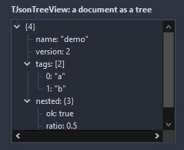

# TJsonTreeView

A tree of a JSON document: an object member per node, "key: value" for the leaves, "key {n}" and "key [n]" for the containers. The JSON stays attached, so a node knows its data and its path.

- Palette page: Unleashed: Views
- Unit: `jsontreeview.pas`
- Ancestor: `TTreeView`



## Usage

```pascal
procedure TForm1.FormCreate(Sender: TObject);
begin
  var tree := TJsonTreeView.Create(Self);
  tree.Parent := Self;
  tree.SetBounds(8, 8, 300, 240);
  tree.ShowTypes := true;
  tree.ExpandDepth := 2;
  tree.Text := '{"name": "demo", "tags": ["a", "b"], "size": 42}';
  tree.OnClick := @treeClick;
end;

procedure TForm1.treeClick(Sender: TObject);
begin
  with TJsonTreeView(Sender) do
    if Selected <> nil then Caption := PathOf(Selected); // like tags[1]
end;
```

## Properties

| Property | Type | Default | Notes |
|---|---|---|---|
| `Text` | `string` |  | the document; parsed as it is set |
| `ShowTypes` | `boolean` | `false` | the type of each value after its label |
| `SortKeys` | `boolean` | `false` |  |
| `ShowCounts` | `boolean` | `true` | the member count after an object or an array |
| `QuoteStrings` | `boolean` | `true` |  |
| `ExpandDepth` | `integer` | `1` | levels open after a load; 0 keeps the tree folded, -1 opens it all |
| `NullImageIndex` | `integer` | `-1` | image indexes per kind of value, -1 for none |
| `BooleanImageIndex` | `integer` | `-1` |  |
| `NumberImageIndex` | `integer` | `-1` |  |
| `StringImageIndex` | `integer` | `-1` |  |
| `ArrayImageIndex` | `integer` | `-1` |  |
| `ObjectImageIndex` | `integer` | `-1` |  |

## Events

| Event | Handler | Notes |
|---|---|---|
| `OnFormatNode` | `procedure(Sender: TObject; node: TTreeNode; data: TJSONData; var text: string)` | replaces the text of a node |

## Runtime

Available in code, not in the Object Inspector.

| Property | Type | Notes |
|---|---|---|
| `Json` | `TJSONData` |  |

| Method | Notes |
|---|---|
| `LoadFromFile(const fileName: string)` | loads the content from a file |
| `LoadFromStream(stream: TStream)` | loads the content from a stream |
| `SetJson(data: TJSONData)` | takes the ownership of `data` |
| `DataOf(node: TTreeNode): TJSONData` | the data behind a node, nil for none |
| `PathOf(node: TTreeNode): string` | the JSON pointer of a node, like /items/0/name |
| `NodeOf(const path: string): TTreeNode` | the node of a JSON pointer, nil when absent |
| `ExpandToDepth(depth: integer)` |  |
