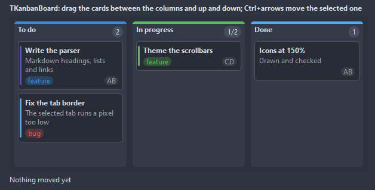

# TKanbanBoard

Columns of cards the mouse drags from one to another and up and down inside one: a task board, a pipeline, a sorting tray. The columns and the cards are collections, so a board can be filled in the designer; every move fires an event with the card and both columns.

- Palette page: Unleashed: Views
- Unit: `kanbanboard.pas`
- Ancestor: `TCustomControl`



## Usage

```pascal
procedure TForm1.FormCreate(Sender: TObject);
begin
  var board := TKanbanBoard.Create(Self);
  board.Parent := Self;
  board.SetBounds(8, 8, 600, 320);
  board.AddColumn('To do');
  board.AddColumn('Doing').Limit := 3;
  board.AddColumn('Done', clGreen);
  board.AddCard(0, 'Write the docs', 'every component');
  board.AddCard(1, 'Fix the diff map').Priority := 2;
  board.OnCardMove := @boardMove;
end;

procedure TForm1.boardMove(Sender: TObject; card: TKanbanCard; fromColumn, toColumn: integer);
begin
  Caption := Format('%s: %d -> %d', [card.Title, fromColumn, toColumn]);
end;
```

## Properties

| Property | Type | Default | Notes |
|---|---|---|---|
| `Columns` | `TKanbanColumns` |  | the columns |
| `Cards` | `TKanbanCards` |  |  |
| `ColumnGap` | `integer` | `10` |  |
| `CardSpacing` | `integer` | `6` |  |
| `CardRadius` | `integer` | `5` |  |
| `HeaderHeight` | `integer` | `0` | 0 takes it from the font |
| `Padding` | `integer` | `8` | the space between the border and the content |
| `MinColumnWidth` | `integer` | `140` | columns never get narrower; the board scrolls sideways instead |
| `ShowCounts` | `boolean` | `true` | the number of cards next to the caption |
| `ShowText` | `boolean` | `true` | the text part is shown |
| `ShowLabels` | `boolean` | `true` | the labels are shown |
| `ShowAssignee` | `boolean` | `true` |  |
| `ShowPriority` | `boolean` | `true` |  |
| `AllowDrag` | `boolean` | `true` | cards move between columns with the mouse |
| `AllowReorder` | `boolean` | `true` | cards change their order inside a column with the mouse |
| `FitColumns` | `boolean` | `true` | the columns share the width; off, every column is MinColumnWidth wide |
| `BoardColor` | `TColor` | `clDefault` | clDefault takes the colors of the theme |
| `ColumnColor` | `TColor` | `clDefault` |  |
| `CardColor` | `TColor` | `clDefault` | clDefault takes the color of the theme |
| `BorderColor` | `TColor` | `clDefault` | clDefault takes the color of the theme |
| `TitleColor` | `TColor` | `clDefault` | clDefault takes the color of the theme |
| `TextColor` | `TColor` | `clDefault` | clDefault takes the color of the theme |
| `HeaderColor` | `TColor` | `clDefault` | clDefault takes the color of the theme |
| `Antialiasing` | `TAntialiasSetting` | `asTheme` | asTheme follows the theme setting, asOn and asOff force it |

Also the standard properties of a control, re-published: `Align`, `Anchors`, `BorderSpacing`, `Constraints`, `Enabled`, `Font`, `Hint`, `ParentFont`, `ParentShowHint`, `PopupMenu`, `ShowHint`, `TabOrder`, `TabStop`, `Visible`, `OnClick`, `OnContextPopup`, `OnDblClick`, `OnEnter`, `OnExit`, `OnKeyDown`, `OnKeyPress`, `OnKeyUp`, `OnMouseDown`, `OnMouseEnter`, `OnMouseLeave`, `OnMouseMove`, `OnMouseUp`, `OnMouseWheel`, `OnResize`.

## Events

| Event | Handler | Notes |
|---|---|---|
| `OnCardClick` | `procedure(Sender: TObject; card: TKanbanCard)` |  |
| `OnCardDblClick` | `procedure(Sender: TObject; card: TKanbanCard)` |  |
| `OnSelect` | `procedure(Sender: TObject; card: TKanbanCard)` | the selection changed |
| `OnCardMove` | `procedure(Sender: TObject; card: TKanbanCard; fromColumn, toColumn: integer)` | a card went to another column or another place; fromColumn is the old one |
| `OnAllowMove` | `procedure(Sender: TObject; card: TKanbanCard; toColumn: integer; var allow: boolean)` | a card is about to move; allow false keeps it where it is |
| `OnColumnClick` | `procedure(Sender: TObject; column: integer)` | a click on a header |
| `OnDrawCard` | `procedure(Sender: TObject; canvas: TCanvas; const r: TRect; card: TKanbanCard; state: TDrawState)` | paints over every card once the board is painted; see TKanbanDrawCardEvent |

## Runtime

Available in code, not in the Object Inspector.

| Property | Type | Notes |
|---|---|---|
| `Selected` | `TKanbanCard` |  |

| Method | Notes |
|---|---|
| `AddColumn(const caption: string; color: TColor = clDefault): TKanbanColumn` | a new column |
| `AddCard(column: integer; const title: string; const text: string = ''): TKanbanCard` |  |
| `CardsOf(column: integer; list: TList)` | the cards of a column in their order |
| `MoveCard(card: TKanbanCard; toColumn: integer; toIndex: integer = -1)` | moves a card as a drag would, with the events |
| `ScrollColumn(column, delta: integer)` |  |

## Companion classes

### `TKanbanColumn`

| Property | Type | Default | Notes |
|---|---|---|---|
| `Caption` | `string` |  | the text shown |
| `Color` | `TColor` | `clDefault` | the strip under the header; clDefault takes a color from the palette |
| `Limit` | `integer` | `0` | the most cards the column takes, 0 for any number; over it the count shows red |
| `Collapsed` | `boolean` | `false` | a collapsed column shows its header only |
| `Tag` | `PtrInt` | `0` | free for the application |

| Method | Notes |
|---|---|
| `CardCount: integer` | the cards in this column |

### `TKanbanColumns`

| Method | Notes |
|---|---|
| `Add: TKanbanColumn` | a new entry at the end |

### `TKanbanCard`

| Property | Type | Default | Notes |
|---|---|---|---|
| `Title` | `string` |  | the heading |
| `Text` | `string` |  | a line or two under the title |
| `LabelText` | `string` |  | a small tag in the corner, like a type or a milestone |
| `LabelColor` | `TColor` | `clDefault` |  |
| `Assignee` | `string` |  | initials or a name shown bottom right |
| `Column` | `integer` | `0` | the index of the column the card sits in |
| `Priority` | `integer` | `0` | 0 none, 1 low, 2 medium, 3 high: a mark on the left edge |
| `Tag` | `PtrInt` | `0` | free for the application |

| Property | Type | Notes |
|---|---|---|
| `Data` | `TObject` | an object of the application the card stands for; not owned |

### `TKanbanCards`

| Method | Notes |
|---|---|
| `Add: TKanbanCard` | a new entry at the end |

## Custom drawing

The component paints its parts by itself, through the shapes of `ControlPaint`. A handler on the event below takes over a part: it gets the canvas of the control, the rectangle of the part, which part it is and a `TDrawState` set telling what the part is in: `dsHover`, `dsActive`, `dsSelected`, `dsPressed`, `dsDisabled`, `dsFocused`, `dsChecked`.

- `OnDrawCard`: paints over every card once the board is painted; see TKanbanDrawCardEvent. Handler: `procedure(Sender: TObject; canvas: TCanvas; const r: TRect; card: TKanbanCard; state: TDrawState)`.

A handler may paint with the plain canvas, or through `beginShapes()` from `ControlPaint` for the same smoothed shapes the components use: `paintRoundRect()`, `paintCircle()`, `paintCheck()`, `FillPolygon()` and the rest, then `Flush` once. Colors of the theme come from `pick()`, `blend()` and `contrastText()`.
