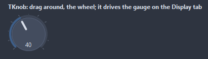
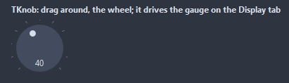
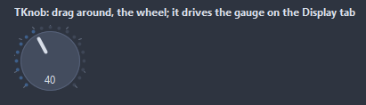

# TKnob

A rotary control: the mark turns from StartAngle through SweepAngle as the value runs from Min to Max. The mouse drags it, the wheel and the arrow keys step it.

- Palette page: Unleashed: Input
- Unit: `knob.pas`
- Ancestor: `TCustomControl`



## Usage

```pascal
procedure TForm1.FormCreate(Sender: TObject);
begin
  var volume := TKnob.Create(Self);
  volume.Parent := Self;
  volume.SetBounds(8, 8, 90, 90);
  volume.Min := 0;
  volume.Max := 11;
  volume.Step := 0.5;
  volume.Value := 7;
  volume.ShowTicks := true;
  volume.TickCount := 12;
  volume.ValueFormat := '%.1f';
  volume.OnChange := @volumeChange;
end;

procedure TForm1.volumeChange(Sender: TObject);
begin
  Caption := Format('volume %.1f', [TKnob(Sender).Value]);
end;
```

## Properties

| Property | Type | Default | Notes |
|---|---|---|---|
| `Min` | `double` |  | the lower limit |
| `Max` | `double` |  | the upper limit |
| `Value` | `double` |  | the value shown |
| `Step` | `double` |  | the value snaps to multiples of Step; 0 turns freely |
| `StartAngle` | `integer` | `-135` | degrees clockwise from the top where Min sits |
| `SweepAngle` | `integer` | `270` | degrees the mark travels to Max |
| `KnobSize` | `integer` | `0` | the knob; 0 fills the control |
| `ArcWidth` | `integer` | `4` | the stroke of the arc, in pixels |
| `TickCount` | `integer` | `0` |  |
| `DragMode` | `TKnobDragMode` | `kdCircular` | kdCircular follows the angle of the mouse around the center; kdVertical turns with the vertical mouse movement, like a fader |
| `ShowArc` | `boolean` | `true` | the arc from Min to the value around the knob |
| `ShowValue` | `boolean` | `true` | the value is shown as text |
| `ShowTicks` | `boolean` | `false` | tick marks are shown |
| `ReadOnly` | `boolean` | `false` | the mouse and the keyboard change nothing |
| `ValueFormat` | `string` |  | a Format pattern with the value as a float argument |
| `KnobColor` | `TColor` | `clDefault` | clDefault takes the colors of the theme |
| `ArcColor` | `TColor` | `clDefault` |  |
| `TrackColor` | `TColor` | `clDefault` | the unfilled part; clDefault takes the color of the theme |
| `MarkerColor` | `TColor` | `clDefault` |  |
| `BorderColor` | `TColor` | `clDefault` | clDefault takes the color of the theme |
| `Antialiasing` | `TAntialiasSetting` | `asTheme` | asTheme follows the theme setting, asOn and asOff force it |
| `Style` | `TKnobStyle` | `ksArc` | the look: an arc around the knob, a flat disc with a dot for the mark, or a ring of dots lighting up with the value |
| `Language` | `TFormatLanguage` | `flSystem` | the names and separators of dates, times and numbers: those of the locale of the system, or English |

Also the standard properties of a control, re-published: `Align`, `Anchors`, `BorderSpacing`, `Color`, `Constraints`, `Enabled`, `Font`, `Hint`, `ParentColor`, `ParentFont`, `ParentShowHint`, `PopupMenu`, `ShowHint`, `TabOrder`, `TabStop`, `Visible`, `OnClick`, `OnContextPopup`, `OnDblClick`, `OnEnter`, `OnExit`, `OnKeyDown`, `OnKeyPress`, `OnKeyUp`, `OnMouseDown`, `OnMouseEnter`, `OnMouseLeave`, `OnMouseMove`, `OnMouseUp`, `OnMouseWheel`, `OnResize`.

## Events

| Event | Handler | Notes |
|---|---|---|
| `OnChange` | `procedure(Sender: TObject)` | after the value changed |
| `OnFormatValue` | `procedure(Sender: TObject; value: double; var text: string)` |  |

## Types

| Type | Values | Notes |
|---|---|---|
| `TKnobDragMode` | `kdCircular`, `kdVertical` | kdCircular follows the angle of the mouse around the center; kdVertical turns with the vertical mouse movement, like a fader |
| `TKnobStyle` | `ksArc`, `ksFlat`, `ksDots` | the look: an arc around the knob, a flat disc with a dot for the mark, or a ring of dots lighting up with the value |

## In pictures

### Every Style

The demo group with each value of `Style` in turn.

`Style = ksArc`


`Style = ksFlat`



`Style = ksDots`


