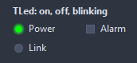
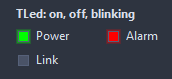
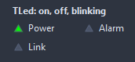
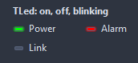

# TLed

An indicator light: on, off or blinking, with a caption beside it. A clickable one toggles on a click.

- Palette page: Unleashed: Display
- Unit: `led.pas`
- Ancestor: `TGraphicControl`



## Usage

```pascal
procedure TForm1.FormCreate(Sender: TObject);
begin
  var link := TLed.Create(Self);
  link.Parent := Self;
  link.Caption := 'Link';
  link.ColorOn := clLime;
  link.LedOn := true;
  link.Blink := true;
  link.BlinkInterval := 300;
end;
```

## Properties

| Property | Type | Default | Notes |
|---|---|---|---|
| `LedOn` | `boolean` | `false` |  |
| `Blink` | `boolean` | `false` | the light flashes while on |
| `BlinkInterval` | `integer` | `500` | milliseconds of a blink half |
| `LedSize` | `integer` | `14` |  |
| `Spacing` | `integer` | `6` | between the light and the caption |
| `Clickable` | `boolean` | `false` | a click toggles the light |
| `Glow` | `boolean` | `true` | a soft halo around a lit light |
| `Shape` | `TLedShape` | `lsRound` | the outline of the light: a disc, a square, a rounded square, a diamond, a triangle, a hexagon, a wide bar, a hollow ring |
| `Border` | `boolean` | `true` | a frame around the light, in BorderColor |
| `BorderWidth` | `integer` | `1` | the frame, in pixels |
| `CaptionPosition` | `TLedCaptionPosition` | `lcRight` | where the caption sits |
| `ColorOn` | `TColor` | `clLime` | clDefault takes the colors of the theme |
| `ColorOff` | `TColor` | `clDefault` | the color while off |
| `BorderColor` | `TColor` | `clDefault` | clDefault takes the color of the theme |
| `Antialiasing` | `TAntialiasSetting` | `asTheme` | asTheme follows the theme setting, asOn and asOff force it |

Also the standard properties of a control, re-published: `Caption`, `Align`, `Anchors`, `AutoSize`, `BorderSpacing`, `Color`, `Constraints`, `Enabled`, `Font`, `Hint`, `ParentColor`, `ParentFont`, `ParentShowHint`, `PopupMenu`, `ShowHint`, `Visible`, `OnClick`, `OnContextPopup`, `OnDblClick`, `OnMouseDown`, `OnMouseEnter`, `OnMouseLeave`, `OnMouseMove`, `OnMouseUp`.

## Events

| Event | Handler | Notes |
|---|---|---|
| `OnChange` | `procedure(Sender: TObject)` | after the light went on or off |
| `OnDraw` | `TCustomDrawEvent` | paints the light by itself: dsChecked while it is lit |

## Runtime

Available in code, not in the Object Inspector.

| Method | Notes |
|---|---|
| `Toggle` | flips the state |
| `Lit: boolean` | the light is lit right now, the blink phase included |

## Types

| Type | Values | Notes |
|---|---|---|
| `TLedShape` | `lsRound`, `lsSquare`, `lsRounded`, `lsDiamond`, `lsTriangle`, `lsHexagon`, `lsBar`, `lsRing` | the outline of the light: a disc, a square, a rounded square, a diamond, a triangle, a hexagon, a wide bar, a hollow ring |
| `TLedCaptionPosition` | `lcRight`, `lcLeft`, `lcBelow`, `lcNone` |  |

## Custom drawing

The component paints its parts by itself, through the shapes of `ControlPaint`. A handler on the event below takes over a part: it gets the canvas of the control, the rectangle of the part, which part it is and a `TDrawState` set telling what the part is in: `dsHover`, `dsActive`, `dsSelected`, `dsPressed`, `dsDisabled`, `dsFocused`, `dsChecked`.

- `OnDraw`: paints the light by itself: dsChecked while it is lit. Handler: `TCustomDrawEvent`.

A handler may paint with the plain canvas, or through `beginShapes()` from `ControlPaint` for the same smoothed shapes the components use: `paintRoundRect()`, `paintCircle()`, `paintCheck()`, `FillPolygon()` and the rest, then `Flush` once. Colors of the theme come from `pick()`, `blend()` and `contrastText()`.

## In pictures

### Every Shape

The demo group with each value of `Shape` in turn.

`Shape = lsRound`


`Shape = lsSquare`



`Shape = lsRounded`


`Shape = lsDiamond`


`Shape = lsTriangle`



`Shape = lsHexagon`


`Shape = lsBar`



`Shape = lsRing`


