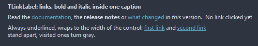

# TLinkLabel

A label whose caption holds links: the text between <a href="..."> and </a> shows as a link and opens its target when clicked, unless OnLinkClick handles it. <b>, <i> and <u> mark bold, italic and underlined runs; the rest is plain text.

- Palette page: Unleashed: Display
- Unit: `linklabel.pas`
- Ancestor: `TGraphicControl`



## Usage

```pascal
procedure TForm1.FormCreate(Sender: TObject);
begin
  var more := TLinkLabel.Create(Self);
  more.Parent := Self;
  more.Caption := 'Read the <a href="docs">documentation</a> or <a href="issues">report a bug</a>.';
  more.Underline := luHover;
  more.TrackVisited := true;
  more.OnLinkClick := @moreLink;
end;

procedure TForm1.moreLink(Sender: TObject; const link: string; var handled: boolean);
begin
  Caption := link;
  handled := true; // nothing opens in the browser
end;
```

## Properties

| Property | Type | Default | Notes |
|---|---|---|---|
| `LinkColor` | `TColor` | `clDefault` | clDefault takes the colors of the theme |
| `HoverColor` | `TColor` | `clDefault` |  |
| `VisitedColor` | `TColor` | `clDefault` |  |
| `Underline` | `TLinkUnderline` | `luHover` |  |
| `OpenLinks` | `boolean` | `true` | a click opens the link in the browser unless OnLinkClick handled it |
| `TrackVisited` | `boolean` | `false` | a followed link turns VisitedColor |
| `WordWrap` | `boolean` | `false` | the text breaks into lines |
| `Transparent` | `boolean` | `true` | the background stays as the parent paints it |
| `Alignment` | `TAlignment` | `taLeftJustify` | where the text sits |
| `Layout` | `TTextLayout` | `tlTop` | the arrangement |

Also the standard properties of a control, re-published: `Caption`, `Align`, `Anchors`, `AutoSize`, `BorderSpacing`, `Color`, `Constraints`, `Enabled`, `Font`, `Hint`, `ParentColor`, `ParentFont`, `ParentShowHint`, `PopupMenu`, `ShowHint`, `Visible`, `OnClick`, `OnContextPopup`, `OnDblClick`, `OnMouseDown`, `OnMouseEnter`, `OnMouseLeave`, `OnMouseMove`, `OnMouseUp`, `OnResize`.

## Events

| Event | Handler | Notes |
|---|---|---|
| `OnLinkClick` | `procedure(Sender: TObject; const link: string; var handled: boolean)` | a click on a link |

## Runtime

Available in code, not in the Object Inspector.

| Method | Notes |
|---|---|
| `LinkCount: integer` | the links of the caption in order |
| `Links(index: integer): string` |  |
| `Visited(const link: string): boolean` | the link was followed; VisitedColor shows it |
| `MarkVisited(const link: string)` |  |
| `ClearVisited` |  |

## Types

| Type | Values | Notes |
|---|---|---|
| `TLinkUnderline` | `luAlways`, `luHover`, `luNever` |  |
