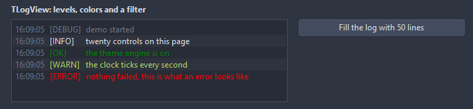

# TLogView

An append-only log: a line per message with its level in color, the time before it, the newest at the bottom and the view following them. Lines past MaxLines go first; a filter hides levels.

- Palette page: Unleashed: Views
- Unit: `logview.pas`
- Ancestor: `TScrollingWinControl`



## Usage

```pascal
procedure TForm1.FormCreate(Sender: TObject);
begin
  var log := TLogView.Create(Self);
  log.Parent := Self;
  log.SetBounds(8, 8, 400, 160);
  log.ShowLevel := true;
  log.Filter := [llInfo, llSuccess, llWarning, llError]; // debug lines stay hidden
  log.Info('started');
  log.Warning('config not found, using defaults');
  log.Success('ready');
  log.SaveToFile('session.log');
end;
```

## Properties

| Property | Type | Default | Notes |
|---|---|---|---|
| `MaxLines` | `integer` | `1000` | lines kept; 0 keeps every one |
| `Padding` | `integer` | `4` | the space between the border and the content |
| `Language` | `TFormatLanguage` | `flSystem` | the names and separators of dates, times and numbers: those of the locale of the system, or English |
| `AutoScroll` | `boolean` | `true` | the view follows the newest line |
| `ShowTime` | `boolean` | `true` | the time of each entry is shown |
| `ShowLevel` | `boolean` | `false` | the level name before the text |
| `AlternateRows` | `boolean` | `false` | every other line on a lighter band |
| `TimeFormat` | `string` |  | a FormatDateTime pattern for the time |
| `Filter` | `TLogLevels` | `[llDebug, llInfo, llSuccess, llWarning, llError]` | the levels on show |
| `DebugColor` | `TColor` | `clDefault` | clDefault takes the colors of the theme |
| `InfoColor` | `TColor` | `clDefault` | clDefault takes the color of the theme |
| `SuccessColor` | `TColor` | `clDefault` | clDefault takes the color of the theme |
| `WarningColor` | `TColor` | `clDefault` | clDefault takes the color of the theme |
| `ErrorColor` | `TColor` | `clDefault` | clDefault takes the color of the theme |
| `TimeColor` | `TColor` | `clDefault` | clDefault takes the color of the theme |

Also the standard properties of a scrolling control, re-published: `Align`, `Anchors`, `BorderSpacing`, `BorderStyle`, `Color`, `Constraints`, `Enabled`, `Font`, `Hint`, `ParentFont`, `ParentShowHint`, `PopupMenu`, `ShowHint`, `TabOrder`, `TabStop`, `Visible`, `OnClick`, `OnContextPopup`, `OnDblClick`, `OnEnter`, `OnExit`, `OnKeyDown`, `OnKeyPress`, `OnKeyUp`, `OnMouseDown`, `OnMouseEnter`, `OnMouseLeave`, `OnMouseMove`, `OnMouseUp`, `OnMouseWheel`, `OnResize`.

## Events

| Event | Handler | Notes |
|---|---|---|
| `OnLineClick` | `procedure(Sender: TObject; index: integer; const text: string; level: TLogLevel)` |  |
| `OnLineAdded` | `procedure(Sender: TObject; index: integer; const text: string; level: TLogLevel)` |  |

## Runtime

Available in code, not in the Object Inspector.

| Method | Notes |
|---|---|
| `Add(const text: string; level: TLogLevel=llInfo)` | a new entry at the end |
| `Debug(const text: string)` |  |
| `Info(const text: string)` | adds an entry of that level |
| `Success(const text: string)` | adds an entry of that level |
| `Warning(const text: string)` | adds an entry of that level |
| `Error(const text: string)` | adds an entry of that level |
| `Clear` | removes everything |
| `Count: integer` | the number of entries |
| `Line(index: integer): TLogLine` |  |
| `AsText: string` | the lines as text, the filter applied |
| `CopyToClipboard` | puts the selection, or everything, on the clipboard |
| `SaveToFile(const fileName: string)` | writes the content to a file |
| `ScrollToEnd` | scrolls to the last line |

## Types

| Type | Values | Notes |
|---|---|---|
| `TLogLevel` | `llDebug`, `llInfo`, `llSuccess`, `llWarning`, `llError` |  |
