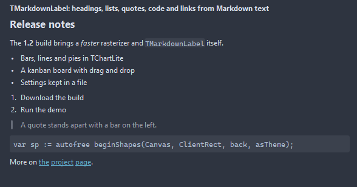

# TMarkdownLabel

A label that reads Markdown: headings, paragraphs, bullet and numbered lists, quotes, code spans and blocks, rules, bold, italic and links. The text wraps to the width and the height follows it, so a help text or a changelog goes straight into the form.

- Palette page: Unleashed: Display
- Unit: `markdownlabel.pas`
- Ancestor: `TGraphicControl`



## Usage

```pascal
procedure TForm1.FormCreate(Sender: TObject);
begin
  var readme := TMarkdownLabel.Create(Self);
  readme.Parent := Self;
  readme.Width := 400;
  readme.SetText('# Release notes' + LineEnding +
    'The **diff view** got a *map* between the panes.' + LineEnding + LineEnding +
    '- patience alignment' + LineEnding +
    '- word marks' + LineEnding + LineEnding +
    'Details in `diffview.pas` and [on the site](https://unleashedpascal.org).');
  readme.OnLinkClick := @readmeLink;
end;

procedure TForm1.readmeLink(Sender: TObject; const url: string; var handled: boolean);
begin
  Caption := url;
  handled := true;
end;
```

## Properties

| Property | Type | Default | Notes |
|---|---|---|---|
| `Lines` | `TStrings` |  | the Markdown source |
| `LinkColor` | `TColor` | `clDefault` | clDefault takes the colors of the theme |
| `HoverLinkColor` | `TColor` | `clDefault` | the link under the mouse; clDefault darkens LinkColor a little |
| `CodeColor` | `TColor` | `clDefault` |  |
| `CodeBackColor` | `TColor` | `clDefault` |  |
| `QuoteColor` | `TColor` | `clDefault` |  |
| `HeadingColor` | `TColor` | `clDefault` |  |
| `TextColor` | `TColor` | `clDefault` | clDefault takes the color of the theme |
| `RuleColor` | `TColor` | `clDefault` |  |
| `ParagraphSpacing` | `integer` | `8` |  |
| `LineSpacing` | `integer` | `2` | extra pixels between the lines of a paragraph |
| `Indent` | `integer` | `18` | the indent of a list level and of a quote |
| `HeadingScale` | `integer` | `160` | the font size of a top heading as a percentage of the font |
| `CodeRadius` | `integer` | `3` |  |
| `ListSpacing` | `integer` | `3` | between the items of one list |
| `Padding` | `integer` | `0` | the space between the border and the content |
| `CodeFont` | `TFont` |  | the font of code spans and blocks; size 0 keeps the size of Font |
| `BulletText` | `string` |  |  |
| `OpenLinks` | `boolean` | `true` | a click opens the link in the browser, unless OnLinkClick handled it |
| `WordWrap` | `boolean` | `true` | the text breaks into lines |
| `Antialiasing` | `TAntialiasSetting` | `asTheme` | asTheme follows the theme setting, asOn and asOff force it |

Also the standard properties of a control, re-published: `Align`, `Anchors`, `AutoSize`, `BorderSpacing`, `Color`, `Constraints`, `Enabled`, `Font`, `Hint`, `ParentColor`, `ParentFont`, `ParentShowHint`, `PopupMenu`, `ShowHint`, `Visible`, `OnClick`, `OnDblClick`, `OnMouseDown`, `OnMouseEnter`, `OnMouseLeave`, `OnMouseMove`, `OnMouseUp`, `OnResize`.

## Events

| Event | Handler | Notes |
|---|---|---|
| `OnLinkClick` | `procedure(Sender: TObject; const url: string; var handled: boolean)` | a click on a link |

## Runtime

Available in code, not in the Object Inspector.

| Method | Notes |
|---|---|
| `SetText(const markdown: string)` | the whole text at once |
| `LoadFromFile(const fileName: string)` | loads the content from a file |
