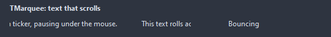

# TMarquee

A caption rolling across the control, like a ticker. Pauses under the mouse when wanted; OnCycle fires each time the text went through.

- Palette page: Unleashed: Display
- Unit: `marquee.pas`
- Ancestor: `TGraphicControl`



## Usage

```pascal
procedure TForm1.FormCreate(Sender: TObject);
begin
  var ticker := TMarquee.Create(Self);
  ticker.Parent := Self;
  ticker.SetBounds(8, 8, 300, 24);
  ticker.Caption := 'Build 42 passed on every target';
  ticker.Behavior := mbBounce;
  ticker.Speed := 1;
end;
```

## Properties

| Property | Type | Default | Notes |
|---|---|---|---|
| `Active` | `boolean` | `true` | on; off stops it |
| `Direction` | `TMarqueeDirection` | `mdLeft` |  |
| `Behavior` | `TMarqueeBehavior` | `mbScroll` | mbScroll runs the text through and starts over; mbBounce turns at the ends |
| `Speed` | `integer` | `2` | pixels per step |
| `Interval` | `integer` | `30` | milliseconds between steps |
| `Gap` | `integer` | `40` | pixels between the end of the text and its next run |
| `PauseOnHover` | `boolean` | `true` |  |
| `Transparent` | `boolean` | `true` | the background of the parent shows through |

Also the standard properties of a control, re-published: `Caption`, `Align`, `Anchors`, `BorderSpacing`, `Color`, `Constraints`, `Enabled`, `Font`, `Hint`, `ParentColor`, `ParentFont`, `ParentShowHint`, `PopupMenu`, `ShowHint`, `Visible`, `OnClick`, `OnContextPopup`, `OnDblClick`, `OnMouseDown`, `OnMouseEnter`, `OnMouseLeave`, `OnMouseMove`, `OnMouseUp`, `OnResize`.

## Events

| Event | Handler | Notes |
|---|---|---|
| `OnCycle` | `procedure(Sender: TObject)` |  |

## Runtime

Available in code, not in the Object Inspector.

| Method | Notes |
|---|---|
| `Reset` | puts the text back at its start |

## Types

| Type | Values | Notes |
|---|---|---|
| `TMarqueeDirection` | `mdLeft`, `mdRight`, `mdUp`, `mdDown` |  |
| `TMarqueeBehavior` | `mbScroll`, `mbBounce` | mbScroll runs the text through and starts over; mbBounce turns at the ends |
