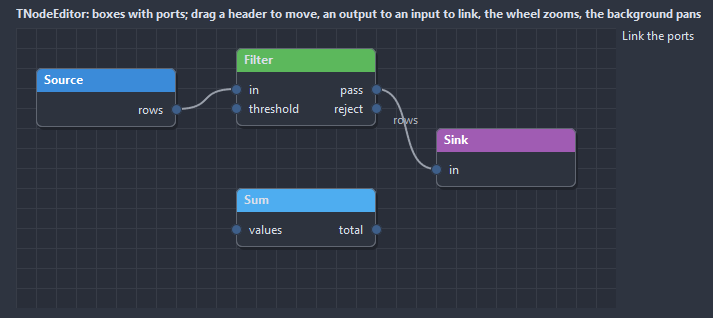

# TNodeEditor

Boxes with ports and curves between them, on a canvas that pans with a drag of the background and zooms with the wheel. A node moves by its header, a link starts on an output and ends on an input, the Delete key removes what is selected.

- Palette page: Unleashed: Views
- Unit: `nodeeditor.pas`
- Ancestor: `TCustomControl`



## Usage

```pascal
procedure TForm1.FormCreate(Sender: TObject);
begin
  var graph := TNodeEditor.Create(Self);
  graph.Parent := Self;
  graph.SetBounds(8, 8, 600, 360);
  var source := graph.AddNode('Source', 40, 60, [], ['out']);
  var filter := graph.AddNode('Filter', 260, 80, ['in'], ['pass', 'drop']);
  var sink := graph.AddNode('Sink', 480, 60, ['in'], []);
  graph.AddLink(source.Index, 0, filter.Index, 0);
  graph.AddLink(filter.Index, 0, sink.Index, 0);
  graph.OnLinkCreated := @graphLink;
end;

procedure TForm1.graphLink(Sender: TObject; link: TGraphLink);
begin
  Caption := Format('link %d:%d to %d:%d', [link.FromNode, link.FromPort, link.ToNode, link.ToPort]);
end;
```

## Properties

| Property | Type | Default | Notes |
|---|---|---|---|
| `Nodes` | `TGraphNodes` |  |  |
| `Links` | `TGraphLinks` |  | the connections between the ports |
| `Zoom` | `double` |  | the scale, 1 for actual size |
| `GridSize` | `integer` | `20` | the step of the grid, in pixels |
| `PortRadius` | `integer` | `5` |  |
| `HeaderHeight` | `integer` | `24` | 0 takes it from the font |
| `CornerRadius` | `integer` | `6` | the rounding of the corners, in pixels |
| `Padding` | `integer` | `8` | the space between the border and the content |
| `ShowGrid` | `boolean` | `true` | a grid behind the content |
| `SnapToGrid` | `boolean` | `true` |  |
| `AllowLinks` | `boolean` | `true` |  |
| `AllowMove` | `boolean` | `true` |  |
| `ReadOnly` | `boolean` | `false` | the mouse and the keyboard change nothing |
| `ShowPortNames` | `boolean` | `true` |  |
| `BackColor` | `TColor` | `clDefault` | clDefault takes the colors of the theme |
| `GridColor` | `TColor` | `clDefault` | clDefault takes the color of the theme |
| `NodeColor` | `TColor` | `clDefault` |  |
| `BorderColor` | `TColor` | `clDefault` | clDefault takes the color of the theme |
| `TextColor` | `TColor` | `clDefault` | clDefault takes the color of the theme |
| `LinkColor` | `TColor` | `clDefault` | clDefault takes the color of the theme |
| `PortColor` | `TColor` | `clDefault` |  |
| `SelectColor` | `TColor` | `clDefault` |  |
| `Antialiasing` | `TAntialiasSetting` | `asTheme` | asTheme follows the theme setting, asOn and asOff force it |

Also the standard properties of a control, re-published: `Align`, `Anchors`, `BorderSpacing`, `Constraints`, `Enabled`, `Font`, `Hint`, `ParentFont`, `ParentShowHint`, `PopupMenu`, `ShowHint`, `TabOrder`, `TabStop`, `Visible`, `OnClick`, `OnContextPopup`, `OnDblClick`, `OnEnter`, `OnExit`, `OnKeyDown`, `OnKeyPress`, `OnKeyUp`, `OnMouseDown`, `OnMouseEnter`, `OnMouseLeave`, `OnMouseMove`, `OnMouseUp`, `OnMouseWheel`, `OnResize`.

## Events

| Event | Handler | Notes |
|---|---|---|
| `OnNodeClick` | `procedure(Sender: TObject; node: TGraphNode)` |  |
| `OnNodeDblClick` | `procedure(Sender: TObject; node: TGraphNode)` |  |
| `OnNodeMoved` | `procedure(Sender: TObject; node: TGraphNode)` |  |
| `OnSelectNode` | `procedure(Sender: TObject; node: TGraphNode)` |  |
| `OnSelectLink` | `procedure(Sender: TObject; link: TGraphLink)` |  |
| `OnLinkCreated` | `procedure(Sender: TObject; link: TGraphLink)` |  |
| `OnLinkDeleted` | `procedure(Sender: TObject; link: TGraphLink)` |  |
| `OnLinkAllow` | `procedure(Sender: TObject; fromNode: TGraphNode; fromPort: integer; toNode: TGraphNode; toPort: integer; var allow: boolean)` | a link is about to be made; allow false refuses it |
| `OnChange` | `procedure(Sender: TObject)` | after the value changed |

## Runtime

Available in code, not in the Object Inspector.

| Property | Type | Notes |
|---|---|---|
| `Selected` | `TGraphNode` |  |
| `SelectedLink` | `TGraphLink` |  |
| `Pan` | `TPoint` |  |

| Method | Notes |
|---|---|
| `AddNode(const caption: string; left, top: integer; const inputs: array of string; const outputs: array of string): TGraphNode` |  |
| `AddLink(fromNode, fromPort, toNode, toPort: integer): TGraphLink` |  |
| `LinksOf(node: TGraphNode; list: TList)` | the links of a node, as input or output |
| `DeleteNode(node: TGraphNode)` |  |
| `DeleteLink(link: TGraphLink)` |  |
| `DeleteSelected` |  |
| `FitToView` | the view moved so every node shows |
| `CenterOn(node: TGraphNode)` |  |

## Companion classes

### `TGraphNode`

| Property | Type | Default | Notes |
|---|---|---|---|
| `Caption` | `string` |  | the text shown |
| `Text` | `string` |  | a line under the caption |
| `Left` | `integer` | `0` |  |
| `Top` | `integer` | `0` |  |
| `Width` | `integer` | `140` | the width in pixels |
| `Color` | `TColor` | `clDefault` | the header; clDefault takes a color from the palette |
| `Inputs` | `TStrings` |  | the ports on the left, one name per line |
| `Outputs` | `TStrings` |  | the ports on the right |
| `Tag` | `PtrInt` | `0` | free for the application |

| Property | Type | Notes |
|---|---|---|
| `Data` | `TObject` | an object of the application the node stands for; not owned |

### `TGraphNodes`

| Method | Notes |
|---|---|
| `Add: TGraphNode` | a new entry at the end |

### `TGraphLink`

| Property | Type | Default | Notes |
|---|---|---|---|
| `FromNode` | `integer` | `-1` | the index of the node and of its output the link leaves |
| `FromPort` | `integer` | `0` |  |
| `ToNode` | `integer` | `-1` | the index of the node and of its input the link enters |
| `ToPort` | `integer` | `0` |  |
| `Color` | `TColor` | `clDefault` | clDefault takes the color of the theme |
| `Caption` | `string` |  | the text shown |
| `Tag` | `PtrInt` | `0` | free for the application |

### `TGraphLinks`

| Method | Notes |
|---|---|
| `Add: TGraphLink` | a new entry at the end |
