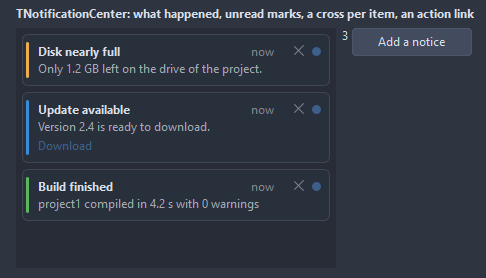

# TNotificationCenter

The list of what happened: a card per notification with a title, a text, the time it came and a close cross, unread ones marked. Add puts the newest on top, a click reads it, the count of unread ones feeds a badge somewhere else.

- Palette page: Unleashed: Feedback
- Unit: `notificationcenters.pas`
- Ancestor: `TScrollingWinControl`



## Usage

```pascal
procedure TForm1.FormCreate(Sender: TObject);
begin
  var center := TNotificationCenter.Create(Self);
  center.Parent := Self;
  center.SetBounds(8, 8, 320, 300);
  center.Add('Build finished', '0 errors, 2 warnings', nkSuccess);
  center.Add('Update available', 'Version 2.1', nkInfo).ActionText := 'Install';
  center.OnAction := @centerAction;
  center.OnUnreadChange := @centerUnread;
end;

procedure TForm1.centerAction(Sender: TObject; item: TNoticeItem);
begin
  Caption := 'installing ' + item.Text;
end;

procedure TForm1.centerUnread(Sender: TObject);
begin
  Caption := Format('%d unread', [TNotificationCenter(Sender).UnreadCount]);
end;
```

## Properties

| Property | Type | Default | Notes |
|---|---|---|---|
| `Items` | `TNoticeItems` |  | the entries |
| `MaxItems` | `integer` | `100` | the oldest go when there are more, 0 for no limit |
| `Padding` | `integer` | `10` | the space between the border and the content |
| `CornerRadius` | `integer` | `6` | the rounding of the corners, in pixels |
| `Spacing` | `integer` | `6` | the gap between the parts |
| `MaxLines` | `integer` | `3` | the lines of text shown per item |
| `ShowTime` | `boolean` | `true` | "5 min ago" in the corner, kept fresh |
| `ShowKindBar` | `boolean` | `true` | a strip in the color of the kind on the left |
| `ShowClose` | `boolean` | `true` |  |
| `NewestFirst` | `boolean` | `true` |  |
| `MarkReadOnClick` | `boolean` | `true` |  |
| `ShowEmptyText` | `boolean` | `true` |  |
| `EmptyText` | `string` |  | the text shown while there is nothing |
| `BackColor` | `TColor` | `clDefault` | clDefault takes the colors of the theme |
| `CardColor` | `TColor` | `clDefault` | clDefault takes the color of the theme |
| `UnreadColor` | `TColor` | `clDefault` | the card of an unread item |
| `BorderColor` | `TColor` | `clDefault` | clDefault takes the color of the theme |
| `TitleColor` | `TColor` | `clDefault` | clDefault takes the color of the theme |
| `TextColor` | `TColor` | `clDefault` | clDefault takes the color of the theme |
| `TimeColor` | `TColor` | `clDefault` | clDefault takes the color of the theme |
| `Antialiasing` | `TAntialiasSetting` | `asTheme` | asTheme follows the theme setting, asOn and asOff force it |

Also the standard properties of a scrolling control, re-published: `Align`, `Anchors`, `BorderSpacing`, `BorderStyle`, `Color`, `Constraints`, `Enabled`, `Font`, `Hint`, `ParentFont`, `ParentShowHint`, `PopupMenu`, `ShowHint`, `TabOrder`, `TabStop`, `Visible`, `OnClick`, `OnContextPopup`, `OnEnter`, `OnExit`, `OnMouseDown`, `OnMouseEnter`, `OnMouseLeave`, `OnMouseMove`, `OnMouseUp`, `OnMouseWheel`, `OnResize`.

## Events

| Event | Handler | Notes |
|---|---|---|
| `OnItemClick` | `procedure(Sender: TObject; item: TNoticeItem)` | a click on an entry |
| `OnAction` | `procedure(Sender: TObject; item: TNoticeItem)` | the action link of an item |
| `OnDismiss` | `procedure(Sender: TObject; item: TNoticeItem; var allow: boolean)` | an item is about to go; allow false keeps it |
| `OnDismissed` | `procedure(Sender: TObject; item: TNoticeItem)` |  |
| `OnUnreadChange` | `procedure(Sender: TObject)` |  |

## Runtime

Available in code, not in the Object Inspector.

| Method | Notes |
|---|---|
| `Add(const title, text: string; kind: TNoticeKind = nkInfo; tag: PtrInt = 0): TNoticeItem` | a new entry at the end |
| `Dismiss(item: TNoticeItem)` | removes an item with the dismiss events |
| `Clear` | removes everything |
| `ClearRead` |  |
| `MarkAllRead` |  |
| `UnreadCount: integer` |  |

## Companion classes

### `TNoticeItem`

| Property | Type | Default | Notes |
|---|---|---|---|
| `Title` | `string` |  | the heading |
| `Text` | `string` |  | the text |
| `ActionText` | `string` |  | a link under the text that fires OnAction |
| `Kind` | `TNoticeKind` | `nkInfo` | the icon and the color bar of a notice; nkPlain carries neither |
| `Unread` | `boolean` | `true` |  |
| `Tag` | `PtrInt` | `0` | free for the application |

| Property | Type | Notes |
|---|---|---|
| `Time` | `TDateTime` | when the item was added |

### `TNoticeItems`

| Method | Notes |
|---|---|
| `Add: TNoticeItem` | a new entry at the end |

## Types

| Type | Values | Notes |
|---|---|---|
| `TNoticeKind` | `nkInfo`, `nkSuccess`, `nkWarning`, `nkError`, `nkPlain` | the icon and the color bar of a notice; nkPlain carries neither |
