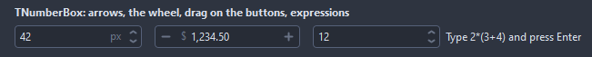

# TNumberBox

A number typed, stepped or dragged: Up and Down step it, Page Up and Page Down take the large step, the wheel steps it while the field has the focus, a drag up or down on the buttons scrubs through the values. With AllowExpressions the field takes arithmetic, 2*(3+4) gives 14. The value counts once Enter, the end of the focus or a button sets it; Escape brings back the last one.

- Palette page: Unleashed: Input
- Unit: `numberbox.pas`
- Ancestor: `TCustomControl`



## Usage

```pascal
procedure TForm1.FormCreate(Sender: TObject);
begin
  var price := TNumberBox.Create(Self);
  price.Parent := Self;
  price.Width := 160;
  price.MinValue := 0;
  price.MaxValue := 10000;
  price.DecimalPlaces := 2;
  price.Increment := 0.5;
  price.Prefix := '$';
  price.ShowThousands := true;
  price.Value := 1250;
end;
```

## Properties

| Property | Type | Default | Notes |
|---|---|---|---|
| `Value` | `double` |  | the value shown |
| `MinValue` | `double` |  | MinValue equal to MaxValue leaves the value free, as with TSpinEdit |
| `MaxValue` | `double` |  | the upper limit |
| `Increment` | `double` |  |  |
| `LargeIncrement` | `double` |  |  |
| `DecimalPlaces` | `integer` | `0` | the digits after the decimal separator |
| `Prefix` | `string` |  | gray text before and after the number, a unit for example |
| `Suffix` | `string` |  |  |
| `AllowExpressions` | `boolean` | `true` |  |
| `AllowEmpty` | `boolean` | `false` | the field may hold no value |
| `ShowThousands` | `boolean` | `false` |  |
| `Wrap` | `boolean` | `false` | past one limit the steps come back at the other |
| `Scrubbing` | `boolean` | `true` | a drag up or down on the buttons changes the value |
| `SpinStyle` | `TNumberSpinStyle` | `nsUpDown` | the buttons: stacked arrows at the right end, minus and plus at the two ends, or none |
| `ScrubPixels` | `integer` | `4` | the drag one step takes |
| `CornerRadius` | `integer` | `4` | the rounding of the corners, in pixels |
| `Padding` | `integer` | `6` | the space between the border and the content |
| `Text` | `string` |  | the text |
| `TextHint` | `string` |  | the gray text shown while the field is empty |
| `ReadOnly` | `boolean` | `false` | the mouse and the keyboard change nothing |
| `Alignment` | `TAlignment` | `taLeftJustify` | where the text sits |
| `BorderColor` | `TColor` | `clDefault` | clDefault takes the colors of the theme |
| `FocusBorderColor` | `TColor` | `clDefault` | the border while focused; clDefault takes the accent of the theme |
| `FieldColor` | `TColor` | `clDefault` | the fill of the field; clDefault takes the color of the theme |
| `GlyphColor` | `TColor` | `clDefault` | clDefault takes the color of the theme |
| `AffixColor` | `TColor` | `clDefault` |  |
| `Antialiasing` | `TAntialiasSetting` | `asTheme` | asTheme follows the theme setting, asOn and asOff force it |
| `Language` | `TFormatLanguage` | `flSystem` | the names and separators of dates, times and numbers: those of the locale of the system, or English |

Also the standard properties of a control, re-published: `Align`, `Anchors`, `AutoSize`, `BorderSpacing`, `Color`, `Constraints`, `Enabled`, `Font`, `Hint`, `ParentColor`, `ParentFont`, `ParentShowHint`, `PopupMenu`, `ShowHint`, `TabOrder`, `TabStop`, `Visible`, `OnClick`, `OnContextPopup`, `OnEnter`, `OnExit`, `OnKeyDown`, `OnKeyPress`, `OnKeyUp`, `OnMouseEnter`, `OnMouseLeave`, `OnResize`.

## Events

| Event | Handler | Notes |
|---|---|---|
| `OnChange` | `procedure(Sender: TObject)` | the value changed |

## Runtime

Available in code, not in the Object Inspector.

| Property | Type | Notes |
|---|---|---|
| `Edit` | `TEdit` | the edit control inside, for its own properties |

| Method | Notes |
|---|---|
| `SetFocus` | moves the keyboard focus into the field |
| `Focused: Boolean` | the field has the keyboard focus |
| `Commit: boolean` | reads the field now, as Enter would; false when it holds no number |
| `Increase` |  |
| `Decrease` |  |
| `Clear` | removes everything |
| `IsEmpty: boolean` | the field holds no number; only with AllowEmpty |
| `Evaluate(const expression: string; out number: double): boolean` | arithmetic of + - * / % ^ and parentheses; false for anything else |

## Types

| Type | Values | Notes |
|---|---|---|
| `TNumberSpinStyle` | `nsUpDown`, `nsPlusMinus`, `nsNone` | the buttons: stacked arrows at the right end, minus and plus at the two ends, or none |
