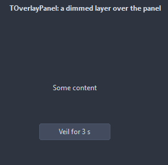
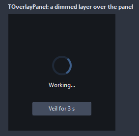

# TOverlayPanel

A veil over its parent while something runs: Active covers the whole parent, dims it, shows a spinner and the caption, and keeps the mouse from what is underneath. Inactive, it is out of the way.

- Palette page: Unleashed: Feedback
- Unit: `overlaypanel.pas`
- Ancestor: `TCustomControl`



## Usage

```pascal
procedure TForm1.FormCreate(Sender: TObject);
begin
  var list := TListBox.Create(Self);
  list.Parent := Self;
  list.Align := alClient;
  var veil := TOverlayPanel.Create(Self);
  veil.Parent := list.Parent; // covers the parent of the busy control
  veil.Show('Loading the list');
  // ... later, once the data is in
  veil.Hide;
end;
```

## Properties

| Property | Type | Default | Notes |
|---|---|---|---|
| `Active` | `boolean` | `false` | on; off stops it |
| `ShowSpinner` | `boolean` | `true` |  |
| `Dimmed` | `boolean` | `true` | the veil darkens what it covers; off, it only takes the mouse |
| `DimPercent` | `integer` | `55` | the share of the veil color laid over the parent color |
| `SpinnerSize` | `integer` | `40` |  |
| `Thickness` | `integer` | `4` | the stroke, in pixels |
| `Spacing` | `integer` | `12` | between the spinner and the caption |
| `Speed` | `integer` | `24` | steps of a turn of the spinner; fewer steps turn faster |
| `VeilColor` | `TColor` | `clDefault` | clDefault takes the colors of the theme |
| `SpinnerColor` | `TColor` | `clDefault` |  |
| `TextColor` | `TColor` | `clDefault` | clDefault takes the color of the theme |
| `Antialiasing` | `TAntialiasSetting` | `asTheme` | asTheme follows the theme setting, asOn and asOff force it |

Also the standard properties of a control, re-published: `Caption`, `Font`, `ParentFont`, `OnClick`, `OnMouseDown`, `OnMouseUp`.

## Events

| Event | Handler | Notes |
|---|---|---|
| `OnActivate` | `procedure(Sender: TObject)` | it became active |
| `OnDeactivate` | `procedure(Sender: TObject)` |  |

## Runtime

Available in code, not in the Object Inspector.

| Method | Notes |
|---|---|
| `Show(const text: string = '')` | the veil up with this text |
| `Hide` | hides it |

## In pictures

**The veil on: the content dimmed, a spinner and the text.**


