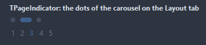
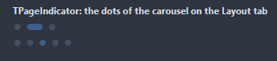
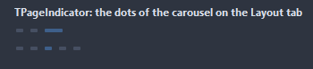
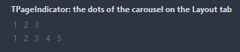
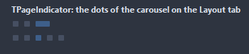
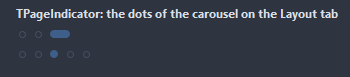
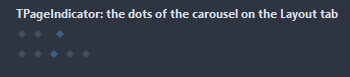
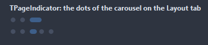
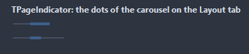

# TPageIndicator

A row of dots standing for pages, one of them lit. On its own it holds PageCount and PageIndex; tied to a page control or a notebook through Target it follows and drives that one.

- Palette page: Unleashed: Navigation
- Unit: `pageindicator.pas`
- Ancestor: `TGraphicControl`



## Usage

```pascal
procedure TForm1.FormCreate(Sender: TObject);
begin
  var dots := TPageIndicator.Create(Self);
  dots.Parent := Self;
  dots.SetBounds(8, 8, 120, 20);
  dots.PageCount := 5;
  dots.PageIndex := 2;
  dots.Style := isDots;
  dots.OnChange := @dotsChange; // a click on a dot
end;

procedure TForm1.dotsChange(Sender: TObject);
begin
  Caption := Format('page %d', [TPageIndicator(Sender).PageIndex + 1]);
end;
```

## Properties

| Property | Type | Default | Notes |
|---|---|---|---|
| `PageCount` | `integer` | `3` | used without a target |
| `PageIndex` | `integer` | `0` | the current page, from 0 |
| `Target` | `TWinControl` |  | a TPageControl, a TNotebook or a carousel-like control with PageIndex |
| `Style` | `TIndicatorStyle` | `isDots` | the marks of the pages: dots, bars, numbers, squares, hollow rings, diamonds, a worm stretched over the current page, one line with a thicker part for the current page |
| `DotSize` | `integer` | `8` | the diameter of a dot, in pixels |
| `Spacing` | `integer` | `8` | the gap between the parts |
| `ActiveWidth` | `integer` | `0` | the lit dot stretches to this width; 0 keeps it round |
| `DotColor` | `TColor` | `clDefault` | clDefault takes the colors of the theme |
| `ActiveColor` | `TColor` | `clDefault` | clDefault takes the accent of the theme |
| `Antialiasing` | `TAntialiasSetting` | `asTheme` | asTheme follows the theme setting, asOn and asOff force it |

Also the standard properties of a control, re-published: `Align`, `Anchors`, `AutoSize`, `BorderSpacing`, `Color`, `Constraints`, `Enabled`, `Font`, `Hint`, `ParentColor`, `ParentFont`, `ParentShowHint`, `PopupMenu`, `ShowHint`, `Visible`, `OnClick`, `OnMouseDown`, `OnMouseEnter`, `OnMouseLeave`, `OnMouseMove`, `OnMouseUp`.

## Events

| Event | Handler | Notes |
|---|---|---|
| `OnChange` | `procedure(Sender: TObject)` | after the value changed |
| `OnDrawDot` | `TCustomDrawEvent` | paints one dot by itself: dsSelected for the current page, dsHover under the mouse |

## Runtime

Available in code, not in the Object Inspector.

| Method | Notes |
|---|---|
| `Refresh` | picks up the page of the target again, after it changed elsewhere |

## Types

| Type | Values | Notes |
|---|---|---|
| `TIndicatorStyle` | `isDots`, `isBars`, `isNumbers`, `isSquares`, `isRings`, `isDiamonds`, `isWorm`, `isLine` | the marks of the pages: dots, bars, numbers, squares, hollow rings, diamonds, a worm stretched over the current page, one line with a thicker part for the current page |

## Custom drawing

The component paints its parts by itself, through the shapes of `ControlPaint`. A handler on the event below takes over a part: it gets the canvas of the control, the rectangle of the part, which part it is and a `TDrawState` set telling what the part is in: `dsHover`, `dsActive`, `dsSelected`, `dsPressed`, `dsDisabled`, `dsFocused`, `dsChecked`.

- `OnDrawDot`: paints one dot by itself: dsSelected for the current page, dsHover under the mouse. Handler: `TCustomDrawEvent`.

A handler may paint with the plain canvas, or through `beginShapes()` from `ControlPaint` for the same smoothed shapes the components use: `paintRoundRect()`, `paintCircle()`, `paintCheck()`, `FillPolygon()` and the rest, then `Flush` once. Colors of the theme come from `pick()`, `blend()` and `contrastText()`.

## In pictures

### Every Style

The demo group with each value of `Style` in turn.

`Style = isDots`



`Style = isBars`



`Style = isNumbers`



`Style = isSquares`



`Style = isRings`



`Style = isDiamonds`



`Style = isWorm`



`Style = isLine`


