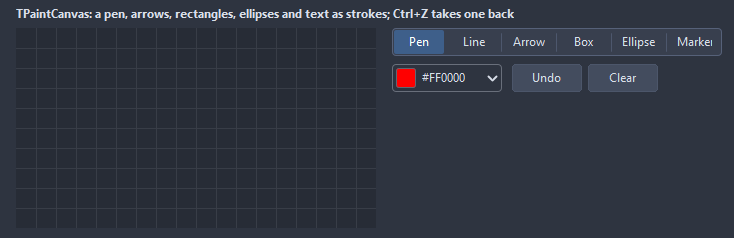

# TPaintCanvas

A surface to draw on: a pen, lines, arrows, rectangles, ellipses, text and a highlighter, each stroke kept as a shape so undo takes it back and the picture renders at any size. Over a background image it annotates; on its own it sketches.

- Palette page: Unleashed: Views
- Unit: `paintcanvas.pas`
- Ancestor: `TCustomControl`



## Usage

```pascal
procedure TForm1.FormCreate(Sender: TObject);
begin
  var sketch := TPaintCanvas.Create(Self);
  sketch.Parent := Self;
  sketch.SetBounds(8, 8, 480, 320);
  sketch.Tool := ptArrow;
  sketch.PenColor := clRed;
  sketch.PenWidth := 3;
  sketch.ShowGrid := true;
  sketch.OnChange := @sketchChange;
end;

procedure TForm1.sketchChange(Sender: TObject);
begin
  Caption := Format('%d strokes', [TPaintCanvas(Sender).StrokeCount]);
end;
```

## Properties

| Property | Type | Default | Notes |
|---|---|---|---|
| `Tool` | `TPaintTool` | `ptPen` |  |
| `PenColor` | `TColor` | `clRed` |  |
| `FillColor` | `TColor` | `clDefault` | the inside of rectangles and ellipses when Filled |
| `BackColor` | `TColor` | `clDefault` | clDefault takes the color of the theme |
| `GridColor` | `TColor` | `clDefault` | clDefault takes the color of the theme |
| `PenWidth` | `integer` | `3` |  |
| `GridSize` | `integer` | `20` | the step of the grid, in pixels |
| `Filled` | `boolean` | `false` |  |
| `ShowGrid` | `boolean` | `false` | a grid behind the content |
| `ReadOnly` | `boolean` | `false` | the mouse and the keyboard change nothing |
| `Background` | `TPicture` |  | the picture under the strokes |
| `Antialiasing` | `TAntialiasSetting` | `asTheme` | asTheme follows the theme setting, asOn and asOff force it |

Also the standard properties of a control, re-published: `Align`, `Anchors`, `BorderSpacing`, `Constraints`, `Enabled`, `Font`, `Hint`, `ParentFont`, `ParentShowHint`, `PopupMenu`, `ShowHint`, `TabOrder`, `TabStop`, `Visible`, `OnClick`, `OnContextPopup`, `OnDblClick`, `OnEnter`, `OnExit`, `OnKeyDown`, `OnKeyPress`, `OnKeyUp`, `OnMouseDown`, `OnMouseEnter`, `OnMouseLeave`, `OnMouseMove`, `OnMouseUp`, `OnResize`.

## Events

| Event | Handler | Notes |
|---|---|---|
| `OnStroke` | `procedure(Sender: TObject; index: integer)` | a stroke ended |
| `OnChange` | `procedure(Sender: TObject)` | after the value changed |
| `OnTextWanted` | `procedure(Sender: TObject; index: integer)` | the text tool clicked: the handler calls AddText with what to put there |

## Runtime

Available in code, not in the Object Inspector.

| Property | Type | Notes |
|---|---|---|
| `StrokeCount` | `integer` |  |

| Method | Notes |
|---|---|
| `Undo` | takes the last change back |
| `Redo` | does the change taken back again |
| `CanUndo: boolean` | there is something to undo |
| `CanRedo: boolean` | there is something to redo |
| `Clear` | removes everything |
| `DeleteLast` | the last stroke goes |
| `AddText(x, y: integer; const text: string)` | a text placed at a point, with the pen color and size |
| `Render: TBitmap` | the picture with every stroke, the background included, as a bitmap the caller owns |
| `SaveToFile(const fileName: string)` | writes the content to a file |
| `SaveStrokes(lines: TStrings)` | the strokes as lines of "tool;color;width;x,y x,y ...;text", for a file |
| `LoadStrokes(lines: TStrings)` |  |

## Types

| Type | Values | Notes |
|---|---|---|
| `TPaintTool` | `ptPen`, `ptLine`, `ptArrow`, `ptRectangle`, `ptEllipse`, `ptText`, `ptHighlighter`, `ptEraser` |  |
