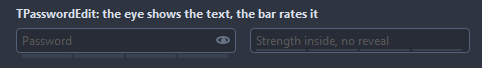
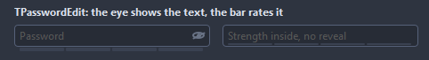

# TPasswordEdit

A password field with an eye that reveals the text, a strength bar and a caps lock warning. The strength counts length and the kinds of characters; OnGetStrength replaces that.

- Palette page: Unleashed: Input
- Unit: `passwordedit.pas`
- Ancestor: `TCustomControl`



## Usage

```pascal
procedure TForm1.FormCreate(Sender: TObject);
begin
  var secret := TPasswordEdit.Create(Self);
  secret.Parent := Self;
  secret.Width := 220;
  secret.MinLength := 10;
  secret.StrengthPosition := spBelow;
  secret.OnChange := @secretChange;
end;

procedure TForm1.secretChange(Sender: TObject);
begin
  // psNone, psWeak, psFair, psGood or psStrong
  Caption := Format('strength %d', [ord(TPasswordEdit(Sender).Strength)]);
end;
```

## Properties

| Property | Type | Default | Notes |
|---|---|---|---|
| `Text` | `string` |  | the text |
| `TextHint` | `string` |  | the gray text shown while the field is empty |
| `MaxLength` | `integer` | `0` | 0 for no limit |
| `Revealed` | `boolean` | `false` | the text shows in the clear |
| `ShowRevealButton` | `boolean` | `true` |  |
| `ShowCapsLockWarning` | `boolean` | `true` | a mark while caps lock is on and the field has the focus |
| `StrengthPosition` | `TStrengthPosition` | `spBelow` |  |
| `MinLength` | `integer` | `8` | shorter passwords count as weak |
| `CornerRadius` | `integer` | `4` | the rounding of the corners, in pixels |
| `Padding` | `integer` | `6` | the space between the border and the content |
| `IconSize` | `integer` | `0` | the size of the icon, 0 takes it from the font |
| `PasswordChar` | `char` | `'*'` |  |
| `IconColor` | `TColor` | `clDefault` | clDefault takes the colors of the theme |
| `BorderColor` | `TColor` | `clDefault` | clDefault takes the color of the theme |
| `FocusBorderColor` | `TColor` | `clDefault` | the border while focused; clDefault takes the accent of the theme |
| `WeakColor` | `TColor` | `clRed` |  |
| `FairColor` | `TColor` | `clDefault` |  |
| `GoodColor` | `TColor` | `clDefault` |  |
| `StrongColor` | `TColor` | `clGreen` |  |
| `Antialiasing` | `TAntialiasSetting` | `asTheme` | asTheme follows the theme setting, asOn and asOff force it |

Also the standard properties of a control, re-published: `Align`, `Anchors`, `AutoSize`, `BorderSpacing`, `Color`, `Constraints`, `Enabled`, `Font`, `Hint`, `ParentColor`, `ParentFont`, `ParentShowHint`, `PopupMenu`, `ShowHint`, `TabOrder`, `TabStop`, `Visible`, `OnClick`, `OnContextPopup`, `OnEnter`, `OnExit`, `OnKeyDown`, `OnKeyPress`, `OnKeyUp`, `OnMouseEnter`, `OnMouseLeave`, `OnResize`.

## Events

| Event | Handler | Notes |
|---|---|---|
| `OnChange` | `procedure(Sender: TObject)` | after the value changed |
| `OnGetStrength` | `procedure(Sender: TObject; const password: string; var strength: TPasswordStrength)` |  |

## Runtime

Available in code, not in the Object Inspector.

| Property | Type | Notes |
|---|---|---|
| `Edit` | `TEdit` | the edit control inside, for its own properties |

| Method | Notes |
|---|---|
| `SetFocus` | moves the keyboard focus into the field |
| `Focused: Boolean` | the field has the keyboard focus |
| `Strength: TPasswordStrength` | the strength of the text now |
| `Clear` | removes everything |

## Types

| Type | Values | Notes |
|---|---|---|
| `TPasswordStrength` | `psNone`, `psWeak`, `psFair`, `psGood`, `psStrong` | psNone for an empty field, then four steps of a password getting harder to guess |
| `TStrengthPosition` | `spBelow`, `spInside`, `spNone` |  |

## In pictures

**Revealed: the text in the clear.**


