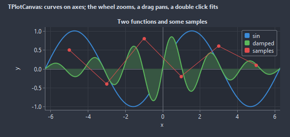

# TPlotCanvas

X and y pairs as curves on two axes with ticks and a grid: a measurement, a function, a rolling signal. The wheel zooms, a drag pans, a crosshair reads the value, the range follows the data or stays where it was set.

- Palette page: Unleashed: Display
- Unit: `plotcanvas.pas`
- Ancestor: `TCustomControl`



## Usage

```pascal
function TForm1.wave(x: double): double;
begin
  result := sin(x) * exp(-x / 8);
end;

procedure TForm1.FormCreate(Sender: TObject);
begin
  var plot := TPlotCanvas.Create(Self);
  plot.Parent := Self;
  plot.SetBounds(8, 8, 400, 240);
  plot.Title := 'damped wave';
  plot.XTitle := 't';
  plot.AddFunction('sin', @wave, 0, 20);
  var samples := plot.AddCurve('samples', clRed);
  samples.Marker := pmDot;
  samples.AddPoints([0, 5, 10, 15], [0, 0.3, -0.2, 0.1]);
  plot.ZoomToFit;
end;
```

## Properties

| Property | Type | Default | Notes |
|---|---|---|---|
| `Curves` | `TPlotCurves` |  |  |
| `XMin` | `double` |  |  |
| `XMax` | `double` |  |  |
| `YMin` | `double` |  |  |
| `YMax` | `double` |  |  |
| `AutoRange` | `boolean` | `true` | the view follows the data; a zoom or a pan turns it off |
| `ShowGrid` | `boolean` | `true` | a grid behind the content |
| `ShowLegend` | `boolean` | `true` | the legend is shown |
| `ShowCrosshair` | `boolean` | `true` | the readout follows the mouse |
| `Interactive` | `boolean` | `true` | the wheel zooms, a drag pans, a double click fits |
| `ShowAxes` | `boolean` | `true` | the axes are drawn |
| `Square` | `boolean` | `false` | the same scale on both axes |
| `ShowZero` | `boolean` | `true` | the axes drawn through zero when it is in view |
| `Title` | `string` |  | the heading |
| `XTitle` | `string` |  |  |
| `YTitle` | `string` |  |  |
| `XFormat` | `string` |  | Format patterns for the tick labels; empty picks the digits by the step |
| `YFormat` | `string` |  |  |
| `Padding` | `integer` | `8` | the space between the border and the content |
| `TickLength` | `integer` | `4` |  |
| `GridColor` | `TColor` | `clDefault` | clDefault takes the colors of the theme |
| `AxisColor` | `TColor` | `clDefault` | clDefault takes the color of the theme |
| `TextColor` | `TColor` | `clDefault` | clDefault takes the color of the theme |
| `BackColor` | `TColor` | `clDefault` | clDefault takes the color of the theme |
| `PlotColor` | `TColor` | `clDefault` | the area inside the axes |
| `CrosshairColor` | `TColor` | `clDefault` |  |
| `Antialiasing` | `TAntialiasSetting` | `asTheme` | asTheme follows the theme setting, asOn and asOff force it |

Also the standard properties of a control, re-published: `Align`, `Anchors`, `BorderSpacing`, `Constraints`, `Enabled`, `Font`, `Hint`, `ParentFont`, `ParentShowHint`, `PopupMenu`, `ShowHint`, `TabOrder`, `TabStop`, `Visible`, `OnClick`, `OnContextPopup`, `OnDblClick`, `OnEnter`, `OnExit`, `OnKeyDown`, `OnKeyPress`, `OnKeyUp`, `OnMouseDown`, `OnMouseEnter`, `OnMouseLeave`, `OnMouseMove`, `OnMouseUp`, `OnMouseWheel`, `OnResize`.

## Events

| Event | Handler | Notes |
|---|---|---|
| `OnPointHover` | `procedure(Sender: TObject; curve, index: integer)` | the mouse is near a point; curve -1 once it left |
| `OnPointClick` | `procedure(Sender: TObject; curve, index: integer)` | a click on a point |
| `OnMouseMovePlot` | `procedure(Sender: TObject; x, y: double)` | the mouse moved over the plot; x and y are plot coordinates |
| `OnViewChange` | `procedure(Sender: TObject; xMin, xMax, yMin, yMax: double)` | the view changed |

## Runtime

Available in code, not in the Object Inspector.

| Property | Type | Notes |
|---|---|---|
| `PlotArea` | `TRect` |  |

| Method | Notes |
|---|---|
| `AddCurve(const title: string; color: TColor = clDefault): TPlotCurve` |  |
| `AddFunction(const title: string; f: TPlotFunction; xFrom, xTo: double; samples: integer = 200; color: TColor = clDefault): TPlotCurve` | a curve from a function sampled across the x range in `samples` points |
| `Clear` | removes everything |
| `ZoomToFit` | the view back on the data |
| `SetView(xMin, xMax, yMin, yMax: double)` |  |
| `Zoom(factor: double)` | the scale, 1 for actual size |
| `ToPlot(px, py: integer): TPlotPoint` | pixels to plot coordinates and back |
| `ToPixel(x, y: double): TPoint` |  |

## Companion classes

### `TPlotCurve`

| Property | Type | Default | Notes |
|---|---|---|---|
| `Title` | `string` |  | the heading |
| `Color` | `TColor` | `clDefault` | clDefault takes a color from the palette of the plot |
| `Width` | `integer` | `2` | the width in pixels |
| `Marker` | `TPlotMarker` | `pmNone` | the mark at every point: none, a dot, a square, a cross, a hollow circle, a triangle, a diamond, a plus |
| `Visible` | `boolean` | `true` | hidden items take no room |
| `Filled` | `boolean` | `false` | the area down to zero shaded |
| `Stepped` | `boolean` | `false` | a staircase instead of a slope between points |
| `Tag` | `PtrInt` | `0` | free for the application |

| Property | Type | Notes |
|---|---|---|
| `Count` | `integer` | the number of entries |
| `X[index: integer]` | `double` |  |
| `Y[index: integer]` | `double` |  |

| Method | Notes |
|---|---|
| `AddPoint(x, y: double)` |  |
| `AddPoints(const xs, ys: array of double)` |  |
| `AddValues(const ys: array of double)` | y values at 0, 1, 2 and so on |
| `Clear` | removes everything |
| `Trim(n: integer)` | keeps the last n points, for a rolling plot |

### `TPlotCurves`

| Method | Notes |
|---|---|
| `Add: TPlotCurve` | a new entry at the end |

## Types

| Type | Values | Notes |
|---|---|---|
| `TPlotMarker` | `pmNone`, `pmDot`, `pmSquare`, `pmCross`, `pmCircle`, `pmTriangle`, `pmDiamond`, `pmPlus` | the mark at every point: none, a dot, a square, a cross, a hollow circle, a triangle, a diamond, a plus |
