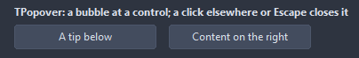
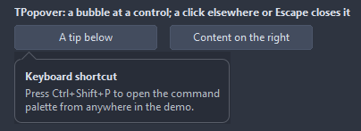

# TPopover

A bubble with an arrow pointing at a control: a title and text, or a control of the form shown inside it. It never takes the focus from the form; a click elsewhere, Escape or a switch to another application closes it, unless LightDismiss is off.

- Palette page: Unleashed: Feedback
- Unit: `popover.pas`
- Ancestor: `TComponent`



## Usage

```pascal
procedure TForm1.FormCreate(Sender: TObject);
begin
  var help := TPopover.Create(Self);
  help.Title := 'Shortcuts';
  help.Text := 'Ctrl+S saves, Ctrl+Shift+P opens the palette.';
  help.Placement := ppBelow;
  var button := TButton.Create(Self);
  button.Parent := Self;
  button.Caption := 'Help';
  button.Tag := PtrInt(help);
  button.OnClick := @helpClick;
end;

procedure TForm1.helpClick(Sender: TObject);
begin
  TPopover(TButton(Sender).Tag).Toggle(TControl(Sender)); // a click elsewhere closes it
end;
```

## Properties

| Property | Type | Default | Notes |
|---|---|---|---|
| `Title` | `string` |  | the heading |
| `Text` | `string` |  | wraps at MaxWidth; line breaks in it stay |
| `Content` | `TControl` |  | a control of the form shown in the bubble instead of the text; it goes back to its parent, hidden, when the bubble closes |
| `Placement` | `TPopoverPlacement` | `ppAuto` |  |
| `ShowCloseButton` | `boolean` | `false` | a close button is shown |
| `LightDismiss` | `boolean` | `true` | a click elsewhere, Escape or another application closes the bubble |
| `MaxWidth` | `integer` | `280` |  |
| `Padding` | `integer` | `12` | the space between the border and the content |
| `CornerRadius` | `integer` | `8` | the rounding of the corners, in pixels |
| `ArrowSize` | `integer` | `8` | the size of the arrow, in pixels |
| `Gap` | `integer` | `2` | between the arrow tip and the target |
| `Font` | `TFont` |  | the font of the text |
| `Color` | `TColor` | `clDefault` | clDefault takes the colors of the theme |
| `BorderColor` | `TColor` | `clDefault` | clDefault takes the color of the theme |
| `TitleColor` | `TColor` | `clDefault` | clDefault takes the color of the theme |
| `TextColor` | `TColor` | `clDefault` | clDefault takes the color of the theme |
| `Antialiasing` | `TAntialiasSetting` | `asTheme` | asTheme follows the theme setting, asOn and asOff force it |

## Events

| Event | Handler | Notes |
|---|---|---|
| `OnShow` | `procedure(Sender: TObject)` |  |
| `OnClose` | `procedure(Sender: TObject)` | before it closes |

## Runtime

Available in code, not in the Object Inspector.

| Property | Type | Notes |
|---|---|---|
| `Target` | `TControl` | the control it works on |

| Method | Notes |
|---|---|
| `Popup(target: TControl)` | opens next to the target, on the side Placement picks |
| `Toggle(target: TControl)` | opens or closes, for a button that shows the bubble |
| `Close` | closes it |
| `IsOpen: boolean` | it is open |

## Types

| Type | Values | Notes |
|---|---|---|
| `TPopoverPlacement` | `ppAuto`, `ppBelow`, `ppAbove`, `ppRight`, `ppLeft` |  |

## In pictures

**The bubble under the first button, its arrow pointing at it.**


