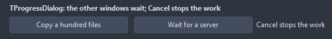
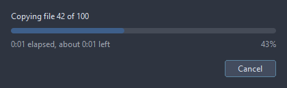

# TProgressDialog

A window with a bar for work that takes a while, driven by the code doing it: Start, then Position or Step as the work goes, then Finish. Each update repaints the window and lets Cancel be clicked, so a loop checks Cancelled. Work done before ShowDelay passes never shows a window.

- Palette page: Unleashed: Feedback
- Unit: `progressdialog.pas`
- Ancestor: `TComponent`



## Usage

```pascal
procedure TForm1.FormCreate(Sender: TObject);
begin
  var progress := TProgressDialog.Create(Self);
  progress.Title := 'Exporting';
  progress.Max := 200;
  progress.Start('Writing pages');
  for var i := 1 to 200 do begin
    if progress.Cancelled then break;
    // one page of work here
    progress.Step;
  end;
  progress.Finish;
end;
```

## Properties

| Property | Type | Default | Notes |
|---|---|---|---|
| `Title` | `string` |  | the heading |
| `Message` | `string` |  | the text |
| `Max` | `integer` | `100` | the upper limit |
| `Position` | `integer` | `0` | the current value, from Min to Max |
| `Indeterminate` | `boolean` | `false` | a bar without an end, for work of an unknown length |
| `ShowCancel` | `boolean` | `true` | the Cancel button is shown |
| `CancelCaption` | `string` |  | the caption of the Cancel button |
| `ShowTime` | `boolean` | `true` | the time gone and the time left, from the pace so far |
| `ShowPercent` | `boolean` | `true` |  |
| `DisableForms` | `boolean` | `true` | the other windows of the application wait while the dialog shows |
| `ShowDelay` | `integer` | `400` | milliseconds of work before the window shows |
| `Width` | `integer` | `420` | the width in pixels |
| `AccentColor` | `TColor` | `clDefault` | clDefault takes the color of the theme |
| `Antialiasing` | `TAntialiasSetting` | `asTheme` | asTheme follows the theme setting, asOn and asOff force it |

## Events

| Event | Handler | Notes |
|---|---|---|
| `OnCancel` | `procedure(Sender: TObject)` | Cancel was pressed |

## Runtime

Available in code, not in the Object Inspector.

| Property | Type | Notes |
|---|---|---|
| `Active` | `boolean` | on; off stops it |
| `Cancelled` | `boolean` | it was cancelled |

| Method | Notes |
|---|---|
| `Start(const message: string = '')` | starts it |
| `Step(delta: integer = 1)` |  |
| `Finish` | ends it |
| `Cancel` | what the Cancel button does |

## In pictures

**The dialog while the work runs: the message, the bar, the time elapsed and left, Cancel.**


