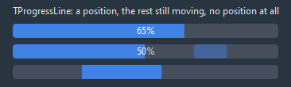
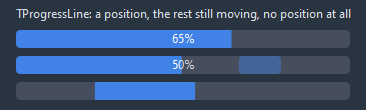
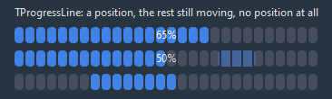
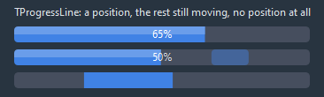
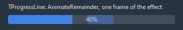
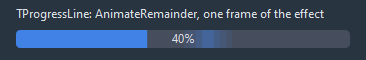
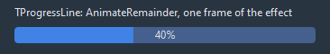
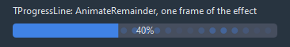
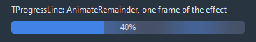

# TProgressLine

Progress as a bar filling from one end, the number over it. The fill glides to a new position when Animated is on; Indeterminate runs a block along the whole bar instead. AnimateRemainder keeps the part still to do moving while the position holds, for a step whose length is unknown.

- Palette page: Unleashed: Display
- Unit: `progressline.pas`
- Ancestor: `TGraphicControl`



## Usage

```pascal
procedure TForm1.FormCreate(Sender: TObject);
begin
  var line := TProgressLine.Create(Self);
  line.Parent := Self;
  line.SetBounds(8, 8, 240, 20);
  line.Position := 50;
  line.TextMode := ltPercent;
  // a step of unknown length: the position stays, the rest keeps moving
  line.AnimateRemainder := true;
  line.RemainderEffect := reMarquee;
  // while nothing is known at all
  // line.Indeterminate := true;
end;
```

## Properties

| Property | Type | Default | Notes |
|---|---|---|---|
| `Min` | `integer` | `0` | the lower limit |
| `Max` | `integer` | `100` | the upper limit |
| `Position` | `integer` | `0` | the current value, from Min to Max |
| `Orientation` | `TProgressLineOrientation` | `plHorizontal` | a horizontal bar fills from the left, a vertical one from the bottom |
| `Style` | `TProgressLineStyle` | `plsSolid` | the fill: one block, a row of segments with gaps between them, or a block with a lighter upper half |
| `Indeterminate` | `boolean` | `false` | no position to show: a block runs along the whole bar |
| `Animated` | `boolean` | `true` | the fill glides to a new position instead of jumping |
| `AnimateRemainder` | `boolean` | `false` | the part past the position moves with RemainderEffect, to show work going on while the position cannot tell how far it is |
| `RemainderEffect` | `TRemainderEffect` | `reMarquee` | what moves over the part still to do while AnimateRemainder is on |
| `TextMode` | `TProgressLineTextMode` | `ltNone` | what the text shows |
| `TextFormat` | `string` | `%d%%` | a Format pattern; the argument is the percent or the value, after TextMode |
| `CornerRadius` | `integer` | `4` | the rounding of the ends of the bar, in pixels; 0 leaves them square |
| `BorderWidth` | `integer` | `0` | a frame around the bar; 0 draws none |
| `SegmentLength` | `integer` | `10` | the length of one segment of the plsSegments style, in pixels |
| `BarColor` | `TColor` | `clDefault` | clDefault takes the colors of the theme |
| `TrackColor` | `TColor` | `clDefault` | the unfilled part; clDefault takes the color of the theme |
| `TextColor` | `TColor` | `clDefault` | the text over the unfilled part; over the fill the text takes a color that reads on it |
| `BorderColor` | `TColor` | `clDefault` | clDefault takes the color of the theme |
| `EffectColor` | `TColor` | `clDefault` | the color of the remainder effect; clDefault takes a tint between the track and the bar |
| `Antialiasing` | `TAntialiasSetting` | `asTheme` | the smoothing of the shapes: after the theme, or its own choice |

Also the standard properties of a control, re-published: `Caption`, `Align`, `Anchors`, `BorderSpacing`, `Color`, `Constraints`, `Enabled`, `Font`, `Hint`, `ParentColor`, `ParentFont`, `ParentShowHint`, `PopupMenu`, `ShowHint`, `Visible`, `OnClick`, `OnContextPopup`, `OnDblClick`, `OnMouseDown`, `OnMouseEnter`, `OnMouseLeave`, `OnMouseMove`, `OnMouseUp`, `OnResize`.

## Events

| Event | Handler | Notes |
|---|---|---|
| `OnGetText` | `procedure(Sender: TObject; var text: string)` | replaces the text over the bar |

## Runtime

Available in code, not in the Object Inspector.

| Method | Notes |
|---|---|
| `Fraction: double` | the share done, 0..1 |
| `StepBy(delta: integer)` | steps the position by `delta` |

## Types

| Type | Values | Notes |
|---|---|---|
| `TProgressLineOrientation` | `plHorizontal`, `plVertical` |  |
| `TProgressLineStyle` | `plsSolid`, `plsSegments`, `plsGradient` | the fill: one block, a row of segments with gaps between them, or a block with a lighter upper half |
| `TProgressLineTextMode` | `ltPercent`, `ltValue`, `ltCaption`, `ltNone` |  |
| `TRemainderEffect` | `reMarquee`, `reShimmer`, `reFade`, `reStripes`, `reDots`, `reWave` | what moves over the part still to do while AnimateRemainder is on: reMarquee a block running along it, reShimmer a soft highlight sweeping it, reFade the whole part breathing, reStripes diagonal stripes rolling, reDots dots lighting up in turn, reWave a wave of brightness running |

## In pictures

### Every Style

The demo group with each value of `Style` in turn.

`Style = plsSolid`



`Style = plsSegments`



`Style = plsGradient`



### Every RemainderEffect

One frame of each value of `RemainderEffect`, with `AnimateRemainder` on and the position at 40.

`RemainderEffect = reMarquee`



`RemainderEffect = reShimmer`



`RemainderEffect = reFade`



`RemainderEffect = reStripes`


`RemainderEffect = reDots`



`RemainderEffect = reWave`


