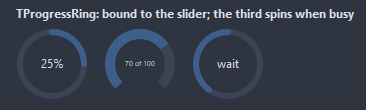
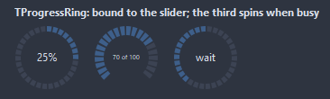
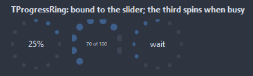
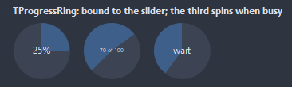

# TProgressRing

Progress as an arc closing a ring, the number in the middle. Indeterminate runs a short arc around the ring instead; the arc animates toward a new position when Animated is on.

- Palette page: Unleashed: Display
- Unit: `progressring.pas`
- Ancestor: `TGraphicControl`



## Usage

```pascal
procedure TForm1.FormCreate(Sender: TObject);
begin
  var ring := TProgressRing.Create(Self);
  ring.Parent := Self;
  ring.SetBounds(8, 8, 80, 80);
  ring.Thickness := 8;
  ring.Position := 65;
  ring.TextMode := rtPercent;
  // while the length of the work is unknown
  // ring.Indeterminate := true;
end;
```

## Properties

| Property | Type | Default | Notes |
|---|---|---|---|
| `Min` | `integer` | `0` | the lower limit |
| `Max` | `integer` | `100` | the upper limit |
| `Position` | `integer` | `0` | the current value, from Min to Max |
| `Thickness` | `integer` | `6` | the stroke, in pixels |
| `StartAngle` | `integer` | `0` | where the arc starts, degrees clockwise from the top |
| `Gap` | `integer` | `0` | left open at the bottom of the ring, degrees; 0 closes it |
| `Clockwise` | `boolean` | `true` |  |
| `RoundCaps` | `boolean` | `true` |  |
| `Indeterminate` | `boolean` | `false` | no position to show: a short arc runs around the ring |
| `Animated` | `boolean` | `true` | the arc glides to a new position instead of jumping |
| `TextMode` | `TRingTextMode` | `rtPercent` | what the text shows |
| `TextFormat` | `string` |  | a Format pattern; the argument is the percent or the value, after TextMode |
| `RingColor` | `TColor` | `clDefault` | clDefault takes the colors of the theme |
| `TrackColor` | `TColor` | `clDefault` | the unfilled part; clDefault takes the color of the theme |
| `TextColor` | `TColor` | `clDefault` | clDefault takes the color of the theme |
| `Antialiasing` | `TAntialiasSetting` | `asTheme` | the smoothing of the shapes: after the theme, or its own choice |
| `Style` | `TRingStyle` | `rsArc` | the ring: one arc, an arc cut into segments, a ring of dots, or a disc filling up like a pie |

Also the standard properties of a control, re-published: `Caption`, `Align`, `Anchors`, `BorderSpacing`, `Color`, `Constraints`, `Enabled`, `Font`, `Hint`, `ParentColor`, `ParentFont`, `ParentShowHint`, `PopupMenu`, `ShowHint`, `Visible`, `OnClick`, `OnContextPopup`, `OnDblClick`, `OnMouseDown`, `OnMouseEnter`, `OnMouseLeave`, `OnMouseMove`, `OnMouseUp`, `OnResize`.

## Events

| Event | Handler | Notes |
|---|---|---|
| `OnGetText` | `procedure(Sender: TObject; var text: string)` | replaces the text in the middle |

## Runtime

Available in code, not in the Object Inspector.

| Method | Notes |
|---|---|
| `Fraction: double` | the share done, 0..1 |
| `StepBy(delta: integer)` | steps the position by `delta` |

## Types

| Type | Values | Notes |
|---|---|---|
| `TRingTextMode` | `rtPercent`, `rtValue`, `rtCaption`, `rtNone` |  |
| `TRingStyle` | `rsArc`, `rsSegments`, `rsDots`, `rsPie` | the ring: one arc, an arc cut into segments, a ring of dots, or a disc filling up like a pie |

## In pictures

### Every Style

The demo group with each value of `Style` in turn.

`Style = rsArc`


`Style = rsSegments`



`Style = rsDots`



`Style = rsPie`


