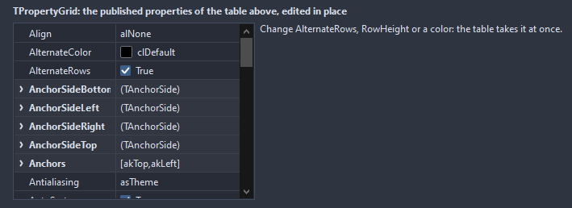

# TPropertyGrid

The published properties of an object, one per row, with the value editable in place: text and numbers in a box, booleans and enums from a list, colors from a dialog, sets as yes or no per element under the set. Object properties open as a group of their own rows.

- Palette page: Unleashed: Views
- Unit: `propertygrid.pas`
- Ancestor: `TScrollingWinControl`



## Usage

```pascal
procedure TForm1.FormCreate(Sender: TObject);
begin
  var edit := TEdit.Create(Self);
  edit.Parent := Self;
  var grid := TPropertyGrid.Create(Self);
  grid.Parent := Self;
  grid.SetBounds(8, 40, 320, 300);
  grid.Excluded.AddStrings(['Tag', 'HelpContext']);
  grid.Target := edit; // every published property, edited in place
  grid.OnChange := @gridChange;
end;

procedure TForm1.gridChange(Sender: TObject; const propName: string);
begin
  Caption := propName + ' changed';
end;
```

## Properties

| Property | Type | Default | Notes |
|---|---|---|---|
| `Target` | `TPersistent` |  | the object whose properties show; a control, a font, anything published |
| `Split` | `integer` | `45` | the share of the width the names take, in percent |
| `ShowReadOnly` | `boolean` | `false` |  |
| `SortProperties` | `boolean` | `true` |  |
| `ShowObjects` | `boolean` | `true` | object properties such as Font open into their own rows |
| `ShowGridLines` | `boolean` | `true` | lines between the cells |
| `RowHeight` | `integer` | `0` | 0 takes it from the font |
| `Padding` | `integer` | `6` | the space between the border and the content |
| `Indent` | `integer` | `14` | the shift of each level, in pixels |
| `Excluded` | `TStrings` |  | property names never shown, one per line |
| `NameColor` | `TColor` | `clDefault` | clDefault takes the colors of the theme |
| `ValueColor` | `TColor` | `clDefault` | clDefault takes the color of the theme |
| `GridColor` | `TColor` | `clDefault` | clDefault takes the color of the theme |
| `BackColor` | `TColor` | `clDefault` | clDefault takes the color of the theme |
| `ActiveColor` | `TColor` | `clDefault` | clDefault takes the accent of the theme |
| `GroupColor` | `TColor` | `clDefault` |  |
| `Antialiasing` | `TAntialiasSetting` | `asTheme` | asTheme follows the theme setting, asOn and asOff force it |
| `Language` | `TFormatLanguage` | `flSystem` | the names and separators of dates, times and numbers: those of the locale of the system, or English |

Also the standard properties of a scrolling control, re-published: `Align`, `Anchors`, `BorderSpacing`, `BorderStyle`, `Color`, `Constraints`, `Enabled`, `Font`, `Hint`, `ParentFont`, `ParentShowHint`, `PopupMenu`, `ShowHint`, `TabOrder`, `TabStop`, `Visible`, `OnClick`, `OnContextPopup`, `OnEnter`, `OnExit`, `OnKeyDown`, `OnKeyPress`, `OnKeyUp`, `OnMouseDown`, `OnMouseEnter`, `OnMouseLeave`, `OnMouseMove`, `OnMouseUp`, `OnMouseWheel`, `OnResize`.

## Events

| Event | Handler | Notes |
|---|---|---|
| `OnFilter` | `procedure(Sender: TObject; const propName: string; var show: boolean; var displayName: string)` | decides what is shown |
| `OnChange` | `procedure(Sender: TObject; const propName: string)` | a value went into the target |
| `OnSelect` | `procedure(Sender: TObject; const propName: string)` | the selection changed |

## Runtime

Available in code, not in the Object Inspector.

| Method | Notes |
|---|---|
| `Refresh` | reads the values of the target again, after they changed elsewhere |
| `ActiveProperty: string` | the name of the property on the active row, empty for none |
| `ExpandAll` | opens every node |
| `CollapseAll` | folds every node |
