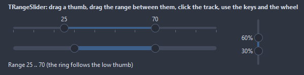
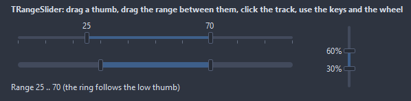

# TRangeSlider

A track with two thumbs picking a range from LowValue to HighValue. The thumbs drag with the mouse, the range between them drags as a whole, a click on the track jumps the nearer thumb; the keyboard moves the active thumb and the wheel the one under the mouse.

- Palette page: Unleashed: Input
- Unit: `rangeslider.pas`
- Ancestor: `TCustomControl`


## Usage

```pascal
procedure TForm1.FormCreate(Sender: TObject);
begin
  var budget := TRangeSlider.Create(Self);
  budget.Parent := Self;
  budget.Width := 300;
  budget.Min := 0;
  budget.Max := 500;
  budget.Step := 10;
  budget.SetRange(100, 300);
  budget.ValueFormat := '$%d';
  budget.OnChange := @budgetChange;
end;

procedure TForm1.budgetChange(Sender: TObject);
begin
  with TRangeSlider(Sender) do Caption := Format('%d to %d', [LowValue, HighValue]);
end;
```

## Properties

| Property | Type | Default | Notes |
|---|---|---|---|
| `Min` | `integer` | `0` | the lower limit |
| `Max` | `integer` | `100` | the upper limit |
| `LowValue` | `integer` | `20` |  |
| `HighValue` | `integer` | `80` |  |
| `Step` | `integer` | `1` | the values land on Min plus a multiple of Step |
| `MinRange` | `integer` | `0` | the thumbs stay at least this far apart |
| `KeyStep` | `integer` | `1` | an arrow key moves the active thumb by this much |
| `PageStep` | `integer` | `10` |  |
| `WheelStep` | `integer` | `1` |  |
| `Orientation` | `TSliderOrientation` | `soHorizontal` | horizontal or vertical |
| `ThumbShape` | `TSliderThumbShape` | `tsRound` | the thumb: a disc, a square, a diamond, a tag pointing at the track, a narrow bar |
| `ThumbSize` | `integer` | `16` |  |
| `TrackSize` | `integer` | `4` |  |
| `ShowTicks` | `boolean` | `false` | tick marks are shown |
| `TickStep` | `integer` | `0` | a tick every TickStep values; 0 picks ten ticks |
| `TickSize` | `integer` | `4` |  |
| `ValuePosition` | `TSliderValuePosition` | `vpOutside` | where the values of the thumbs are written |
| `ValueFormat` | `string` |  | a Format pattern with the value as its integer argument |
| `MoveRange` | `boolean` | `true` | the range between the thumbs drags as a whole |
| `ClickJump` | `boolean` | `true` | a click on the track jumps the nearer thumb there |
| `ReadOnly` | `boolean` | `false` | the mouse and the keyboard change nothing |
| `TrackColor` | `TColor` | `clDefault` | clDefault takes the colors of the theme |
| `RangeColor` | `TColor` | `clDefault` |  |
| `ThumbColor` | `TColor` | `clDefault` | clDefault takes the color of the theme |
| `ThumbBorderColor` | `TColor` | `clDefault` |  |
| `TickColor` | `TColor` | `clDefault` | clDefault takes the color of the theme |
| `Antialiasing` | `TAntialiasSetting` | `asTheme` | the smoothing of the shapes: after the theme, or its own choice |

Also the standard properties of a control, re-published: `Align`, `Anchors`, `BorderSpacing`, `Color`, `Constraints`, `Cursor`, `Enabled`, `Font`, `Hint`, `ParentColor`, `ParentFont`, `ParentShowHint`, `PopupMenu`, `ShowHint`, `TabOrder`, `TabStop`, `Visible`, `OnClick`, `OnContextPopup`, `OnDblClick`, `OnEnter`, `OnExit`, `OnKeyDown`, `OnKeyPress`, `OnKeyUp`, `OnMouseDown`, `OnMouseEnter`, `OnMouseLeave`, `OnMouseMove`, `OnMouseUp`, `OnMouseWheel`, `OnResize`.

## Events

| Event | Handler | Notes |
|---|---|---|
| `OnChange` | `procedure(Sender: TObject)` | after a value settled: the drag ended, a key or the wheel moved a thumb |
| `OnChanging` | `procedure(Sender: TObject)` | on every move while a thumb drags |
| `OnFormatValue` | `procedure(Sender: TObject; thumb: TSliderThumb; value: integer; var text: string)` | replaces the text written at a thumb |
| `OnDrawThumb` | `TCustomDrawEvent` | paints over a thumb: index 0 is the low one, 1 the high one; dsHover, dsPressed while dragged, dsFocused for the thumb the keyboard moves |

## Runtime

Available in code, not in the Object Inspector.

| Property | Type | Notes |
|---|---|---|
| `ActiveThumb` | `TSliderThumb` | the thumb the keyboard moves |

| Method | Notes |
|---|---|
| `SetRange(low, high: integer)` | both values at once, clamped and ordered |
| `Dragging: boolean` | a thumb or the range is being dragged |

## Types

| Type | Values | Notes |
|---|---|---|
| `TSliderOrientation` | `soHorizontal`, `soVertical` |  |
| `TSliderThumb` | `stLow`, `stHigh` |  |
| `TSliderThumbShape` | `tsRound`, `tsSquare`, `tsDiamond`, `tsPointer`, `tsBar` | the thumb: a disc, a square, a diamond, a tag pointing at the track, a narrow bar |
| `TSliderValuePosition` | `vpNone`, `vpOutside`, `vpInside` | where the values of the thumbs are written |

## Custom drawing

The component paints its parts by itself, through the shapes of `ControlPaint`. A handler on the event below takes over a part: it gets the canvas of the control, the rectangle of the part, which part it is and a `TDrawState` set telling what the part is in: `dsHover`, `dsActive`, `dsSelected`, `dsPressed`, `dsDisabled`, `dsFocused`, `dsChecked`.

- `OnDrawThumb`: paints over a thumb: index 0 is the low one, 1 the high one; dsHover, dsPressed while dragged, dsFocused for the thumb the keyboard moves. Handler: `TCustomDrawEvent`.

A handler may paint with the plain canvas, or through `beginShapes()` from `ControlPaint` for the same smoothed shapes the components use: `paintRoundRect()`, `paintCircle()`, `paintCheck()`, `FillPolygon()` and the rest, then `Flush` once. Colors of the theme come from `pick()`, `blend()` and `contrastText()`.

## In pictures

### Every ThumbShape

The demo group with each value of `ThumbShape` in turn.

`ThumbShape = tsRound`



`ThumbShape = tsSquare`


`ThumbShape = tsDiamond`


`ThumbShape = tsPointer`


`ThumbShape = tsBar`


