# TRating

A row of stars to rate with: the mouse picks a star, or half of one, the arrow keys step the value. Hovering previews the pick.

- Palette page: Unleashed: Input
- Unit: `rating.pas`
- Ancestor: `TCustomControl`

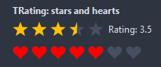

## Usage

```pascal
procedure TForm1.FormCreate(Sender: TObject);
begin
  var stars := TRating.Create(Self);
  stars.Parent := Self;
  stars.Max := 5;
  stars.AllowHalf := true;
  stars.ShowValue := true;
  stars.Labels.AddStrings(['poor', 'fair', 'good', 'great', 'superb']);
  stars.Value := 3.5;
  stars.OnChange := @starsChange;
end;

procedure TForm1.starsChange(Sender: TObject; value: double);
begin
  Caption := Format('%.1f stars', [value]);
end;
```

## Properties

| Property | Type | Default | Notes |
|---|---|---|---|
| `Max` | `integer` | `5` | the upper limit |
| `Value` | `double` |  | the rating; with AllowHalf in steps of 0.5 |
| `AllowHalf` | `boolean` | `true` | half values are allowed |
| `ReadOnly` | `boolean` | `false` | the mouse and the keyboard change nothing |
| `AllowClear` | `boolean` | `true` | a click on the current value clears the rating |
| `ShowValue` | `boolean` | `false` | the value as text after the stars, after ValueFormat |
| `ValueFormat` | `string` |  | a Format pattern with the value and the maximum, like "%.1f / %d" |
| `Labels` | `TStrings` |  | one line per star: its hint, and the text ShowValue prefers over the number |
| `Shape` | `TRatingShape` | `rsStar` | the outline of an item: a star, a circle, a heart, a diamond, a square, a triangle, a hexagon, a thumb up, a smiley, bars climbing in height, a circle with a check mark |
| `ItemSize` | `integer` | `20` | the size of one item, in pixels |
| `Spacing` | `integer` | `4` | the gap between the parts |
| `BorderWidth` | `integer` | `0` | an outline around every star; 0 for none |
| `ActiveColor` | `TColor` | `clDefault` | clDefault: gold stars, red hearts, circles in the highlight of the theme |
| `InactiveColor` | `TColor` | `clDefault` | clDefault takes the color of the theme |
| `HoverColor` | `TColor` | `clDefault` | the preview under the mouse; clDefault pales the active color |
| `BorderColor` | `TColor` | `clDefault` | the outline; clDefault darkens the active color |
| `TextColor` | `TColor` | `clDefault` | clDefault takes the color of the theme |
| `Antialiasing` | `TAntialiasSetting` | `asTheme` | asTheme follows the theme setting, asOn and asOff force it |
| `Language` | `TFormatLanguage` | `flSystem` | the names and separators of dates, times and numbers: those of the locale of the system, or English |

Also the standard properties of a control, re-published: `Align`, `Anchors`, `AutoSize`, `BorderSpacing`, `Color`, `Constraints`, `Enabled`, `Font`, `Hint`, `ParentColor`, `ParentFont`, `ParentShowHint`, `PopupMenu`, `ShowHint`, `TabOrder`, `TabStop`, `Visible`, `OnClick`, `OnContextPopup`, `OnEnter`, `OnExit`, `OnKeyDown`, `OnKeyPress`, `OnKeyUp`, `OnMouseDown`, `OnMouseEnter`, `OnMouseLeave`, `OnMouseMove`, `OnMouseUp`, `OnResize`.

## Events

| Event | Handler | Notes |
|---|---|---|
| `OnChange` | `procedure(Sender: TObject; value: double)` | after the value changed |
| `OnDrawItem` | `procedure(Sender: TObject; canvas: TCanvas; const r: TRect; index: integer; share: double; state: TDrawState; var handled: boolean)` | paints every item by itself; see TRatingDrawEvent |

## Types

| Type | Values | Notes |
|---|---|---|
| `TRatingShape` | `rsStar`, `rsCircle`, `rsHeart`, `rsDiamond`, `rsSquare`, `rsTriangle`, `rsHexagon`, `rsThumb`, `rsSmiley`, `rsBar`, `rsCheck` | the outline of an item: a star, a circle, a heart, a diamond, a square, a triangle, a hexagon, a thumb up, a smiley, bars climbing in height, a circle with a check mark |

## Custom drawing

The component paints its parts by itself, through the shapes of `ControlPaint`. A handler on the event below takes over a part: it gets the canvas of the control, the rectangle of the part, which part it is and a `TDrawState` set telling what the part is in: `dsHover`, `dsActive`, `dsSelected`, `dsPressed`, `dsDisabled`, `dsFocused`, `dsChecked`.

- `OnDrawItem`: paints every item by itself; see TRatingDrawEvent. Handler: `procedure(Sender: TObject; canvas: TCanvas; const r: TRect; index: integer; share: double; state: TDrawState; var handled: boolean)`.

A handler may paint with the plain canvas, or through `beginShapes()` from `ControlPaint` for the same smoothed shapes the components use: `paintRoundRect()`, `paintCircle()`, `paintCheck()`, `FillPolygon()` and the rest, then `Flush` once. Colors of the theme come from `pick()`, `blend()` and `contrastText()`.

The demo paints a rating of boxes with their numbers, each box filling with the value:

```pascal
procedure TForm1.RatingCustomDrawItem(Sender: TObject; canvas: TCanvas; const r: TRect; index: integer; share: double; state: TDrawState; var handled: boolean);
begin
  // a rounded box per item: the filled part of it in the accent, lighter
  // while the mouse previews a value, the number of the item on top
  var box := r;
  box.Inflate(-1, -1);
  var accent := ColorToRGB(clHighlight);
  if dsHover in state then accent := blend(accent, clWhite, 35);
  var sp := autofree beginShapes(canvas, r, GetRGBColorResolvingParent, asOn);
  paintRoundRect(sp, box, 6, blend(clBtnFace, clBtnShadow, 40), clNone);
  if share > 0 then begin
    sp.SetClip(Rect(box.Left, box.Top, box.Left+Round(box.Width*share), box.Bottom));
    paintRoundRect(sp, box, 6, accent, clNone);
    sp.ResetClip;
  end;
  sp.Flush;
  canvas.Font.Style := [fsBold];
  paintCenteredText(canvas, box, IntToStr(index+1), (if share >= 0.5 then contrastText(accent) else ColorToRGB(clWindowText)));
  canvas.Font.Style := [];
  handled := true;
end;
```

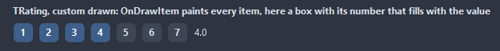

## In pictures

### Every Shape

The demo group with each value of `Shape` in turn.

`Shape = rsStar`

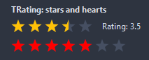

`Shape = rsCircle`


`Shape = rsHeart`

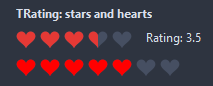

`Shape = rsDiamond`

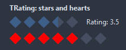

`Shape = rsSquare`

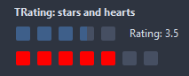

`Shape = rsTriangle`

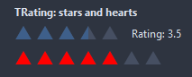

`Shape = rsHexagon`


`Shape = rsThumb`

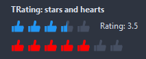

`Shape = rsSmiley`

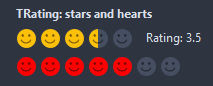

`Shape = rsBar`

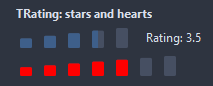

`Shape = rsCheck`

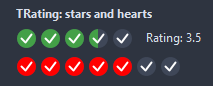
