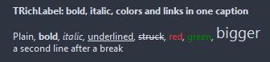

# TRichLabel

A label with styled runs inside one caption: <b>, <i>, <u>, <s> for bold, italic, underlined and struck text, <c=#RRGGBB> or <c=clRed> for a color, <size=N> for a point size, <br> for a line break, <a href="url"> for a link; &lt; &gt; &amp; stand for the characters.

- Palette page: Unleashed: Display
- Unit: `richlabel.pas`
- Ancestor: `TGraphicControl`



## Usage

```pascal
procedure TForm1.FormCreate(Sender: TObject);
begin
  var note := TRichLabel.Create(Self);
  note.Parent := Self;
  note.Width := 320;
  note.WordWrap := true;
  note.Caption := 'A <b>bold</b> word, an <i>italic</i> one, <c=clRed>red</c> text and <a href="https://example.com">a link</a>.';
  note.OnLinkClick := @noteLink;
end;

procedure TForm1.noteLink(Sender: TObject; const href: string);
begin
  Caption := href; // OpenLinks false keeps the browser out of it
end;
```

## Properties

| Property | Type | Default | Notes |
|---|---|---|---|
| `WordWrap` | `boolean` | `false` | the text breaks into lines |
| `Transparent` | `boolean` | `true` | the background of the parent shows through |
| `Alignment` | `TAlignment` | `taLeftJustify` | where the text sits |
| `Layout` | `TTextLayout` | `tlTop` | the arrangement |
| `LineSpacing` | `integer` | `0` | extra pixels between lines |
| `EndEllipsis` | `boolean` | `false` | a caption that does not fit ends in an ellipsis instead of being cut |
| `OpenLinks` | `boolean` | `true` | a click on a link opens it in the browser, before OnLinkClick |
| `TextColor` | `TColor` | `clDefault` | clDefault takes the font color, or the text color of the theme |
| `LinkColor` | `TColor` | `clDefault` | clDefault takes the color of the theme |
| `HoverLinkColor` | `TColor` | `clDefault` |  |

Also the standard properties of a control, re-published: `Caption`, `Align`, `Anchors`, `AutoSize`, `BorderSpacing`, `Color`, `Constraints`, `Enabled`, `Font`, `Hint`, `ParentColor`, `ParentFont`, `ParentShowHint`, `PopupMenu`, `ShowHint`, `Visible`, `OnClick`, `OnContextPopup`, `OnDblClick`, `OnMouseDown`, `OnMouseEnter`, `OnMouseLeave`, `OnMouseMove`, `OnMouseUp`, `OnResize`.

## Events

| Event | Handler | Notes |
|---|---|---|
| `OnLinkClick` | `procedure(Sender: TObject; const link: string; var handled: boolean)` | a click on a link |

## Runtime

Available in code, not in the Object Inspector.

| Method | Notes |
|---|---|
| `PlainText: string` | the caption without its tags |
