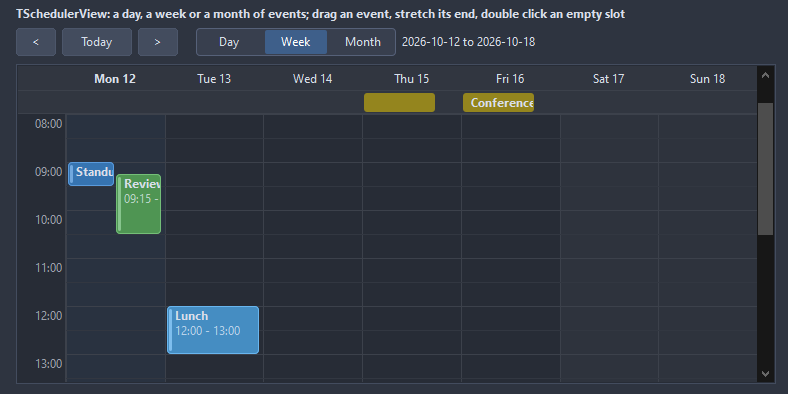
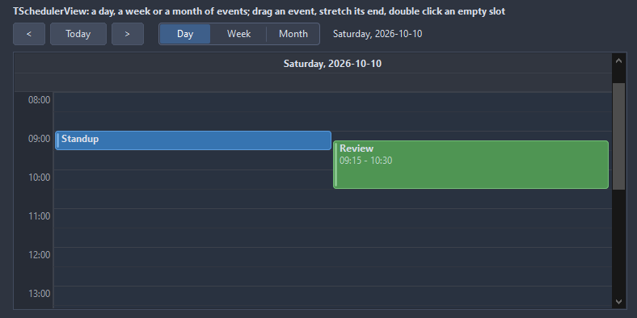
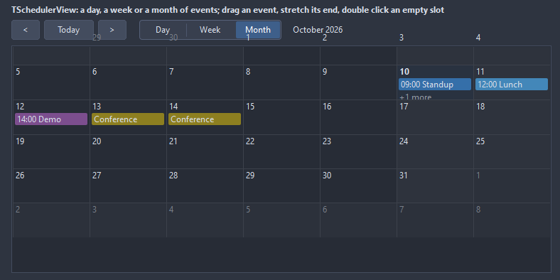

# TSchedulerView

A day, a week or a month of events: in the day and week views the hours run down and the events are blocks that move and stretch with the mouse, events that overlap share the column; the month view lists them per day. Previous and Next page through the time.

- Palette page: Unleashed: Views
- Unit: `schedulerview.pas`
- Ancestor: `TScrollingWinControl`



## Usage

```pascal
procedure TForm1.FormCreate(Sender: TObject);
begin
  var week := TSchedulerView.Create(Self);
  week.Parent := Self;
  week.SetBounds(8, 8, 700, 400);
  week.Mode := smWeek;
  week.FirstHour := 7;
  week.LastHour := 19;
  week.AddEvent('Standup', Date + EncodeTime(9, 0, 0, 0), Date + EncodeTime(9, 15, 0, 0));
  week.AddEvent('Review', Date + 1 + EncodeTime(14, 0, 0, 0), Date + 1 + EncodeTime(15, 30, 0, 0), clTeal);
  week.OnSlotDblClick := @weekSlot;
end;

procedure TForm1.weekSlot(Sender: TObject; time: TDateTime);
begin
  TSchedulerView(Sender).AddEvent('New', time, time + EncodeTime(1, 0, 0, 0));
end;
```

## Properties

| Property | Type | Default | Notes |
|---|---|---|---|
| `Events` | `TSchedulerEvents` |  |  |
| `Mode` | `TSchedulerMode` | `smWeek` |  |
| `Date` | `TDateTime` |  | the day shown, or one of the week or the month |
| `FirstHour` | `integer` | `0` |  |
| `LastHour` | `integer` | `24` |  |
| `HourHeight` | `integer` | `48` |  |
| `HeaderHeight` | `integer` | `0` | 0 takes it from the font |
| `TimeWidth` | `integer` | `48` |  |
| `SnapMinutes` | `integer` | `15` | a drag lands on this many minutes |
| `CornerRadius` | `integer` | `4` | the rounding of the corners, in pixels |
| `Padding` | `integer` | `2` | the space between the border and the content |
| `MondayFirst` | `boolean` | `true` | the week starts on Monday, else on Sunday |
| `ShowNow` | `boolean` | `true` | the line of the current time |
| `ShowAllDay` | `boolean` | `true` |  |
| `AllowDrag` | `boolean` | `true` | the mouse can drag |
| `AllowResize` | `boolean` | `true` | the mouse can resize |
| `ShowWeekends` | `boolean` | `true` | Saturday and Sunday are shown |
| `ShowGrid` | `boolean` | `true` | a grid behind the content |
| `BackColor` | `TColor` | `clDefault` | clDefault takes the colors of the theme |
| `GridColor` | `TColor` | `clDefault` | clDefault takes the color of the theme |
| `TextColor` | `TColor` | `clDefault` | clDefault takes the color of the theme |
| `HeaderColor` | `TColor` | `clDefault` | clDefault takes the color of the theme |
| `NowColor` | `TColor` | `clDefault` |  |
| `TodayColor` | `TColor` | `clDefault` | clDefault takes the color of the theme |
| `EventColor` | `TColor` | `clDefault` |  |
| `WeekendColor` | `TColor` | `clDefault` | clDefault takes the color of the theme |
| `Antialiasing` | `TAntialiasSetting` | `asTheme` | asTheme follows the theme setting, asOn and asOff force it |
| `Language` | `TFormatLanguage` | `flSystem` | the names and separators of dates, times and numbers: those of the locale of the system, or English |

Also the standard properties of a scrolling control, re-published: `Align`, `Anchors`, `BorderSpacing`, `BorderStyle`, `Color`, `Constraints`, `Enabled`, `Font`, `Hint`, `ParentFont`, `ParentShowHint`, `PopupMenu`, `ShowHint`, `TabOrder`, `TabStop`, `Visible`, `OnClick`, `OnContextPopup`, `OnDblClick`, `OnEnter`, `OnExit`, `OnKeyDown`, `OnKeyPress`, `OnKeyUp`, `OnMouseDown`, `OnMouseEnter`, `OnMouseLeave`, `OnMouseMove`, `OnMouseUp`, `OnMouseWheel`, `OnResize`.

## Events

| Event | Handler | Notes |
|---|---|---|
| `OnEventClick` | `procedure(Sender: TObject; event: TSchedulerEvent)` |  |
| `OnEventDblClick` | `procedure(Sender: TObject; event: TSchedulerEvent)` |  |
| `OnSelect` | `procedure(Sender: TObject; event: TSchedulerEvent)` | the selection changed |
| `OnEventChange` | `procedure(Sender: TObject; event: TSchedulerEvent; oldStart, oldFinish: TDateTime)` | an event was dragged or stretched; the times are already set |
| `OnSlotClick` | `procedure(Sender: TObject; time: TDateTime)` | a click on an empty slot |
| `OnSlotDblClick` | `procedure(Sender: TObject; time: TDateTime)` | a double click on an empty slot, the place to add an event |
| `OnDateChange` | `procedure(Sender: TObject)` | the date changed |

## Runtime

Available in code, not in the Object Inspector.

| Property | Type | Notes |
|---|---|---|
| `Selected` | `TSchedulerEvent` |  |

| Method | Notes |
|---|---|
| `AddEvent(const caption: string; start, finish: TDateTime; color: TColor = clDefault): TSchedulerEvent` |  |
| `Next` | moves to the next one |
| `Previous` | moves to the previous one |
| `Today` | moves to today |
| `EventsOn(day: TDateTime; list: TList)` | the events of a day, in order |
| `ScrollToHour(hour: integer)` | the view scrolled so an hour shows at the top |
| `Title: string` | the title of the view, like a week or a month name |

## Companion classes

### `TSchedulerEvent`

| Property | Type | Default | Notes |
|---|---|---|---|
| `Caption` | `string` |  | the text shown |
| `Text` | `string` |  | the text |
| `Start` | `TDateTime` |  | when it begins |
| `Finish` | `TDateTime` |  | when it ends |
| `Color` | `TColor` | `clDefault` | clDefault takes a color from the palette |
| `AllDay` | `boolean` | `false` | in the band above the hours instead of the grid |
| `Tag` | `PtrInt` | `0` | free for the application |

| Method | Notes |
|---|---|
| `Minutes: integer` |  |

### `TSchedulerEvents`

| Method | Notes |
|---|---|
| `Add: TSchedulerEvent` | a new entry at the end |

## Types

| Type | Values | Notes |
|---|---|---|
| `TSchedulerMode` | `smDay`, `smWeek`, `smMonth` |  |

## In pictures

**A day.**



**The month.**


