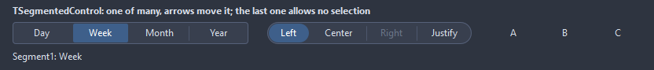
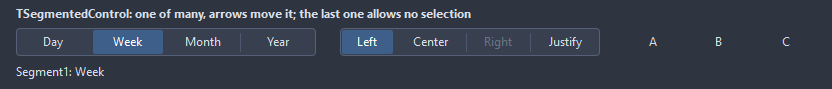
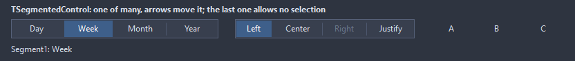
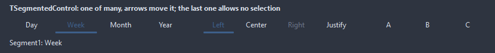
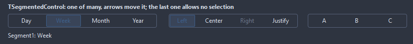
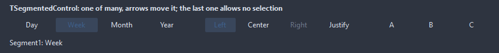

# TSegmentedControl

A row of segments with one selected, a radio group drawn as one bar. The arrow keys move the selection, Home and End jump to the ends.

- Palette page: Unleashed: Input
- Unit: `segmentedcontrol.pas`
- Ancestor: `TCustomControl`



## Usage

```pascal
procedure TForm1.FormCreate(Sender: TObject);
begin
  var view := TSegmentedControl.Create(Self);
  view.Parent := Self;
  view.Width := 240;
  view.Items.AddCaption('Day');
  view.Items.AddCaption('Week');
  view.Items.AddCaption('Month');
  view.ItemIndex := 1;
  view.Shape := ssPill;
  view.OnChange := @viewChange;
end;

procedure TForm1.viewChange(Sender: TObject; index: integer);
begin
  Caption := TSegmentedControl(Sender).Items[index].Caption;
end;
```

## Properties

| Property | Type | Default | Notes |
|---|---|---|---|
| `Items` | `TSegmentItems` |  | the entries |
| `ItemIndex` | `integer` | `0` |  |
| `Images` | `TCustomImageList` |  | the image list the pictures come from |
| `ImageWidth` | `integer` | `0` | the images at 96 dpi; 0 takes the size of the list |
| `Shape` | `TSegmentShape` | `ssRounded` | the bar: rounded corners, a pill, square corners, an underline under the choice, a frame only, flat with a tint under the choice |
| `CornerRadius` | `integer` | `4` | the rounding of the corners, in pixels |
| `Padding` | `integer` | `10` | inside each segment, around the content |
| `Spacing` | `integer` | `4` | between an image and its caption |
| `SeparatorWidth` | `integer` | `1` |  |
| `AllowNoSelection` | `boolean` | `false` | a click on the selected segment clears the selection |
| `ShowSeparators` | `boolean` | `true` |  |
| `Flat` | `boolean` | `false` | no bar behind the segments, only the selected one shows a face |
| `EqualWidths` | `boolean` | `true` | every segment as wide as the widest one; off, each fits its content |
| `SelectedColor` | `TColor` | `clDefault` | clDefault takes the colors of the theme |
| `SelectedTextColor` | `TColor` | `clDefault` | clDefault takes the color of the theme |
| `BarColor` | `TColor` | `clDefault` |  |
| `BorderColor` | `TColor` | `clDefault` | clDefault takes the color of the theme |
| `Antialiasing` | `TAntialiasSetting` | `asTheme` | the smoothing of the shapes: after the theme, or its own choice |

Also the standard properties of a control, re-published: `Align`, `Anchors`, `AutoSize`, `BorderSpacing`, `Color`, `Constraints`, `Enabled`, `Font`, `Hint`, `ParentColor`, `ParentFont`, `ParentShowHint`, `PopupMenu`, `ShowHint`, `TabOrder`, `TabStop`, `Visible`, `OnClick`, `OnContextPopup`, `OnEnter`, `OnExit`, `OnKeyDown`, `OnKeyPress`, `OnKeyUp`, `OnMouseDown`, `OnMouseEnter`, `OnMouseLeave`, `OnMouseMove`, `OnMouseUp`, `OnResize`.

## Events

| Event | Handler | Notes |
|---|---|---|
| `OnChange` | `procedure(Sender: TObject; index: integer)` | after the selection moved, by the user or by code |
| `OnSegmentClick` | `procedure(Sender: TObject; index: integer)` | a segment was clicked, selected already or not |
| `OnDrawSegment` | `TCustomDrawEvent` | paints over the stock segment: dsSelected for the chosen one, dsHover under the mouse; `handled` true leaves the caption and the icon out |

## Runtime

Available in code, not in the Object Inspector.

| Method | Notes |
|---|---|
| `SelectedItem: TSegmentItem` | the selected item, nil with nothing selected |
| `SegmentRect(index: integer): TRect` | the box of a segment, for a popup placed under it |

## Companion classes

### `TSegmentItem`

| Property | Type | Default | Notes |
|---|---|---|---|
| `Caption` | `string` |  | the text shown |
| `ImageIndex` | `TImageIndex` | `-1` | the picture in the image list, -1 for none |
| `Enabled` | `boolean` | `true` | disabled items are drawn gray and ignore the mouse |
| `Visible` | `boolean` | `true` | hidden items take no room |
| `Width` | `integer` | `0` | 0 shares the width with the other segments |
| `Hint` | `string` |  | the tooltip |
| `Tag` | `PtrInt` | `0` | free for the application |

| Method | Notes |
|---|---|
| `Selected: boolean` | the segment is the selected one |

### `TSegmentItems`

| Method | Notes |
|---|---|
| `Add: TSegmentItem` | a new entry at the end |
| `AddCaption(const caption: string; imageIndex: TImageIndex=-1): TSegmentItem` |  |

## Types

| Type | Values | Notes |
|---|---|---|
| `TSegmentShape` | `ssRounded`, `ssPill`, `ssSquare`, `ssUnderline`, `ssOutline`, `ssFlat` | the bar: rounded corners, a pill, square corners, an underline under the choice, a frame only, flat with a tint under the choice |

## Custom drawing

The component paints its parts by itself, through the shapes of `ControlPaint`. A handler on the event below takes over a part: it gets the canvas of the control, the rectangle of the part, which part it is and a `TDrawState` set telling what the part is in: `dsHover`, `dsActive`, `dsSelected`, `dsPressed`, `dsDisabled`, `dsFocused`, `dsChecked`.

- `OnDrawSegment`: paints over the stock segment: dsSelected for the chosen one, dsHover under the mouse; `handled` true leaves the caption and the icon out. Handler: `TCustomDrawEvent`.

A handler may paint with the plain canvas, or through `beginShapes()` from `ControlPaint` for the same smoothed shapes the components use: `paintRoundRect()`, `paintCircle()`, `paintCheck()`, `FillPolygon()` and the rest, then `Flush` once. Colors of the theme come from `pick()`, `blend()` and `contrastText()`.

## In pictures

### Every Shape

The demo group with each value of `Shape` in turn.

`Shape = ssRounded`



`Shape = ssPill`


`Shape = ssSquare`



`Shape = ssUnderline`



`Shape = ssOutline`



`Shape = ssFlat`


