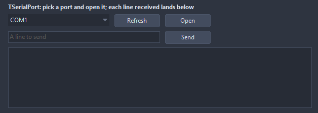

# TSerialPort

A serial port, read in the background: OnData gets every chunk, OnLine every whole line. The same calls and events on every system; only the port names differ, COM3 on Windows and /dev/ttyUSB0 on Linux, and AvailablePorts lists the ones there are. Works on Windows, Linux, Android, NetBSD and OpenBSD, where FPC has its Serial unit; on macOS and FreeBSD Open fails with OnError saying not supported and AvailablePorts is empty.

- Palette page: Unleashed: System
- Unit: `serialport.pas`
- Ancestor: `TComponent`



## Usage

```pascal
procedure TForm1.FormCreate(Sender: TObject);
begin
  var port := TSerialPort.Create(Self);
  port.Port := 'COM3'; // /dev/ttyUSB0 on Linux; AvailablePorts lists them
  port.BaudRate := 115200;
  port.LineEnding := sleCRLF;
  port.OnLine := @portLine;
  port.OnError := @portError;
  if port.Open then port.WriteLine('AT');
end;

procedure TForm1.portLine(Sender: TObject; const line: string);
begin
  Caption := line; // each line received, on the main thread
end;

procedure TForm1.portError(Sender: TObject; const message: string);
begin
  Caption := message;
end;
```

## Platforms

The port is driven by the `Serial` unit of FPC, which FPC builds for Windows, Linux, Android, NetBSD and OpenBSD only. There the component works as described.

On every other system, macOS and FreeBSD among them, the component still compiles and sits on the palette, so a form with a `TSerialPort` opens everywhere, but it has no port behind it: `Open` returns false and fires `OnError` with "Serial ports are not supported on this system", `AvailablePorts` returns an empty list, `IsOpen` stays false. Compiling the package there prints a warning saying the same.

## Properties

| Property | Type | Default | Notes |
|---|---|---|---|
| `Port` | `string` |  | COM3 or \\.\COM12 on Windows, /dev/ttyUSB0 or /dev/ttyS0 on Linux |
| `BaudRate` | `integer` | `9600` |  |
| `DataBits` | `integer` | `8` |  |
| `Parity` | `TSerialParity` | `spNone` |  |
| `StopBits` | `integer` | `1` | 1 or 2 |
| `FlowControl` | `TSerialFlowControl` | `sfNone` |  |
| `LineEnding` | `TSerialLineEnding` | `sleLF` | what ends a line for OnLine and WriteLine |
| `Active` | `boolean` | `false` | the port opens as the form loads, and opens or closes on a change |
| `DTR` | `boolean` | `true` | the output lines of the port while it is open |
| `RTS` | `boolean` | `true` |  |

## Events

| Event | Handler | Notes |
|---|---|---|
| `OnData` | `procedure(Sender: TObject; const data: RawByteString)` | every chunk read; without a handler the bytes wait for ReadAvailable |
| `OnLine` | `procedure(Sender: TObject; const line: string)` | every whole line read, without its end |
| `OnError` | `procedure(Sender: TObject; const message: string)` | something failed; the message says what |
| `OnOpen` | `procedure(Sender: TObject)` |  |
| `OnClose` | `procedure(Sender: TObject)` | before it closes |

## Runtime

Available in code, not in the Object Inspector.

| Property | Type | Notes |
|---|---|---|
| `IsOpen` | `boolean` | it is open |
| `BytesReceived` | `Int64` |  |
| `BytesSent` | `Int64` |  |
| `CTS` | `boolean` | the input lines of the port |
| `DSR` | `boolean` |  |
| `CD` | `boolean` |  |
| `RI` | `boolean` |  |

| Method | Notes |
|---|---|
| `AvailablePorts(list: TStrings)` | the ports this system has |
| `Open: boolean` | opens the port with the settings; false and OnError when it fails |
| `Close` | closes it |
| `Write(const data: RawByteString): integer` | the bytes written |
| `WriteLine(const text: string): integer` | the text and LineEnding |
| `ReadAvailable: RawByteString` | the bytes received and not taken by OnData |

## Types

| Type | Values | Notes |
|---|---|---|
| `TSerialParity` | `spNone`, `spOdd`, `spEven` |  |
| `TSerialFlowControl` | `sfNone`, `sfRtsCts` |  |
| `TSerialLineEnding` | `sleLF`, `sleCR`, `sleCRLF` |  |
