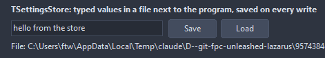

# TSettingsStore

The settings of the application in a text file: typed reads with a default, writes that save on their own, defaults from the designer, the bounds of a form kept across runs. The file lands in the configuration folder of the user unless told otherwise, so it works the same on every system.

- Palette page: Unleashed: System
- Unit: `settingsstore.pas`
- Ancestor: `TComponent`



## Usage

```pascal
procedure TForm1.FormCreate(Sender: TObject);
begin
  var settings := TSettingsStore.Create(Self);
  settings.Name := 'settings';
  settings.FileName := 'editor.ini';
  settings.Location := slUserConfig; // the per-user config folder
  settings.RestoreForm(Self);
  Font.Size := settings.ReadInteger('fontsize', 10, 'editor');
end;

procedure TForm1.FormDestroy(Sender: TObject);
begin
  var settings := TSettingsStore(FindComponent('settings'));
  settings.WriteInteger('fontsize', Font.Size, 'editor');
  settings.SaveForm(Self); // AutoSave writes the file as the store is freed
end;
```

## Properties

| Property | Type | Default | Notes |
|---|---|---|---|
| `FileName` | `string` |  | relative to the location; empty takes the name of the program plus .ini |
| `Location` | `TSettingsLocation` | `slUserConfig` |  |
| `Section` | `string` |  | the section reads and writes go to when they name none |
| `AutoLoad` | `boolean` | `true` | read the file the first time a value is needed |
| `AutoSave` | `boolean` | `true` | write the file after every change |
| `Defaults` | `TStrings` |  | values for keys the file does not have, as key=value or section/key=value |

## Events

| Event | Handler | Notes |
|---|---|---|
| `OnLoad` | `procedure(Sender: TObject)` |  |
| `OnSave` | `procedure(Sender: TObject)` |  |
| `OnChange` | `procedure(Sender: TObject; const section, key: string)` | after the value changed |

## Runtime

Available in code, not in the Object Inspector.

| Property | Type | Notes |
|---|---|---|
| `Dirty` | `boolean` | unsaved writes wait in memory |

| Method | Notes |
|---|---|
| `Path: string` | the path of the file as the location and the file name make it |
| `Load` | reads the file |
| `Save` | writes the file |
| `Clear` | drops every value, the file too |
| `ValueExists(const key: string; const section: string = ''): boolean` |  |
| `DeleteValue(const key: string; const section: string = '')` |  |
| `DeleteSection(const section: string)` |  |
| `ReadKeys(keys: TStrings; const section: string = '')` | the keys of a section, the sections of the file |
| `ReadSections(sections: TStrings)` |  |
| `ReadString(const key: string; const fallback: string = ''; const section: string = ''): string` |  |
| `ReadInteger(const key: string; fallback: integer = 0; const section: string = ''): integer` |  |
| `ReadInt64(const key: string; fallback: int64 = 0; const section: string = ''): int64` |  |
| `ReadBool(const key: string; fallback: boolean = false; const section: string = ''): boolean` |  |
| `ReadFloat(const key: string; fallback: double = 0; const section: string = ''): double` |  |
| `ReadColor(const key: string; fallback: TColor = clBlack; const section: string = ''): TColor` |  |
| `ReadDateTime(const key: string; fallback: TDateTime = 0; const section: string = ''): TDateTime` |  |
| `ReadStrings(const key: string; lines: TStrings; const section: string = '')` | lines kept as one value, newlines escaped |
| `WriteString(const key, value: string; const section: string = '')` |  |
| `WriteInteger(const key: string; value: integer; const section: string = '')` |  |
| `WriteInt64(const key: string; value: int64; const section: string = '')` |  |
| `WriteBool(const key: string; value: boolean; const section: string = '')` |  |
| `WriteFloat(const key: string; value: double; const section: string = '')` |  |
| `WriteColor(const key: string; value: TColor; const section: string = '')` |  |
| `WriteDateTime(const key: string; value: TDateTime; const section: string = '')` |  |
| `WriteStrings(const key: string; lines: TStrings; const section: string = '')` |  |
| `SaveForm(form: TCustomForm; const section: string = '')` | the bounds and the state of a form under a section named after it |
| `RestoreForm(form: TCustomForm; const section: string = '')` |  |

## Types

| Type | Values | Notes |
|---|---|---|
| `TSettingsLocation` | `slUserConfig`, `slAppDirectory`, `slCustom` |  |
