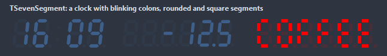
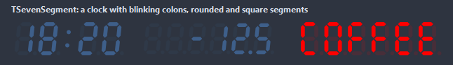
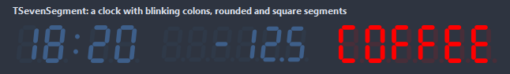
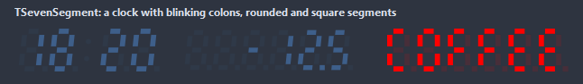
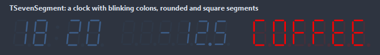

# TSevenSegment

A seven segment display: digits, the hex letters and the letters the segments can form, a decimal point after any digit and colons between them. The digits scale with the control.

- Palette page: Unleashed: Display
- Unit: `sevensegment.pas`
- Ancestor: `TGraphicControl`



## Usage

```pascal
procedure TForm1.FormCreate(Sender: TObject);
begin
  var readout := TSevenSegment.Create(Self);
  readout.Parent := Self;
  readout.SetBounds(8, 8, 220, 60);
  readout.DigitCount := 6;
  readout.Text := '12:34:56';
  readout.BlinkColons := true;
  readout.SegmentStyle := ssRounded;
end;
```

## Properties

| Property | Type | Default | Notes |
|---|---|---|---|
| `Text` | `string` |  | digits, letters, `-`, `_`, `=`, quotes and brackets; a `.` or `,` lights the point of the digit before it, a `:` puts a colon between digits |
| `DigitCount` | `integer` | `0` | the digit cells at least, the text aligned in them; 0 fits the text |
| `Thickness` | `integer` | `12` | the width of a segment in percent of the digit height |
| `Gap` | `integer` | `1` | the pixels between two segments |
| `Slant` | `integer` | `6` | the lean of the digits in degrees |
| `Spacing` | `integer` | `30` | the room between two digits in percent of the digit width |
| `Padding` | `integer` | `4` | the space between the border and the content |
| `Alignment` | `TAlignment` | `taRightJustify` | where the text sits |
| `SegmentStyle` | `TSegmentStyle` | `ssBeveled` | the segments: beveled ends, round ends, square ends, rows of dots, slim bars |
| `ShowInactive` | `boolean` | `true` | the unlit segments show faintly, as on a real display |
| `BlinkColons` | `boolean` | `false` | the colons blink once a second |
| `ColorOn` | `TColor` | `clDefault` | clDefault takes the colors of the theme |
| `ColorOff` | `TColor` | `clDefault` | the color while off |
| `Antialiasing` | `TAntialiasSetting` | `asTheme` | asTheme follows the theme setting, asOn and asOff force it |

Also the standard properties of a control, re-published: `Align`, `Anchors`, `BorderSpacing`, `Color`, `Constraints`, `Enabled`, `Hint`, `ParentColor`, `ParentShowHint`, `PopupMenu`, `ShowHint`, `Visible`, `OnClick`, `OnContextPopup`, `OnDblClick`, `OnMouseDown`, `OnMouseEnter`, `OnMouseLeave`, `OnMouseMove`, `OnMouseUp`, `OnResize`.

## Events

| Event | Handler | Notes |
|---|---|---|
| `OnGetSegments` | `procedure(Sender: TObject; ch: char; var segments: byte)` | the segments of each character, to change them or form new ones |

## Runtime

Available in code, not in the Object Inspector.

| Method | Notes |
|---|---|
| `SegmentsOf(ch: char): byte` | the segments the display lights for a character, before OnGetSegments |

## Types

| Type | Values | Notes |
|---|---|---|
| `TSegmentStyle` | `ssBeveled`, `ssRounded`, `ssSquare`, `ssDots`, `ssThin` | the segments: beveled ends, round ends, square ends, rows of dots, slim bars |

## In pictures

### Every SegmentStyle

The demo group with each value of `SegmentStyle` in turn.

`SegmentStyle = ssBeveled`



`SegmentStyle = ssRounded`



`SegmentStyle = ssSquare`



`SegmentStyle = ssDots`


`SegmentStyle = ssThin`


