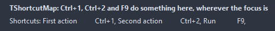

# TShortcutMap

The keyboard shortcuts of a form or the application in one list: a name, a caption and a key per item, a handler each or one for all. The map sees the keys before the focused control, so a shortcut works wherever the focus is. Save and Load keep the keys the user changed.

- Palette page: Unleashed: System
- Unit: `shortcutmap.pas`
- Ancestor: `TComponent`



## Usage

```pascal
procedure TForm1.FormCreate(Sender: TObject);
begin
  var keys := TShortcutMap.Create(Self);
  keys.Add('save', 'Save', ShortCut(VK_S, [ssCtrl]), @saveClick);
  keys.Add('build', 'Build', VK_F9, @buildClick);
  keys.Scope := ssOwnerForm; // wherever the focus is on this form
  keys.OnUnhandled := @keysUnhandled;
end;

procedure TForm1.saveClick(Sender: TObject);
begin
  Caption := 'saved';
end;

procedure TForm1.buildClick(Sender: TObject);
begin
  Caption := 'building';
end;

procedure TForm1.keysUnhandled(Sender: TObject; shortcut: TShortCut; var handled: boolean);
begin
  Caption := 'no command for ' + ShortCutToText(shortcut);
end;
```

## Properties

| Property | Type | Default | Notes |
|---|---|---|---|
| `Items` | `TShortcutItems` |  | the entries |
| `Enabled` | `boolean` | `true` | disabled items are drawn gray and ignore the mouse |
| `Scope` | `TShortcutScope` | `ssOwnerForm` | the form that owns the map, or every form of the application |

## Events

| Event | Handler | Notes |
|---|---|---|
| `OnExecute` | `procedure(Sender: TObject; item: TShortcutItem)` | every item, after its own handler |
| `OnUnhandled` | `procedure(Sender: TObject; shortcut: TShortCut; var handled: boolean)` | a key with no shortcut of its own; handled true swallows it |

## Runtime

Available in code, not in the Object Inspector.

| Method | Notes |
|---|---|
| `Find(const name: string): TShortcutItem` |  |
| `FindShortcut(shortcut: TShortCut): TShortcutItem` | the item with that key, nil for none |
| `Execute(const name: string): boolean` | runs the item by name; false when there is none |
| `Handle(shortcut: TShortCut): boolean` | runs the item for the key; false when none matches |
| `Add(const name, caption: string; shortcut: TShortCut; handler: TNotifyEvent = nil): TShortcutItem` | a new entry at the end |
| `SaveToStrings(lines: TStrings)` | the keys as name=shortcut lines, to keep in a settings file |
| `LoadFromStrings(lines: TStrings)` | loads the content from lines of text |
| `Describe(lines: TStrings)` | caption, tab, shortcut per line, grouped by category, for a help page |
| `FindConflicts(lines: TStrings)` | the items whose keys collide, as pairs of names |

## Companion classes

### `TShortcutItem`

| Property | Type | Default | Notes |
|---|---|---|---|
| `Name` | `string` |  | the key the item goes by in Find and Execute |
| `Caption` | `string` |  | the text for a menu or a help page |
| `Category` | `string` |  |  |
| `Shortcut` | `TShortCut` | `0` |  |
| `Secondary` | `TShortCut` | `0` | a second key for the same thing |
| `Enabled` | `boolean` | `true` | disabled items are drawn gray and ignore the mouse |
| `Tag` | `PtrInt` | `0` | free for the application |

| Event | Handler | Notes |
|---|---|---|
| `OnExecute` | `procedure(Sender: TObject)` |  |

| Method | Notes |
|---|---|
| `ShortcutText: string` | the shortcut as text, like Ctrl+S |
| `Matches(shortcut: TShortCut): boolean` |  |

### `TShortcutItems`

| Method | Notes |
|---|---|
| `Add: TShortcutItem` | a new entry at the end |
| `ByName(const name: string): TShortcutItem` |  |

## Types

| Type | Values | Notes |
|---|---|---|
| `TShortcutScope` | `ssOwnerForm`, `ssApplication` |  |
