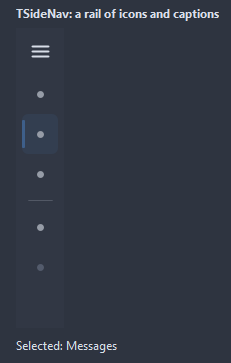
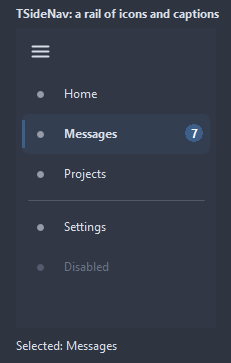
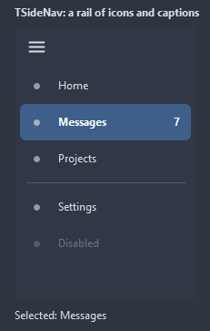
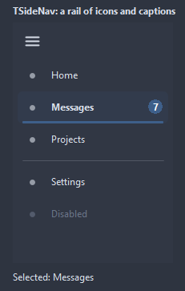
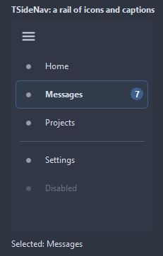

# TSideNav

A column of entries for the sections of a window, with an icon and a caption each. Collapsed, it narrows to the icons; the toggle at the top switches between the two widths.

- Palette page: Unleashed: Navigation
- Unit: `sidenav.pas`
- Ancestor: `TCustomControl`


## Usage

```pascal
procedure TForm1.FormCreate(Sender: TObject);
begin
  var nav := TSideNav.Create(Self);
  nav.Parent := Self;
  nav.Align := alLeft;
  nav.Items.AddItem('Home');
  nav.Items.AddItem('Projects');
  nav.Items.AddItem('Messages').Badge := '3';
  nav.Items.AddSeparator;
  nav.Items.AddItem('Settings');
  nav.ItemIndex := 0;
  nav.OnChange := @navChange;
end;

procedure TForm1.navChange(Sender: TObject);
begin
  Caption := TSideNav(Sender).SelectedItem.Caption;
end;
```

## Properties

| Property | Type | Default | Notes |
|---|---|---|---|
| `Items` | `TSideNavItems` |  | the entries |
| `Images` | `TCustomImageList` |  | the image list the pictures come from |
| `ItemIndex` | `integer` | `-1` |  |
| `Collapsed` | `boolean` | `false` | the icons alone, at CollapsedWidth |
| `ShowToggle` | `boolean` | `true` | the button at the top that folds the column |
| `Animated` | `boolean` | `true` | changes are animated |
| `ItemHeight` | `integer` | `40` |  |
| `CollapsedWidth` | `integer` | `48` |  |
| `ExpandedWidth` | `integer` | `200` |  |
| `Padding` | `integer` | `6` | the space between the border and the content |
| `CornerRadius` | `integer` | `6` | the rounding of the corners, in pixels |
| `HeaderHeight` | `integer` | `0` | the room above the entries; 0 shows only the toggle |
| `AnimationTime` | `integer` | `150` | milliseconds of the animation |
| `Selection` | `TSideNavSelection` | `nsBar` | nsBar: a strip of the accent beside the selected entry; nsPill: a filled pill |
| `BackColor` | `TColor` | `clDefault` | clDefault takes the colors of the theme |
| `TextColor` | `TColor` | `clDefault` | clDefault takes the color of the theme |
| `SelectedColor` | `TColor` | `clDefault` | clDefault takes the color of the theme |
| `SelectedTextColor` | `TColor` | `clDefault` | clDefault takes the color of the theme |
| `BadgeColor` | `TColor` | `clDefault` |  |
| `Antialiasing` | `TAntialiasSetting` | `asTheme` | asTheme follows the theme setting, asOn and asOff force it |

Also the standard properties of a control, re-published: `Align`, `Anchors`, `BorderSpacing`, `Color`, `Constraints`, `Enabled`, `Font`, `Hint`, `ParentColor`, `ParentFont`, `ParentShowHint`, `PopupMenu`, `ShowHint`, `TabOrder`, `TabStop`, `Visible`, `OnClick`, `OnContextPopup`, `OnDblClick`, `OnEnter`, `OnExit`, `OnKeyDown`, `OnKeyPress`, `OnKeyUp`, `OnMouseDown`, `OnMouseEnter`, `OnMouseLeave`, `OnMouseMove`, `OnMouseUp`, `OnResize`.

## Events

| Event | Handler | Notes |
|---|---|---|
| `OnDrawItem` | `TCustomDrawEvent` | paints over the stock entry: dsSelected for the chosen one, dsHover under the mouse; `handled` true leaves the icon, the caption and the badge out |
| `OnChange` | `procedure(Sender: TObject)` | after the value changed |
| `OnItemClick` | `procedure(Sender: TObject; item: TSideNavItem)` | a click on an entry |
| `OnToggle` | `procedure(Sender: TObject)` | it was expanded or collapsed |

## Runtime

Available in code, not in the Object Inspector.

| Method | Notes |
|---|---|
| `Toggle` | flips the state |
| `SelectedItem: TSideNavItem` |  |

## Companion classes

### `TSideNavItem`

| Property | Type | Default | Notes |
|---|---|---|---|
| `Caption` | `string` |  | the text shown |
| `Hint` | `string` |  | the tooltip |
| `ImageIndex` | `TImageIndex` | `-1` | the picture in the image list, -1 for none |
| `Tag` | `PtrInt` | `0` | free for the application |
| `Enabled` | `boolean` | `true` | disabled items are drawn gray and ignore the mouse |
| `Visible` | `boolean` | `true` | hidden items take no room |
| `Separator` | `boolean` | `false` | a gap with a line instead of an entry |
| `Badge` | `string` |  | a short mark at the right end, a count for example |

### `TSideNavItems`

| Method | Notes |
|---|---|
| `Add: TSideNavItem` | a new entry at the end |
| `AddItem(const caption: string; imageIndex: TImageIndex = -1): TSideNavItem` | a new entry with these values |
| `AddSeparator: TSideNavItem` | a separator entry |

## Types

| Type | Values | Notes |
|---|---|---|
| `TSideNavSelection` | `nsBar`, `nsPill`, `nsFill`, `nsUnderline`, `nsOutline` | how the chosen entry shows: a tinted row with a bar at its left, a filled pill, the full row filled, a bar under the caption, a frame |

## Custom drawing

The component paints its parts by itself, through the shapes of `ControlPaint`. A handler on the event below takes over a part: it gets the canvas of the control, the rectangle of the part, which part it is and a `TDrawState` set telling what the part is in: `dsHover`, `dsActive`, `dsSelected`, `dsPressed`, `dsDisabled`, `dsFocused`, `dsChecked`.

- `OnDrawItem`: paints over the stock entry: dsSelected for the chosen one, dsHover under the mouse; `handled` true leaves the icon, the caption and the badge out. Handler: `TCustomDrawEvent`.

A handler may paint with the plain canvas, or through `beginShapes()` from `ControlPaint` for the same smoothed shapes the components use: `paintRoundRect()`, `paintCircle()`, `paintCheck()`, `FillPolygon()` and the rest, then `Flush` once. Colors of the theme come from `pick()`, `blend()` and `contrastText()`.

## In pictures

**Collapsed: icons only.**



### Every Selection

The demo group with each value of `Selection` in turn.

`Selection = nsBar`



`Selection = nsPill`



`Selection = nsFill`


`Selection = nsUnderline`



`Selection = nsOutline`


