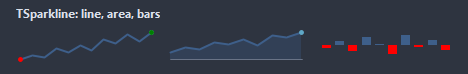
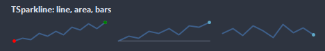
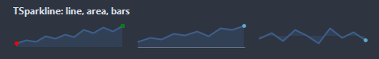
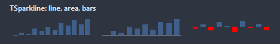
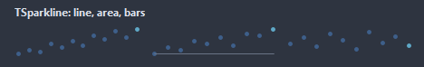
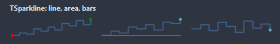
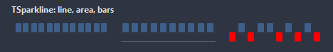
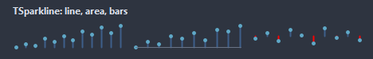

# TSparkline

A tiny chart without axes: a line, a filled area or bars over the last MaxPoints values. New values push the oldest out.

- Palette page: Unleashed: Display
- Unit: `sparkline.pas`
- Ancestor: `TGraphicControl`



## Usage

```pascal
procedure TForm1.FormCreate(Sender: TObject);
begin
  var trend := TSparkline.Create(Self);
  trend.Parent := Self;
  trend.SetBounds(8, 8, 160, 40);
  trend.Style := ssArea;
  trend.ShowLastDot := true;
  trend.SetValues([3, 5, 4, 8, 6, 9, 7, 12]);
  trend.AddValue(10); // the oldest value drops once MaxPoints is reached
end;
```

## Properties

| Property | Type | Default | Notes |
|---|---|---|---|
| `Style` | `TSparklineStyle` | `ssLine` | the drawing: a line, a filled area, bars from the baseline, dots alone, a stepped line, fixed bars up or down from the baseline, stems with a dot |
| `MaxPoints` | `integer` | `50` | values kept; 0 keeps every one |
| `LineWidth` | `integer` | `2` | the width of the line, in pixels |
| `DotSize` | `integer` | `4` | the diameter of a dot, in pixels |
| `Padding` | `integer` | `2` | the space between the border and the content |
| `MinValue` | `double` |  | the range of the drawing; with AutoRange the values set it |
| `MaxValue` | `double` |  | the upper limit |
| `Baseline` | `double` |  | the value the area fills from and the baseline sits at |
| `AutoRange` | `boolean` | `true` | the range follows the data |
| `ShowDots` | `boolean` | `false` | dots are shown |
| `ShowLastDot` | `boolean` | `true` |  |
| `ShowBaseline` | `boolean` | `false` |  |
| `ShowMinMax` | `boolean` | `false` | the lowest and the highest value marked |
| `LineColor` | `TColor` | `clDefault` | clDefault takes the colors of the theme |
| `FillColor` | `TColor` | `clDefault` | clDefault takes the color of the theme |
| `DotColor` | `TColor` | `clDefault` | clDefault takes the color of the theme |
| `BaselineColor` | `TColor` | `clDefault` |  |
| `MinColor` | `TColor` | `clDefault` |  |
| `MaxColor` | `TColor` | `clDefault` |  |
| `Antialiasing` | `TAntialiasSetting` | `asTheme` | asTheme follows the theme setting, asOn and asOff force it |
| `HoverMarker` | `boolean` | `true` | a line and a dot on the value under the mouse |
| `ValueFormat` | `string` |  | a Format pattern for the hint, like '%.1f ms'; empty shows the plain number |

Also the standard properties of a control, re-published: `Align`, `Anchors`, `BorderSpacing`, `Color`, `Constraints`, `Enabled`, `Hint`, `ParentColor`, `ParentShowHint`, `PopupMenu`, `ShowHint`, `Visible`, `OnClick`, `OnContextPopup`, `OnDblClick`, `OnMouseDown`, `OnMouseEnter`, `OnMouseLeave`, `OnMouseMove`, `OnMouseUp`, `OnResize`.

## Events

| Event | Handler | Notes |
|---|---|---|
| `OnHover` | `procedure(Sender: TObject; index: integer; value: double)` | the value under the mouse, index -1 when the mouse left the values |

## Runtime

Available in code, not in the Object Inspector.

| Property | Type | Notes |
|---|---|---|
| `Values` | `TSparklineValues` |  |

| Method | Notes |
|---|---|
| `AddValue(value: double)` | appends a value; past MaxPoints the oldest goes |
| `SetValues(const values: array of double)` |  |
| `Clear` | removes everything |
| `Count: integer` | the number of entries |
| `LastValue: double` |  |
| `IndexAt(x: integer): integer` | the value nearest to a point of the control, -1 without values |
| `ValueText(index: integer): string` | the value as the hint shows it |
| `HotIndex: integer` | the value under the mouse, -1 for none |

## Types

| Type | Values | Notes |
|---|---|---|
| `TSparklineStyle` | `ssLine`, `ssArea`, `ssBars`, `ssDots`, `ssStep`, `ssWinLoss`, `ssStem` | the drawing: a line, a filled area, bars from the baseline, dots alone, a stepped line, fixed bars up or down from the baseline, stems with a dot |

## In pictures

### Every Style

The demo group with each value of `Style` in turn.

`Style = ssLine`



`Style = ssArea`



`Style = ssBars`



`Style = ssDots`



`Style = ssStep`



`Style = ssWinLoss`



`Style = ssStem`


