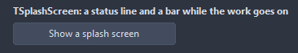
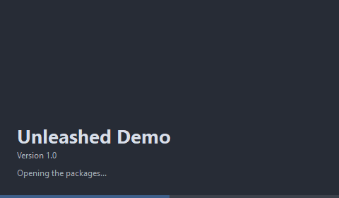

# TSplashScreen

A borderless window in the middle of the screen while the application starts: a picture, the name, a version line, a status line and a bar. AutoShow opens it as the form holding it loads and closes it once the application is idle and MinDisplayTime passed; Show and Close do it by hand.

- Palette page: Unleashed: Feedback
- Unit: `splashscreen.pas`
- Ancestor: `TComponent`



## Usage

```pascal
procedure TForm1.FormCreate(Sender: TObject);
begin
  var splash := TSplashScreen.Create(Self);
  splash.Title := 'Unleashed Editor';
  splash.Subtitle := 'version 2.1';
  splash.MinDisplayTime := 1500;
  splash.Show;
  splash.Status := 'Loading plugins';
  splash.Progress := 50;
  splash.CloseWhenReady; // closes once MinDisplayTime has passed
end;
```

## Properties

| Property | Type | Default | Notes |
|---|---|---|---|
| `Picture` | `TPicture` |  | fills the window behind the texts, cut to fill it |
| `Title` | `string` |  | the heading |
| `Subtitle` | `string` |  |  |
| `Status` | `string` |  | the line at the bottom; a change paints at once, also in busy code |
| `ShowProgress` | `boolean` | `true` | the progress bar is shown |
| `Progress` | `integer` | `-1` | 0 to 100; below 0 the bar runs without an end |
| `AutoShow` | `boolean` | `false` |  |
| `FadeOut` | `boolean` | `true` |  |
| `StayOnTop` | `boolean` | `true` |  |
| `Width` | `integer` | `480` | the width in pixels |
| `Height` | `integer` | `280` |  |
| `CornerRadius` | `integer` | `10` | the rounding of the corners, in pixels |
| `MinDisplayTime` | `integer` | `1200` | the window stays at least this many milliseconds |
| `BackColor` | `TColor` | `clDefault` | clDefault takes the colors of the theme |
| `TextColor` | `TColor` | `clDefault` | clDefault takes the color of the theme |
| `AccentColor` | `TColor` | `clDefault` | clDefault takes the accent of the theme |
| `Antialiasing` | `TAntialiasSetting` | `asTheme` | asTheme follows the theme setting, asOn and asOff force it |

## Events

| Event | Handler | Notes |
|---|---|---|
| `OnClose` | `procedure(Sender: TObject)` | before it closes |

## Runtime

Available in code, not in the Object Inspector.

| Method | Notes |
|---|---|
| `Show` | shows it |
| `Close` | closes now, with the fade when FadeOut is on |
| `CloseWhenReady` | closes once the application is idle and MinDisplayTime passed |
| `Showing: boolean` |  |

## In pictures

**The splash: title, subtitle, status line and the progress bar.**


