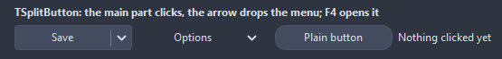

# TSplitButton

A push button with a menu arrow at its end. The main part clicks, the arrow drops DropDownMenu under the button; F4 and Alt+Down drop it from the keyboard.

- Palette page: Unleashed: Input
- Unit: `splitbutton.pas`
- Ancestor: `TCustomControl`



## Usage

```pascal
procedure TForm1.FormCreate(Sender: TObject);
begin
  var menu := TPopupMenu.Create(Self);
  menu.Items.Add(NewItem('Save as...', 0, false, true, @saveAsClick, 0, 'miSaveAs'));
  var save := TSplitButton.Create(Self);
  save.Parent := Self;
  save.Caption := 'Save';
  save.DropDownMenu := menu;
  save.OnClick := @saveClick;
end;

procedure TForm1.saveClick(Sender: TObject);
begin
  Caption := 'saved';
end;

procedure TForm1.saveAsClick(Sender: TObject);
begin
  Caption := 'save as';
end;
```

## Properties

| Property | Type | Default | Notes |
|---|---|---|---|
| `DropDownMenu` | `TPopupMenu` |  |  |
| `Images` | `TCustomImageList` |  | the image list the pictures come from |
| `ImageIndex` | `TImageIndex` | `-1` | the picture in the image list, -1 for none |
| `ImageWidth` | `integer` | `0` | the image at 96 dpi; 0 takes the size of the list |
| `Layout` | `TButtonLayout` | `blGlyphLeft` | the arrangement |
| `Spacing` | `integer` | `4` | between the image and the caption |
| `Margin` | `integer` | `-1` | from the edge to the content; -1 centers it |
| `ArrowWidth` | `integer` | `0` | the arrow part; 0 takes it from the font |
| `CornerRadius` | `integer` | `4` | the rounding of the corners, in pixels |
| `ArrowPadding` | `integer` | `8` | on both sides of the arrow when ArrowWidth is 0 |
| `ShowArrow` | `boolean` | `true` |  |
| `Flat` | `boolean` | `false` | no face until the mouse is over it |
| `SplitMode` | `TSplitMode` | `smSplit` | smSplit: the main part fires OnClick, the arrow opens the menu; smMenu: the whole button opens the menu |
| `ModalResult` | `TModalResult` | `mrNone` |  |
| `ButtonColor` | `TColor` | `clDefault` | clDefault takes the colors of the theme |
| `TextColor` | `TColor` | `clDefault` | clDefault takes the color of the theme |
| `Antialiasing` | `TAntialiasSetting` | `asTheme` | the smoothing of the shapes: after the theme, or its own choice |

Also the standard properties of a control, re-published: `Caption`, `Align`, `Anchors`, `AutoSize`, `BorderSpacing`, `Color`, `Constraints`, `Cursor`, `Enabled`, `Font`, `Hint`, `ParentColor`, `ParentFont`, `ParentShowHint`, `PopupMenu`, `ShowHint`, `TabOrder`, `TabStop`, `Visible`, `OnClick`, `OnContextPopup`, `OnEnter`, `OnExit`, `OnKeyDown`, `OnKeyPress`, `OnKeyUp`, `OnMouseDown`, `OnMouseEnter`, `OnMouseLeave`, `OnMouseMove`, `OnMouseUp`, `OnResize`.

## Events

| Event | Handler | Notes |
|---|---|---|
| `OnDropDown` | `procedure(Sender: TObject; var handled: boolean)` | before the menu drops; handled = true shows nothing |
| `OnMenuClose` | `procedure(Sender: TObject)` |  |

## Runtime

Available in code, not in the Object Inspector.

| Property | Type | Notes |
|---|---|---|
| `MenuOpen` | `boolean` | the menu is on screen |

| Method | Notes |
|---|---|
| `Click` | fires OnClick and closes a modal form with ModalResult |
| `DropDown` | opens the menu under the button |

## Types

| Type | Values | Notes |
|---|---|---|
| `TSplitMode` | `smSplit`, `smMenu` | smSplit: the main part fires OnClick, the arrow opens the menu; smMenu: the whole button opens the menu |
