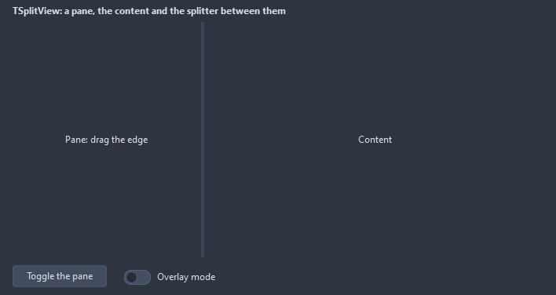

# TSplitView

A host for a side pane and the content beside it: drop two containers on it and name one as the PaneControl, the other one fills the rest. The pane opens and closes with a slide and its edge can be dragged.

- Palette page: Unleashed: Layout
- Unit: `splitview.pas`
- Ancestor: `TCustomControl`



## Usage

```pascal
procedure TForm1.FormCreate(Sender: TObject);
begin
  var split := TSplitView.Create(Self);
  split.Parent := Self;
  split.Align := alClient;
  var side := TListBox.Create(Self);
  side.Parent := split;
  var content := TMemo.Create(Self);
  content.Parent := split;
  split.PaneControl := side;
  split.ContentControl := content;
  split.PaneWidth := 200;
  split.DisplayMode := dmInline; // dmOverlay slides the pane over the content
end;
```

## Properties

| Property | Type | Default | Notes |
|---|---|---|---|
| `PaneControl` | `TControl` |  | the child that is the pane; every other child fills the content area |
| `ContentControl` | `TControl` |  | set, only this child takes the content area |
| `PaneSide` | `TPaneSide` | `psLeft` |  |
| `DisplayMode` | `TPaneDisplayMode` | `dmInline` | dmInline: the pane pushes the content aside; dmOverlay: it slides over it |
| `PaneOpen` | `boolean` | `true` |  |
| `Animated` | `boolean` | `true` | changes are animated |
| `Resizable` | `boolean` | `true` | the edge of the pane can be dragged |
| `PaneWidth` | `integer` | `240` |  |
| `MinPaneWidth` | `integer` | `120` |  |
| `MaxPaneWidth` | `integer` | `0` | 0 for no limit |
| `CompactWidth` | `integer` | `0` | the strip of the pane that stays while it is closed; 0 hides it fully |
| `SplitterWidth` | `integer` | `4` | the width of the splitter, in pixels |
| `AnimationTime` | `integer` | `200` | milliseconds of the animation |
| `SplitterColor` | `TColor` | `clDefault` | clDefault takes the color of the theme |

Also the standard properties of a control, re-published: `Align`, `Anchors`, `BorderSpacing`, `ClientHeight`, `ClientWidth`, `Color`, `Constraints`, `Enabled`, `Font`, `Hint`, `ParentColor`, `ParentFont`, `ParentShowHint`, `PopupMenu`, `ShowHint`, `TabOrder`, `TabStop`, `Visible`, `OnClick`, `OnContextPopup`, `OnDblClick`, `OnMouseDown`, `OnMouseEnter`, `OnMouseLeave`, `OnMouseMove`, `OnMouseUp`, `OnResize`.

## Events

| Event | Handler | Notes |
|---|---|---|
| `OnPaneOpened` | `procedure(Sender: TObject)` |  |
| `OnPaneClosed` | `procedure(Sender: TObject)` |  |
| `OnPaneResized` | `procedure(Sender: TObject)` |  |

## Runtime

Available in code, not in the Object Inspector.

| Method | Notes |
|---|---|
| `TogglePane` |  |

## Types

| Type | Values | Notes |
|---|---|---|
| `TPaneSide` | `psLeft`, `psRight` |  |
| `TPaneDisplayMode` | `dmInline`, `dmOverlay` | dmInline: the pane pushes the content aside; dmOverlay: it slides over it |
