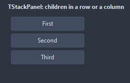

# TStackPanel

Lays its children out one after the other, in the order of their position along the stack, with Spacing between them and Padding around. Align and Anchors of the children do not apply.

- Palette page: Unleashed: Layout
- Unit: `stackpanel.pas`
- Ancestor: `TCustomControl`



## Usage

```pascal
procedure TForm1.FormCreate(Sender: TObject);
begin
  var bar := TStackPanel.Create(Self);
  bar.Parent := Self;
  bar.SetBounds(8, 8, 400, 40);
  bar.Orientation := soHorizontal;
  bar.Spacing := 8;
  bar.MainAlign := smEnd; // the buttons sit at the right end
  for var name in ['OK', 'Cancel', 'Help'] do begin
    var button := TButton.Create(Self);
    button.Caption := name;
    button.Parent := bar;
  end;
end;
```

## Properties

| Property | Type | Default | Notes |
|---|---|---|---|
| `Orientation` | `TStackOrientation` | `soVertical` | horizontal or vertical |
| `CrossAlign` | `TStackCrossAlign` | `saStretch` | how a child sits across the stack: stretched to the full width (or height), or kept at its own size at the start, the middle or the end |
| `MainAlign` | `TStackMainAlign` | `smStart` | where the run of children sits along the stack when it is shorter than the panel; spaced puts the slack between them |
| `Reverse` | `boolean` | `false` | the children run the other way: the last one first |
| `FillLast` | `boolean` | `false` | the last child takes what is left of the stack |
| `Spacing` | `integer` | `6` | the gap between the parts |
| `Padding` | `integer` | `6` | the space between the border and the content |
| `AutoSizeStack` | `boolean` | `false` | the panel grows and shrinks along the stack with its children |

Also the standard properties of a control, re-published: `Align`, `Anchors`, `BorderSpacing`, `ClientHeight`, `ClientWidth`, `Color`, `Constraints`, `Enabled`, `Font`, `Hint`, `ParentColor`, `ParentFont`, `ParentShowHint`, `PopupMenu`, `ShowHint`, `TabOrder`, `TabStop`, `Visible`, `OnClick`, `OnContextPopup`, `OnDblClick`, `OnMouseDown`, `OnMouseEnter`, `OnMouseLeave`, `OnMouseMove`, `OnMouseUp`, `OnResize`.

## Types

| Type | Values | Notes |
|---|---|---|
| `TStackOrientation` | `soVertical`, `soHorizontal` |  |
| `TStackCrossAlign` | `saStretch`, `saStart`, `saCenter`, `saEnd` | how a child sits across the stack: stretched to the full width (or height), or kept at its own size at the start, the middle or the end |
| `TStackMainAlign` | `smStart`, `smCenter`, `smEnd`, `smSpaced` | where the run of children sits along the stack when it is shorter than the panel; spaced puts the slack between them |
