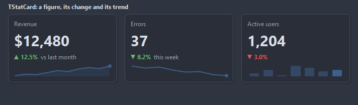

# TStatCard

A card with one figure: a title, the value in large type, its change with an arrow, a line under it and a small chart of the trend.

- Palette page: Unleashed: Display
- Unit: `statcard.pas`
- Ancestor: `TGraphicControl`



## Usage

```pascal
procedure TForm1.FormCreate(Sender: TObject);
begin
  var revenue := TStatCard.Create(Self);
  revenue.Parent := Self;
  revenue.SetBounds(8, 8, 200, 110);
  revenue.Caption := 'Revenue';
  revenue.Value := '$12.4k';
  revenue.Delta := 8.5; // percent, shown with its sign and color
  revenue.Footer := 'this month';
  revenue.SetTrendValues([9, 10, 9.5, 11, 12, 12.4]);
end;
```

## Properties

| Property | Type | Default | Notes |
|---|---|---|---|
| `Value` | `string` |  | the figure, formatted as it shows |
| `Footer` | `string` |  | the line under the change, as `vs last month` |
| `DeltaFormat` | `string` |  | the format of the change; the arrow carries the sign |
| `Delta` | `double` |  | the change: above zero an up arrow, below it a down arrow |
| `ShowDelta` | `boolean` | `true` |  |
| `InvertDelta` | `boolean` | `false` | a fall is good news: down shows in the up color |
| `ShowTrend` | `boolean` | `true` |  |
| `Shadow` | `boolean` | `true` | a soft shadow under the card |
| `Trend` | `TStrings` |  | the points of the trend chart, one number per line with a `.` decimal point |
| `TrendStyle` | `TSparklineStyle` | `ssArea` | the drawing: a line, a filled area, bars from the baseline, dots alone, a stepped line, fixed bars up or down from the baseline, stems with a dot |
| `ValueSize` | `integer` | `0` | the size of the value in points; 0 is twice the font |
| `CornerRadius` | `integer` | `8` | the rounding of the corners, in pixels |
| `Padding` | `integer` | `12` | the space between the border and the content |
| `ShadowSize` | `integer` | `4` | the reach of the shadow, in pixels |
| `TrendHeight` | `integer` | `0` | the height of the chart; 0 takes the room left |
| `MaxTrendPoints` | `integer` | `30` | 0 keeps every point |
| `Images` | `TCustomImageList` |  | an icon in the top right corner |
| `ImageIndex` | `TImageIndex` | `-1` | the picture in the image list, -1 for none |
| `ImagesWidth` | `integer` | `0` | the width of the picture to pick from a multi-resolution list, 0 for the first |
| `CardColor` | `TColor` | `clDefault` | clDefault takes the colors of the theme |
| `BorderColor` | `TColor` | `clDefault` | clDefault takes the color of the theme |
| `TitleColor` | `TColor` | `clDefault` | clDefault takes the color of the theme |
| `ValueColor` | `TColor` | `clDefault` | clDefault takes the color of the theme |
| `UpColor` | `TColor` | `clDefault` |  |
| `DownColor` | `TColor` | `clDefault` |  |
| `TrendColor` | `TColor` | `clDefault` |  |
| `Antialiasing` | `TAntialiasSetting` | `asTheme` | asTheme follows the theme setting, asOn and asOff force it |
| `Language` | `TFormatLanguage` | `flSystem` | the names and separators of dates, times and numbers: those of the locale of the system, or English |

Also the standard properties of a control, re-published: `Caption`, `Align`, `Anchors`, `AutoSize`, `BorderSpacing`, `Color`, `Constraints`, `Enabled`, `Font`, `Hint`, `ParentColor`, `ParentFont`, `ParentShowHint`, `PopupMenu`, `ShowHint`, `Visible`, `OnClick`, `OnContextPopup`, `OnDblClick`, `OnMouseDown`, `OnMouseEnter`, `OnMouseLeave`, `OnMouseMove`, `OnMouseUp`, `OnResize`.

## Runtime

Available in code, not in the Object Inspector.

| Method | Notes |
|---|---|
| `AddTrendValue(value: double)` | appends a point to the trend; past MaxTrendPoints the oldest goes |
| `SetTrendValues(const values: array of double)` |  |
| `TrendCount: integer` |  |
