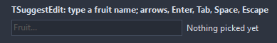
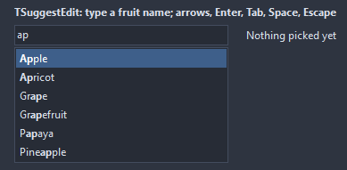

# TSuggestEdit

An edit with a list of suggestions dropping under it as the user types: the matches from Items, or whatever OnGetSuggestions fills in. The arrows walk the list, Enter, Tab and Space take the suggestion, Escape closes it.

- Palette page: Unleashed: Input
- Unit: `suggestedit.pas`
- Ancestor: `TCustomEdit`



## Usage

```pascal
procedure TForm1.FormCreate(Sender: TObject);
begin
  var city := TSuggestEdit.Create(Self);
  city.Parent := Self;
  city.Width := 200;
  city.Items.AddStrings(['Amsterdam', 'Athens', 'Berlin', 'Bern', 'Brussels']);
  city.MatchMode := smContains;
  city.OnSelect := @citySelect;
end;

procedure TForm1.citySelect(Sender: TObject; const suggestion: string);
begin
  Caption := suggestion;
end;
```

## Properties

| Property | Type | Default | Notes |
|---|---|---|---|
| `Items` | `TStrings` |  | the suggestions matched against the typed text |
| `MatchMode` | `TSuggestMatch` | `smPrefix` | how a suggestion has to match the typed text |
| `CaseSensitive` | `boolean` | `false` |  |
| `MinChars` | `integer` | `1` | the list waits for this many characters |
| `MaxItems` | `integer` | `0` | the list keeps at most this many; 0 takes all |
| `MaxVisibleItems` | `integer` | `8` | rows on screen before the list scrolls |
| `Delay` | `integer` | `100` | milliseconds after the typing stops before the list updates |
| `PopupWidth` | `integer` | `0` | the list; 0 matches the edit |
| `AutoSelectFirst` | `boolean` | `true` | the first suggestion starts selected, so Enter takes it at once |
| `HighlightMatch` | `boolean` | `true` | the matched part of each suggestion in MatchStyle |
| `MatchStyle` | `TFontStyles` | `[fsBold]` | the style of the matched part |
| `PopupFont` | `TFont` |  | the font of the list; left alone, the list takes the font of the edit |
| `PopupColor` | `TColor` | `clDefault` | the list; clDefault takes the colors of the theme |
| `PopupTextColor` | `TColor` | `clDefault` |  |
| `SelectedColor` | `TColor` | `clDefault` | the selected suggestion |
| `SelectedTextColor` | `TColor` | `clDefault` | clDefault takes the color of the theme |
| `HoverColor` | `TColor` | `clDefault` | the suggestion under the mouse |
| `TabAccepts` | `boolean` | `true` |  |
| `SpaceAccepts` | `boolean` | `true` | Space takes the selected suggestion; off, it goes into the text, for suggestions of several words |
| `ShowOnFocus` | `boolean` | `false` | the list opens as the edit takes the focus, with what it holds |

Also the standard properties of a edit, re-published: `Align`, `Alignment`, `Anchors`, `AutoSize`, `BorderSpacing`, `BorderStyle`, `CharCase`, `Color`, `Constraints`, `Enabled`, `Font`, `Hint`, `MaxLength`, `ParentColor`, `ParentFont`, `ParentShowHint`, `PopupMenu`, `ReadOnly`, `ShowHint`, `TabOrder`, `TabStop`, `Text`, `TextHint`, `Visible`, `OnChange`, `OnClick`, `OnContextPopup`, `OnDblClick`, `OnEditingDone`, `OnEnter`, `OnExit`, `OnKeyDown`, `OnKeyPress`, `OnKeyUp`, `OnMouseDown`, `OnMouseEnter`, `OnMouseLeave`, `OnMouseMove`, `OnMouseUp`, `OnResize`.

## Events

| Event | Handler | Notes |
|---|---|---|
| `OnGetSuggestions` | `procedure(Sender: TObject; const text: string; suggestions: TStrings)` | fills the suggestions for the text; set, Items is not consulted |
| `OnSelect` | `procedure(Sender: TObject; const suggestion: string)` | a suggestion was picked from the list, with a click or a key |
| `OnDrawSuggestion` | `procedure(Sender: TObject; canvas: TCanvas; const r: TRect; index: integer; const suggestion: string; selected: boolean; var handled: boolean)` |  |
| `OnPopupShow` | `procedure(Sender: TObject)` |  |
| `OnPopupHide` | `procedure(Sender: TObject)` |  |

## Runtime

Available in code, not in the Object Inspector.

| Method | Notes |
|---|---|
| `Suggest` | builds the list for the text now and shows it; nothing to show hides it |
| `HidePopup` |  |
| `PopupVisible: boolean` | the popup is open |

## Types

| Type | Values | Notes |
|---|---|---|
| `TSuggestMatch` | `smPrefix`, `smContains`, `smWords` | how a suggestion has to match the typed text |

## Custom drawing

The component paints its parts by itself, through the shapes of `ControlPaint`. A handler on the event below takes over a part: it gets the canvas of the control, the rectangle of the part, which part it is and a `TDrawState` set telling what the part is in: `dsHover`, `dsActive`, `dsSelected`, `dsPressed`, `dsDisabled`, `dsFocused`, `dsChecked`.

- `OnDrawSuggestion`: paints the part. Handler: `procedure(Sender: TObject; canvas: TCanvas; const r: TRect; index: integer; const suggestion: string; selected: boolean; var handled: boolean)`.

A handler may paint with the plain canvas, or through `beginShapes()` from `ControlPaint` for the same smoothed shapes the components use: `paintRoundRect()`, `paintCircle()`, `paintCheck()`, `FillPolygon()` and the rest, then `Flush` once. Colors of the theme come from `pick()`, `blend()` and `contrastText()`.

## In pictures

**After typing two letters: the matching entries, the first one selected.**


