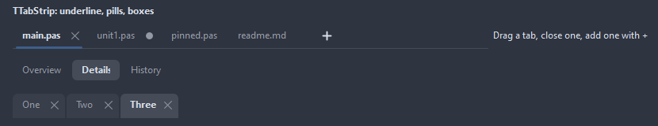
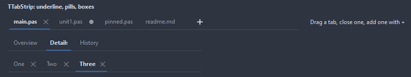
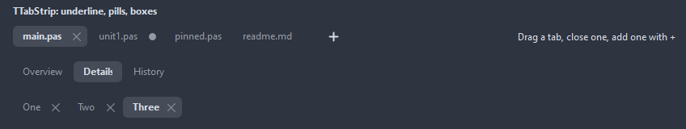
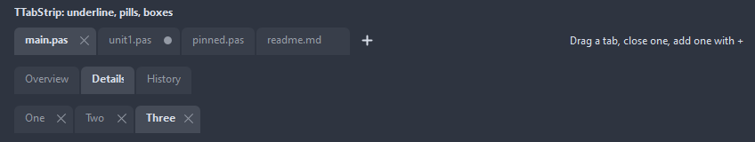
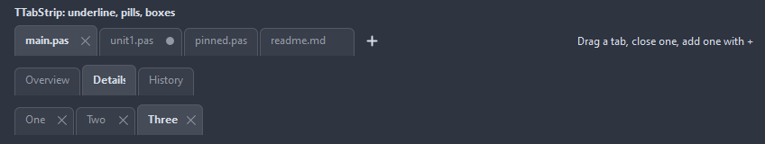
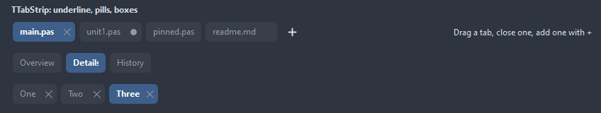
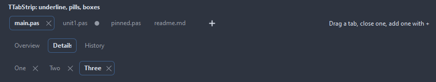

# TTabStrip

A row of tabs without pages, for documents or views: one is active, a tab can close, a drag moves it, the wheel or the arrows scroll the row when it does not fit, and a plus button asks for a new one.

- Palette page: Unleashed: Navigation
- Unit: `tabstrip.pas`
- Ancestor: `TCustomControl`



## Usage

```pascal
procedure TForm1.FormCreate(Sender: TObject);
begin
  var tabs := TTabStrip.Create(Self);
  tabs.Parent := Self;
  tabs.Align := alTop;
  tabs.Style := tssUnderline;
  tabs.Tabs.AddTab('main.pas');
  tabs.Tabs.AddTab('util.pas').Modified := true;
  tabs.ShowAddButton := true;
  tabs.TabIndex := 0;
  tabs.OnChange := @tabsChange;
  tabs.OnTabClose := @tabsClose;
end;

procedure TForm1.tabsChange(Sender: TObject);
begin
  Caption := TTabStrip(Sender).ActiveTab.Caption;
end;

procedure TForm1.tabsClose(Sender: TObject; index: integer; var canClose: boolean);
begin
  canClose := not TTabStrip(Sender).Tabs[index].Modified;
end;
```

## Properties

| Property | Type | Default | Notes |
|---|---|---|---|
| `Tabs` | `TTabStripItems` |  |  |
| `TabIndex` | `integer` | `-1` |  |
| `Style` | `TTabStripStyle` | `tssUnderline` | the look of the tabs: an underline under the active one, pills, boxes open at the bottom, framed cards, buttons, a frame around the active one |
| `CloseButtons` | `TTabCloseButtons` | `tcbHover` |  |
| `ShowAddButton` | `boolean` | `false` | a plus after the tabs; OnAddClick does the rest |
| `AllowReorder` | `boolean` | `true` | a drag moves a tab |
| `MinTabWidth` | `integer` | `60` |  |
| `MaxTabWidth` | `integer` | `200` | 0 lets a tab grow with its caption |
| `TabPadding` | `integer` | `12` |  |
| `Spacing` | `integer` | `2` | the gap between the parts |
| `CornerRadius` | `integer` | `6` | the rounding of the corners, in pixels |
| `ImagesWidth` | `integer` | `0` | the width of the picture to pick from a multi-resolution list, 0 for the first |
| `Images` | `TCustomImageList` |  | the image list the pictures come from |
| `AccentColor` | `TColor` | `clDefault` | clDefault takes the colors of the theme |
| `TabColor` | `TColor` | `clDefault` |  |
| `ActiveTabColor` | `TColor` | `clDefault` | clDefault takes the color of the theme |
| `TextColor` | `TColor` | `clDefault` | clDefault takes the color of the theme |
| `Antialiasing` | `TAntialiasSetting` | `asTheme` | asTheme follows the theme setting, asOn and asOff force it |

Also the standard properties of a control, re-published: `Align`, `Anchors`, `AutoSize`, `BorderSpacing`, `Color`, `Constraints`, `Enabled`, `Font`, `Hint`, `ParentColor`, `ParentFont`, `ParentShowHint`, `PopupMenu`, `ShowHint`, `TabOrder`, `TabStop`, `Visible`, `OnClick`, `OnContextPopup`, `OnDblClick`, `OnEnter`, `OnExit`, `OnKeyDown`, `OnKeyPress`, `OnKeyUp`, `OnMouseDown`, `OnMouseEnter`, `OnMouseLeave`, `OnMouseMove`, `OnMouseUp`, `OnResize`.

## Events

| Event | Handler | Notes |
|---|---|---|
| `OnDrawTab` | `TCustomDrawEvent` | paints over the stock tab shape: dsSelected for the active tab, dsHover under the mouse; `handled` true leaves the caption and the icon out |
| `OnChange` | `procedure(Sender: TObject)` | after TabIndex changed |
| `OnChanging` | `procedure(Sender: TObject; index: integer; var canClose: boolean)` | before a tab gets active; canClose false keeps the old one |
| `OnTabClose` | `procedure(Sender: TObject; index: integer; var canClose: boolean)` | before a tab goes; canClose false keeps it |
| `OnTabMoved` | `procedure(Sender: TObject; fromIndex, toIndex: integer)` |  |
| `OnAddClick` | `procedure(Sender: TObject)` |  |

## Runtime

Available in code, not in the Object Inspector.

| Method | Notes |
|---|---|
| `tabsChanged` |  |
| `CloseTab(index: integer): boolean` | closes a tab the way its close button does, OnTabClose included |
| `MoveTab(fromIndex, toIndex: integer)` |  |
| `ActiveTab: TTabStripItem` | the active tab item, nil without one |

## Companion classes

### `TTabStripItem`

| Property | Type | Default | Notes |
|---|---|---|---|
| `Caption` | `string` |  | the text shown |
| `Hint` | `string` |  | the tooltip |
| `ImageIndex` | `TImageIndex` | `-1` | the picture in the image list, -1 for none |
| `Closable` | `boolean` | `true` | the tab shows a close button, after CloseButtons |
| `Modified` | `boolean` | `false` | a dot in place of the close button until the mouse comes |
| `Enabled` | `boolean` | `true` | disabled items are drawn gray and ignore the mouse |
| `Tag` | `PtrInt` | `0` | free for the application |

### `TTabStripItems`

| Method | Notes |
|---|---|
| `Add: TTabStripItem` | a new entry at the end |
| `AddTab(const caption: string; imageIndex: TImageIndex = -1): TTabStripItem` |  |

## Types

| Type | Values | Notes |
|---|---|---|
| `TTabStripStyle` | `tssUnderline`, `tssPills`, `tssBoxes`, `tssCards`, `tssButtons`, `tssOutline` | the look of the tabs: an underline under the active one, pills, boxes open at the bottom, framed cards, buttons, a frame around the active one |
| `TTabCloseButtons` | `tcbNone`, `tcbActive`, `tcbHover`, `tcbAll` |  |

## Custom drawing

The component paints its parts by itself, through the shapes of `ControlPaint`. A handler on the event below takes over a part: it gets the canvas of the control, the rectangle of the part, which part it is and a `TDrawState` set telling what the part is in: `dsHover`, `dsActive`, `dsSelected`, `dsPressed`, `dsDisabled`, `dsFocused`, `dsChecked`.

- `OnDrawTab`: paints over the stock tab shape: dsSelected for the active tab, dsHover under the mouse; `handled` true leaves the caption and the icon out. Handler: `TCustomDrawEvent`.

A handler may paint with the plain canvas, or through `beginShapes()` from `ControlPaint` for the same smoothed shapes the components use: `paintRoundRect()`, `paintCircle()`, `paintCheck()`, `FillPolygon()` and the rest, then `Flush` once. Colors of the theme come from `pick()`, `blend()` and `contrastText()`.

## In pictures

### Every Style

The demo group with each value of `Style` in turn.

`Style = tssUnderline`



`Style = tssPills`



`Style = tssBoxes`



`Style = tssCards`



`Style = tssButtons`



`Style = tssOutline`


