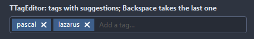

# TTagEditor

A field of tags: each one a chip with a cross, the typing goes into the free end of the field. Enter, a delimiter or the focus leaving adds the text as a tag; Backspace on the empty field takes the last tag back. Suggestions offer tags while typing.

- Palette page: Unleashed: Input
- Unit: `tageditor.pas`
- Ancestor: `TCustomControl`


## Usage

```pascal
procedure TForm1.FormCreate(Sender: TObject);
begin
  var tags := TTagEditor.Create(Self);
  tags.Parent := Self;
  tags.Width := 320;
  tags.Suggestions.AddStrings(['bug', 'feature', 'docs', 'question']);
  tags.MaxTags := 5;
  tags.AddTag('bug');
  tags.OnTagAdded := @tagsChanged;
  tags.OnTagRemoved := @tagsChanged;
end;

procedure TForm1.tagsChanged(Sender: TObject; const tag: string);
begin
  Caption := TTagEditor(Sender).TagsAsText;
end;
```

## Properties

| Property | Type | Default | Notes |
|---|---|---|---|
| `Tags` | `TStrings` |  |  |
| `Suggestions` | `TStrings` |  | offered while typing |
| `TextHint` | `string` |  | the gray text shown while the field is empty |
| `Delimiters` | `string` |  | characters that end a tag while typing |
| `AllowDuplicates` | `boolean` | `false` |  |
| `CaseSensitive` | `boolean` | `false` |  |
| `ReadOnly` | `boolean` | `false` | the mouse and the keyboard change nothing |
| `WordWrap` | `boolean` | `true` | the chips flow onto more lines and the control grows |
| `ShowCloseButtons` | `boolean` | `true` |  |
| `MaxTags` | `integer` | `0` | 0 for no limit |
| `CornerRadius` | `integer` | `4` | the rounding of the corners, in pixels |
| `Padding` | `integer` | `4` | the space between the border and the content |
| `Spacing` | `integer` | `4` | the gap between the parts |
| `ChipRadius` | `integer` | `10` |  |
| `ChipColor` | `TColor` | `clDefault` | clDefault takes the colors of the theme |
| `ChipTextColor` | `TColor` | `clDefault` |  |
| `CloseColor` | `TColor` | `clDefault` |  |
| `BorderColor` | `TColor` | `clDefault` | clDefault takes the color of the theme |
| `FocusBorderColor` | `TColor` | `clDefault` | the border while focused; clDefault takes the accent of the theme |
| `FieldColor` | `TColor` | `clDefault` | the fill of the field; clDefault takes the color of the theme |
| `Antialiasing` | `TAntialiasSetting` | `asTheme` | asTheme follows the theme setting, asOn and asOff force it |
| `ChipShape` | `TChipShape` | `chRounded` | the outline of a chip: a pill, a box rounded by ChipRadius, a square box, or a tag with a point on the left |

Also the standard properties of a control, re-published: `Align`, `Anchors`, `AutoSize`, `BorderSpacing`, `Color`, `Constraints`, `Enabled`, `Font`, `Hint`, `ParentColor`, `ParentFont`, `ParentShowHint`, `PopupMenu`, `ShowHint`, `TabOrder`, `TabStop`, `Visible`, `OnClick`, `OnContextPopup`, `OnEnter`, `OnExit`, `OnKeyDown`, `OnKeyPress`, `OnKeyUp`, `OnMouseEnter`, `OnMouseLeave`, `OnResize`.

## Events

| Event | Handler | Notes |
|---|---|---|
| `OnDrawChip` | `TCustomDrawEvent` | paints over a chip: dsSelected for the one the keyboard is on; `handled` true leaves the text out |
| `OnTagAdded` | `procedure(Sender: TObject; const tag: string)` |  |
| `OnTagRemoved` | `procedure(Sender: TObject; const tag: string)` |  |
| `OnTagClick` | `procedure(Sender: TObject; const tag: string)` |  |
| `OnTagAllow` | `procedure(Sender: TObject; var tag: string; var allow: boolean)` | before a tag goes in; the text may be changed or refused |
| `OnChange` | `procedure(Sender: TObject)` | after the value changed |

## Runtime

Available in code, not in the Object Inspector.

| Property | Type | Notes |
|---|---|---|
| `Edit` | `TSuggestEdit` | the edit control inside, for its own properties |

| Method | Notes |
|---|---|
| `SetFocus` | moves the keyboard focus into the field |
| `Focused: Boolean` | the field has the keyboard focus |
| `AddTag(const tag: string): boolean` | adds a tag unless refused; true when it went in |
| `RemoveTag(index: integer)` |  |
| `Clear` | removes everything |
| `PendingText: string` | the text in the field, not yet a tag |
| `TagsAsText: string` | the tags joined by the first delimiter |

## Types

| Type | Values | Notes |
|---|---|---|
| `TChipShape` | `chPill`, `chRounded`, `chSquare`, `chTag` | the outline of a chip: a pill, a box rounded by ChipRadius, a square box, or a tag with a point on the left |

## Custom drawing

The component paints its parts by itself, through the shapes of `ControlPaint`. A handler on the event below takes over a part: it gets the canvas of the control, the rectangle of the part, which part it is and a `TDrawState` set telling what the part is in: `dsHover`, `dsActive`, `dsSelected`, `dsPressed`, `dsDisabled`, `dsFocused`, `dsChecked`.

- `OnDrawChip`: paints over a chip: dsSelected for the one the keyboard is on; `handled` true leaves the text out. Handler: `TCustomDrawEvent`.

A handler may paint with the plain canvas, or through `beginShapes()` from `ControlPaint` for the same smoothed shapes the components use: `paintRoundRect()`, `paintCircle()`, `paintCheck()`, `FillPolygon()` and the rest, then `Flush` once. Colors of the theme come from `pick()`, `blend()` and `contrastText()`.

## In pictures

### Every ChipShape

The demo group with each value of `ChipShape` in turn.

`ChipShape = chPill`


`ChipShape = chRounded`


`ChipShape = chSquare`



`ChipShape = chTag`


