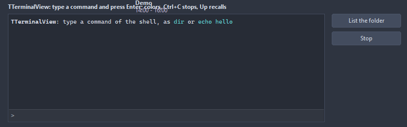

# TTerminalView

A console: runs a command and shows what it writes, the ANSI colors and styles included, and sends the lines typed into the input line at the bottom to it. Without a process the lines go to OnInput, and Write puts text of the application on the screen.

- Palette page: Unleashed: Views
- Unit: `terminalview.pas`
- Ancestor: `TScrollingWinControl`



## Usage

```pascal
procedure TForm1.FormCreate(Sender: TObject);
begin
  var term := TTerminalView.Create(Self);
  term.Parent := Self;
  term.SetBounds(8, 8, 480, 240);
  term.Prompt := '> ';
  term.OnInput := @termInput;
  term.Execute('git status'); // through the shell of the system
end;

procedure TForm1.termInput(Sender: TObject; const line: string; var handled: boolean);
begin
  // a built-in command instead of the shell
  if line = 'clear' then begin
    TTerminalView(Sender).Clear;
    handled := true;
  end;
end;
```

## Properties

| Property | Type | Default | Notes |
|---|---|---|---|
| `Command` | `string` |  | run in the shell of the system: cmd on Windows, sh elsewhere |
| `WorkingDirectory` | `string` |  |  |
| `Prompt` | `string` |  |  |
| `RunInShell` | `boolean` | `true` |  |
| `AutoScroll` | `boolean` | `true` | the view follows the output while it sits at the end |
| `ShowInput` | `boolean` | `true` |  |
| `EchoInput` | `boolean` | `true` | a line sent shows in the output after the prompt |
| `Monospace` | `boolean` | `true` | the font becomes a fixed pitch one of the system, at the size of Font |
| `ShowExitCode` | `boolean` | `true` | a line with the exit code after the process ends |
| `OutputEncoding` | `TTerminalEncoding` | `teAuto` | how the bytes of a process become text: UTF-8, the console code page of the system, or UTF-8 where they form it and the code page elsewhere |
| `MaxLines` | `integer` | `5000` | lines kept; 0 keeps every one |
| `Padding` | `integer` | `4` | the space between the border and the content |
| `TextColor` | `TColor` | `clDefault` | clDefault takes the colors of the theme |
| `InputColor` | `TColor` | `clDefault` |  |

Also the standard properties of a scrolling control, re-published: `Color`, `Align`, `Anchors`, `BorderSpacing`, `BorderStyle`, `Constraints`, `Enabled`, `Font`, `Hint`, `ParentFont`, `ParentShowHint`, `PopupMenu`, `ShowHint`, `TabOrder`, `TabStop`, `Visible`, `OnClick`, `OnContextPopup`, `OnDblClick`, `OnEnter`, `OnExit`, `OnKeyDown`, `OnKeyPress`, `OnKeyUp`, `OnMouseDown`, `OnMouseEnter`, `OnMouseLeave`, `OnMouseMove`, `OnMouseUp`, `OnMouseWheel`, `OnResize`.

## Events

| Event | Handler | Notes |
|---|---|---|
| `OnInput` | `procedure(Sender: TObject; const line: string; var handled: boolean)` | a line typed; handled keeps it from the process |
| `OnOutput` | `procedure(Sender: TObject; const text: string)` | text from the process as it comes, the sequences in it |
| `OnProcessStart` | `procedure(Sender: TObject)` |  |
| `OnProcessExit` | `procedure(Sender: TObject; exitCode: integer)` |  |

## Runtime

Available in code, not in the Object Inspector.

| Property | Type | Notes |
|---|---|---|
| `ExitCode` | `integer` | the exit code of the last process |
| `Input` | `string` |  |

| Method | Notes |
|---|---|
| `Run: boolean` | runs Command; false when a process still runs or it does not start |
| `Execute(const command: string): boolean` |  |
| `Terminate` | kills the process and every process it started; it ends with code 1 |
| `Running: boolean` | it is running |
| `SendText(const text: string)` | to the input of the process, as it is or with a line end |
| `SendLine(const text: string)` |  |
| `CloseInput` | ends the input of the process, as the end of a file does |
| `Write(const text: string)` | text of the application; the ANSI sequences work as from a process |
| `WriteLn(const text: string = '')` |  |
| `Clear` | removes everything |
| `LineCount: integer` |  |
| `Lines(index: integer): string` |  |
| `Text: string` | everything, without the colors |
| `SelectedText: string` |  |
| `SelectAll` | selects everything |
| `CopyToClipboard` | the selection, or everything without one |
| `SaveToFile(const fileName: string)` | writes the content to a file |
| `ScrollToEnd` | scrolls to the last line |

## Types

| Type | Values | Notes |
|---|---|---|
| `TTerminalEncoding` | `teAuto`, `teUTF8`, `teSystem` | how the bytes of a process become text: UTF-8, the console code page of the system, or UTF-8 where they form it and the code page elsewhere |
