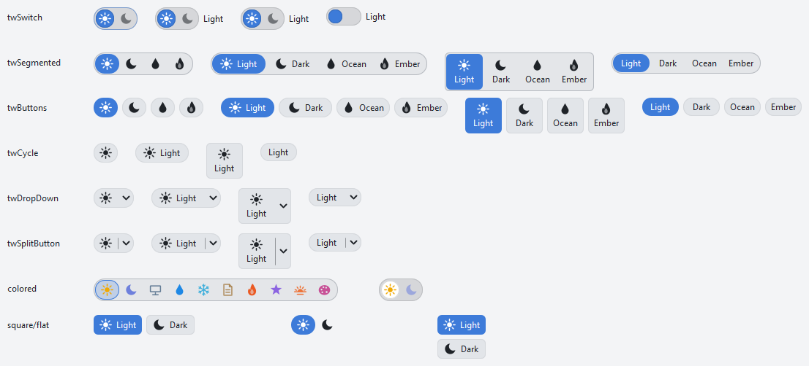
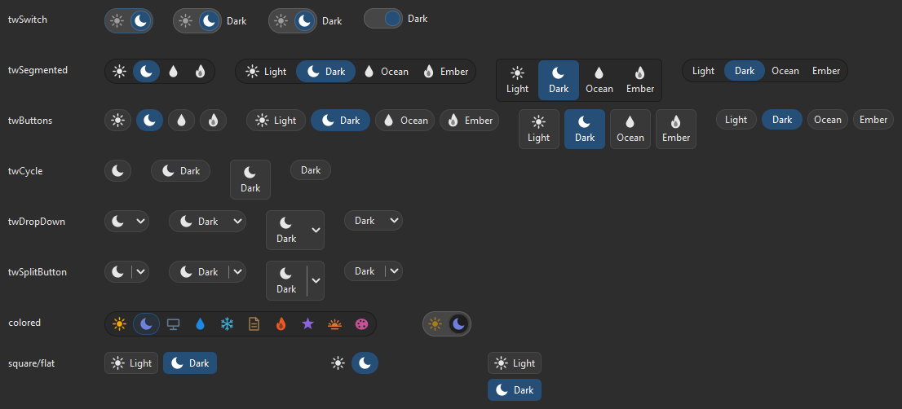
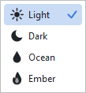
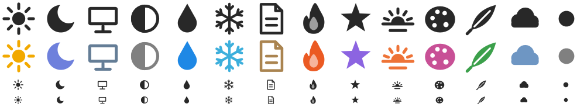
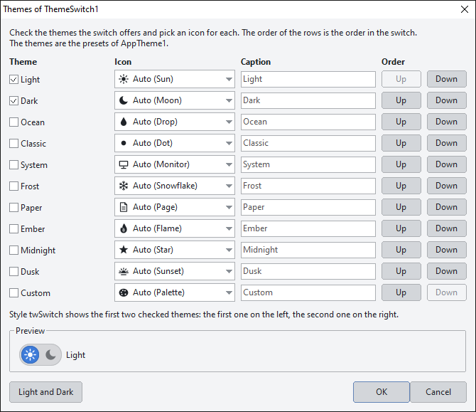

# TThemeSwitch

Switches the theme of the application between the themes chosen for it. `AttachTo` names the `TAppTheme` to drive; dropped on a form that has one, the switch fills it by itself. The current theme shows as selected and follows every change of the `TAppTheme`, so the switch is right from the start, also with `Preset` `tpSystem`. `Themes` holds the offered themes with their icons; out of the box it offers Light and Dark.

- Palette page: Unleashed: Input
- Unit: `themeswitch.pas`
- Ancestor: `TCustomControl`



The same switches under the Dark theme:



## Usage

Drop a `TAppTheme` and a `TThemeSwitch` on the main form. That is all: `AttachTo` fills itself, the switch toggles between Light and Dark, and it starts on the one the screen shows. The same in code:

```pascal
procedure TForm1.FormCreate(Sender: TObject);
begin
  var theme := TAppTheme.Create(Self);
  var picker := TThemeSwitch.Create(Self);
  picker.Parent := Self;
  picker.AttachTo := theme;
  picker.Style := twSegmented;
  picker.Content := tcIconAndName;
  picker.Themes.AddTheme(tpOcean);
  picker.Themes.AddTheme(tpMidnight, tgMoon);
  picker.OnChange := @themePicked;
end;

procedure TForm1.themePicked(Sender: TObject; preset: TThemePreset);
begin
  Caption := 'Theme: '+presetCaption(preset);
end;
```

## How it works

- **The themes are the presets of `TAppTheme`.** Each item of `Themes` names one `TThemePreset` (`tpLight`, `tpDark`, `tpOcean`, ...) and the icon it shows. A click puts that preset into `AttachTo.Preset` and switches `AttachTo.Active` on.
- **The selection follows the theme.** The switch listens to its `TAppTheme`. Whatever changes the theme (the switch, code, the desktop switching between light and dark under `tpSystem`), the switch moves to the matching item. It picks, in this order:
  1. the item with the same preset;
  2. under `tpSystem`, the item of `tpLight` or `tpDark`, after what the desktop shows;
  3. the first item that is as light or as dark as the screen;
  4. the first item.
- **`AttachTo` empty.** In the designer the switch shows the `TAppTheme` of its form. In the running application it drives `TAppTheme.Instance`, the one theme of the application, so a switch on a second form needs no `AttachTo`.
- **`AutoApply` off.** A click only moves the selection and fires `OnChange`; the handler decides what to do with the theme.
- **One `TAppTheme` per form.** The designer refuses a second `TAppTheme` on a form with the message "This form has AppTheme1 already". That is why the switch can fill `AttachTo` by itself: there is at most one candidate.

## Styles

| `Style` | What it is | Themes shown |
|---|---|---|
| `twSwitch` | a switch: a track with a slot per theme, the thumb slides onto the current one | **only the first two visible themes**: the first one on the left, the second one on the right. Add more themes and they are ignored by this style |
| `twSegmented` | a bar of segments, the current theme selected; the selection slides | every visible theme |
| `twButtons` | a row of separate buttons, the current one filled | every visible theme |
| `twCycle` | one button with the current theme; a click steps to the next one | every visible theme, one at a time |
| `twDropDown` | one button with the current theme and an arrow; a click opens the list of the themes | every visible theme in the list |
| `twSplitButton` | the main part steps to the next theme, the arrow opens the list | every visible theme |

`twSwitch` is for two themes, light and dark. For three or more, take `twSegmented`, `twButtons` or one of the drop down styles.

The list of the drop down styles:



## Content

| `Content` | Each theme shows |
|---|---|
| `tcIcon` | its icon; the name comes up as the hint (see `NameHints`) |
| `tcIconAndName` | its icon with the name beside it |
| `tcIconOverName` | its icon with the name under it |
| `tcName` | its name alone |

`twSwitch` keeps the icons in its track and puts the name of the current theme beside the track for every value but `tcIcon`; with `tcName` the track carries no icons.

## Icons

The icons are shapes painted in the color of the text, so they follow the theme and stay sharp at every size and DPI. `Glyph = tgAuto` takes the icon that goes with the preset:

| Preset | Icon |
|---|---|
| `tpNone` (Classic) | `tgDot` |
| `tpSystem` | `tgMonitor` |
| `tpLight` | `tgSun` |
| `tpDark` | `tgMoon` |
| `tpOcean` | `tgDrop` |
| `tpFrost` | `tgSnowflake` |
| `tpPaper` | `tgPage` |
| `tpEmber` | `tgFlame` |
| `tpMidnight` | `tgStar` |
| `tpDusk` | `tgSunset` |
| `tpCustom` | `tgPalette` |

Every icon, in the color of the text (top) and with `ColoredIcons` (below), then at the sizes of a control:



`ColoredIcons` gives each icon its own color: an amber sun, a blue moon, a red flame. A single item takes its own color through `IconColor`. An item with an `ImageIndex` shows that image of `Images` instead of a glyph.

## Choosing the themes in the designer

Double click the switch, pick **Choose Themes...** from its menu, or click the `...` button of `Themes` in the Object Inspector. The dialog lists every preset of the `TAppTheme`:

- the check box shows the theme in the switch;
- **Icon** is a list that draws every icon; `Auto` takes the icon of the preset;
- **Caption** replaces the name of the theme; empty keeps the name;
- **Up** and **Down** set the order, which is the order in the switch;
- **Light and Dark** goes back to the two default themes;
- the preview at the bottom is the switch with its style and colors, as it will look.



A theme unchecked in the dialog stays in `Themes` as an item with `Visible = false` when it was there before, so its icon and caption survive; a theme never checked adds nothing. The `Glyph` of an item in the Object Inspector is the same list with the icons drawn.

## Properties

| Property | Type | Default | Notes |
|---|---|---|---|
| `AttachTo` | `TAppTheme` |  | the theme the switch drives; filled by itself in the designer |
| `Themes` | `TThemeSwitchItems` | Light, Dark | the offered themes and their icons |
| `Style` | `TThemeSwitchStyle` | `twSwitch` | see Styles |
| `Content` | `TThemeSwitchContent` | `tcIcon` | see Content |
| `Images` | `TCustomImageList` |  | images the items take with their `ImageIndex` in place of a glyph |
| `ImageWidth` | `integer` | `0` | the images at 96 dpi; 0 takes the size of the list |
| `IconSize` | `integer` | `0` | the glyphs at 96 dpi; 0 takes the size from the font |
| `Spacing` | `integer` | `6` | between an icon and its name |
| `Padding` | `integer` | `8` | inside each theme, left and right of its content |
| `Gap` | `integer` | `6` | between the buttons of `twButtons` |
| `CornerRadius` | `integer` | `6` | the corners when `Pill` is off; 0 is square |
| `AnimationDuration` | `integer` | `150` | the slide of the selection, in milliseconds |
| `Pill` | `boolean` | `true` | round ends, the radius of half the height; a name under the icon keeps `CornerRadius` |
| `Vertical` | `boolean` | `false` | the segments and the buttons stacked from the top down |
| `Flat` | `boolean` | `false` | no face behind the themes; only the selected one and the one under the mouse show a face |
| `ColoredIcons` | `boolean` | `false` | every glyph in its own color |
| `AutoApply` | `boolean` | `true` | a choice goes to the attached `TAppTheme`; off, only `OnChange` fires |
| `Animated` | `boolean` | `true` | the selection slides to the new theme; off, it jumps |
| `NameHints` | `boolean` | `true` | the name of the theme under the mouse as its hint while the names are not on screen; it shows when `ShowHint` is on |
| `SelectedColor` | `TColor` | `clDefault` | the fill of the current theme; clDefault takes the color of the theme |
| `SelectedTextColor` | `TColor` | `clDefault` | its text and icon |
| `BarColor` | `TColor` | `clDefault` | the bar, the track or the face of the buttons |
| `BorderColor` | `TColor` | `clDefault` |  |
| `TextColor` | `TColor` | `clDefault` | the names and the icons of the other themes |
| `Antialiasing` | `TAntialiasSetting` | `asTheme` | the smoothing of the shapes: after the theme, or its own choice |

Also the standard properties of a control, re-published: `Align`, `Anchors`, `AutoSize` (default `true`), `BorderSpacing`, `Color`, `Constraints`, `Cursor`, `Enabled`, `Font`, `Hint`, `ParentColor`, `ParentFont`, `ParentShowHint`, `PopupMenu`, `ShowHint`, `TabOrder`, `TabStop`, `Visible`, `OnClick`, `OnContextPopup`, `OnEnter`, `OnExit`, `OnKeyDown`, `OnKeyPress`, `OnKeyUp`, `OnMouseDown`, `OnMouseEnter`, `OnMouseLeave`, `OnMouseMove`, `OnMouseUp`, `OnResize`.

## Events

| Event | Handler | Notes |
|---|---|---|
| `OnChanging` | `procedure(Sender: TObject; preset: TThemePreset; var allow: boolean)` | before a choice of the user goes through; `allow` false keeps the theme |
| `OnChange` | `procedure(Sender: TObject; preset: TThemePreset)` | after the user or the code chose a theme |

## Keyboard

| Key | Effect |
|---|---|
| Left, Up | the previous theme, round the start |
| Right, Down | the next theme, round the end |
| Home, End | the first, the last theme |
| Space, Enter | `twSwitch`, `twCycle`, `twSplitButton`: the next theme; `twDropDown`: opens the list |
| F4, Alt+Down | opens the list of `twDropDown` and `twSplitButton` |
| Up, Down, Enter, Escape | in the open list: move, choose, close |

## Runtime

Available in code, not in the Object Inspector.

| Method | Notes |
|---|---|
| `ItemIndex: integer` | the item of the current theme, -1 when no visible item matches it; setting it switches the theme |
| `SelectedPreset: TThemePreset` | the preset of the current item |
| `Theme: TAppTheme` | the `TAppTheme` the switch drives right now, nil without one |
| `Next`, `Previous` | the next or the previous visible theme, round the end |
| `DropDown`, `CloseUp`, `DroppedDown: boolean` | the list of the drop down styles |
| `ItemRect(index: integer): TRect` | the box of an item in the control, empty for a hidden one |

## Companion classes

### `TThemeSwitchItem`

One theme the switch offers: a preset of the attached `TAppTheme` with its icon.

| Property | Type | Default | Notes |
|---|---|---|---|
| `Preset` | `TThemePreset` | `tpLight` | the theme |
| `Glyph` | `TThemeGlyph` | `tgAuto` | the icon; `tgAuto` takes the one of the preset |
| `Caption` | `string` |  | empty shows the name of the preset |
| `ImageIndex` | `TImageIndex` | `-1` | an image of `Images` in place of the glyph |
| `IconColor` | `TColor` | `clDefault` | the glyph in its own color |
| `Visible` | `boolean` | `true` | false keeps the theme in the list but out of the switch |
| `Hint` | `string` |  | the hint over the theme; empty shows its caption |

| Method | Notes |
|---|---|
| `ShownCaption: string` | the caption, or the name of the preset when the caption is empty |
| `ShownGlyph: TThemeGlyph` | the glyph, `tgAuto` resolved to the one of the preset |

### `TThemeSwitchItems`

| Method | Notes |
|---|---|
| `Add: TThemeSwitchItem` | a new item at the end |
| `AddTheme(preset: TThemePreset; glyph: TThemeGlyph = tgAuto): TThemeSwitchItem` | a new item of a preset |
| `IndexOfPreset(preset: TThemePreset): integer` | the first item of the preset, -1 without one |

## Types

| Type | Values | Notes |
|---|---|---|
| `TThemeSwitchStyle` | `twSwitch`, `twSegmented`, `twButtons`, `twCycle`, `twDropDown`, `twSplitButton` | see Styles |
| `TThemeSwitchContent` | `tcIcon`, `tcIconAndName`, `tcIconOverName`, `tcName` | see Content |
| `TThemeGlyph` | `tgAuto`, `tgNone`, `tgSun`, `tgMoon`, `tgMonitor`, `tgContrast`, `tgDrop`, `tgSnowflake`, `tgPage`, `tgFlame`, `tgStar`, `tgSunset`, `tgPalette`, `tgLeaf`, `tgCloud`, `tgDot` | the icon of a theme |

## Functions

| Function | Notes |
|---|---|
| `defaultGlyphOf(preset: TThemePreset): TThemeGlyph` | the glyph that goes with a preset |
| `glyphCaption(glyph: TThemeGlyph): string` | the name of a glyph, for lists and editors |
| `naturalGlyphColor(glyph: TThemeGlyph): TColor` | the color of a glyph under `ColoredIcons` |
| `paintThemeGlyph(sp: TSmoothPaint; const r: TRect; glyph: TThemeGlyph; color, background: TColor)` | paints a glyph centered in `r`, for an icon of your own control |
| `presetCaption(preset: TThemePreset): string` | in `apptheme.pas`: the name of a preset as a user of the application reads it |
