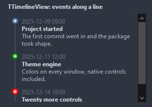
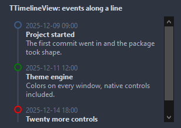
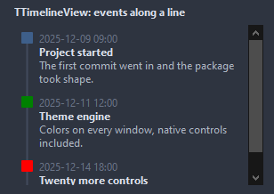
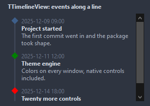
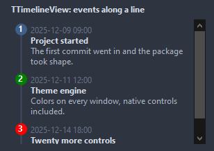

# TTimelineView

Events along a vertical line, each with a dot, a time, a title and a description, newest first or last as sorted. Scrolls when they do not fit; a click selects.

- Palette page: Unleashed: Views
- Unit: `timelineview.pas`
- Ancestor: `TScrollingWinControl`



## Usage

```pascal
procedure TForm1.FormCreate(Sender: TObject);
begin
  var history := TTimelineView.Create(Self);
  history.Parent := Self;
  history.SetBounds(8, 8, 320, 240);
  history.Layout := tlAlternate;
  history.Items.AddItem(Now - 2, 'Ordered', 'three items');
  history.Items.AddItem(Now - 1, 'Shipped', 'by courier');
  history.Items.AddItem(Now, 'Delivered', '').Color := clGreen;
  history.OnItemClick := @historyClick;
end;

procedure TForm1.historyClick(Sender: TObject; item: TTimelineItem);
begin
  Caption := item.Caption;
end;
```

## Properties

| Property | Type | Default | Notes |
|---|---|---|---|
| `Items` | `TTimelineItems` |  | the entries |
| `Images` | `TCustomImageList` |  | the image list the pictures come from |
| `Layout` | `TTimelineLayout` | `tlLeft` | tlLeft keeps the line at the left with the text beside it; tlAlternate puts the line in the middle and the entries left and right in turn |
| `SelectedIndex` | `integer` | `-1` |  |
| `ShowTime` | `boolean` | `true` | the time of each entry is shown |
| `SortNewestFirst` | `boolean` | `false` |  |
| `ShowDescription` | `boolean` | `true` |  |
| `TimeFormat` | `string` |  | a FormatDateTime pattern |
| `ItemSpacing` | `integer` | `12` |  |
| `DotSize` | `integer` | `12` | the diameter of a dot, in pixels |
| `LineWidth` | `integer` | `2` | the width of the line, in pixels |
| `Padding` | `integer` | `8` | the space between the border and the content |
| `LineColor` | `TColor` | `clDefault` | clDefault takes the colors of the theme |
| `TimeColor` | `TColor` | `clDefault` | clDefault takes the color of the theme |
| `CaptionColor` | `TColor` | `clDefault` | clDefault takes the color of the theme |
| `DescriptionColor` | `TColor` | `clDefault` |  |
| `SelectedColor` | `TColor` | `clDefault` | clDefault takes the color of the theme |
| `Antialiasing` | `TAntialiasSetting` | `asTheme` | asTheme follows the theme setting, asOn and asOff force it |
| `DotStyle` | `TTimelineDotStyle` | `tdDot` | the mark of an item on the line: a dot with a light middle, a ring, a square, a diamond, or a circle with the number of the item |
| `Language` | `TFormatLanguage` | `flSystem` | the names and separators of dates, times and numbers: those of the locale of the system, or English |

Also the standard properties of a scrolling control, re-published: `Align`, `Anchors`, `BorderSpacing`, `BorderStyle`, `Color`, `Constraints`, `Enabled`, `Font`, `Hint`, `ParentColor`, `ParentFont`, `ParentShowHint`, `PopupMenu`, `ShowHint`, `TabOrder`, `TabStop`, `Visible`, `OnClick`, `OnContextPopup`, `OnDblClick`, `OnEnter`, `OnExit`, `OnKeyDown`, `OnKeyPress`, `OnKeyUp`, `OnMouseDown`, `OnMouseEnter`, `OnMouseLeave`, `OnMouseMove`, `OnMouseUp`, `OnMouseWheel`, `OnResize`.

## Events

| Event | Handler | Notes |
|---|---|---|
| `OnDrawDot` | `TCustomDrawEvent` | paints over the mark of an item, in the square of DotSize: index is the item, dsSelected for the selected one |
| `OnItemClick` | `procedure(Sender: TObject; item: TTimelineItem)` | a click on an entry |
| `OnSelectionChange` | `procedure(Sender: TObject; item: TTimelineItem)` |  |

## Runtime

Available in code, not in the Object Inspector.

| Method | Notes |
|---|---|
| `SelectedItem: TTimelineItem` |  |
| `ScrollToItem(index: integer)` |  |

## Companion classes

### `TTimelineItem`

An event on the line: a time, a title, a text under it.

| Property | Type | Default | Notes |
|---|---|---|---|
| `Time` | `TDateTime` |  |  |
| `Caption` | `string` |  | the text shown |
| `Description` | `string` |  |  |
| `Color` | `TColor` | `clDefault` | the dot; clDefault takes the accent |
| `ImageIndex` | `integer` | `-1` | the picture in the image list, -1 for none |
| `Tag` | `PtrInt` | `0` | free for the application |

### `TTimelineItems`

| Method | Notes |
|---|---|
| `Add: TTimelineItem` | a new entry at the end |
| `AddItem(time: TDateTime; const caption, description: string): TTimelineItem` | a new entry with these values |

## Types

| Type | Values | Notes |
|---|---|---|
| `TTimelineLayout` | `tlLeft`, `tlAlternate` | tlLeft keeps the line at the left with the text beside it; tlAlternate puts the line in the middle and the entries left and right in turn |
| `TTimelineDotStyle` | `tdDot`, `tdRing`, `tdSquare`, `tdDiamond`, `tdNumber` | the mark of an item on the line: a dot with a light middle, a ring, a square, a diamond, or a circle with the number of the item |

## Custom drawing

The component paints its parts by itself, through the shapes of `ControlPaint`. A handler on the event below takes over a part: it gets the canvas of the control, the rectangle of the part, which part it is and a `TDrawState` set telling what the part is in: `dsHover`, `dsActive`, `dsSelected`, `dsPressed`, `dsDisabled`, `dsFocused`, `dsChecked`.

- `OnDrawDot`: paints over the mark of an item, in the square of DotSize: index is the item, dsSelected for the selected one. Handler: `TCustomDrawEvent`.

A handler may paint with the plain canvas, or through `beginShapes()` from `ControlPaint` for the same smoothed shapes the components use: `paintRoundRect()`, `paintCircle()`, `paintCheck()`, `FillPolygon()` and the rest, then `Flush` once. Colors of the theme come from `pick()`, `blend()` and `contrastText()`.

## In pictures

### Every DotStyle

The demo group with each value of `DotStyle` in turn.

`DotStyle = tdDot`


`DotStyle = tdRing`



`DotStyle = tdSquare`



`DotStyle = tdDiamond`



`DotStyle = tdNumber`


