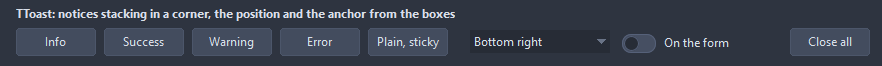
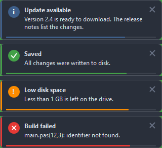

# TToast

Shows notices in a corner of the screen or of its form: a title, a text, an icon after the kind, a close button and a bar running out with the time left. The notices stack and fade in and out.

- Palette page: Unleashed: Feedback
- Unit: `toast.pas`
- Ancestor: `TComponent`



## Usage

```pascal
procedure TForm1.FormCreate(Sender: TObject);
begin
  var toast := TToast.Create(Self);
  toast.Position := tpBottomRight;
  toast.Anchor := taOwnerForm; // the corner of this form, not of the screen
  toast.Duration := 3000;
  toast.Success('Saved', 'All changes written to disk');
  toast.Show('Update', 'Version 2.1 is out', tkInfo, 21);
  toast.OnClick := @toastClick;
end;

procedure TForm1.toastClick(Sender: TObject; const title, text: string; tag: PtrInt);
begin
  if tag = 21 then Caption := 'opening the release notes';
end;
```

## Properties

| Property | Type | Default | Notes |
|---|---|---|---|
| `Position` | `TToastPosition` | `tpBottomRight` | where the notices stack up |
| `Anchor` | `TToastAnchor` | `taScreen` | the area the position refers to: the screen, or the form owning the component |
| `Duration` | `integer` | `4000` | milliseconds a notice stays; 0 keeps it until closed |
| `Width` | `integer` | `320` | the width in pixels |
| `Margin` | `integer` | `16` | from the edge of the area |
| `Spacing` | `integer` | `8` | between two notices |
| `MaxVisible` | `integer` | `5` | more notices wait their turn; 0 shows them all |
| `CornerRadius` | `integer` | `8` | the rounding of the corners, in pixels |
| `Padding` | `integer` | `12` | the space between the border and the content |
| `IconSize` | `integer` | `22` | the size of the icon, 0 takes it from the font |
| `Opacity` | `integer` | `240` | 0 to 255 |
| `FadeTime` | `integer` | `200` | milliseconds of the fade in and the fade out |
| `AccentStyle` | `TToastAccentStyle` | `acLeftStrip` | where the color of the kind shows: a strip along one edge, the whole border, a tint of the surface, or only the icon |
| `AccentWidth` | `integer` | `4` | the strip of the accent, or the accent border |
| `BorderWidth` | `integer` | `1` | the plain border; 0 for none |
| `ShowCloseButton` | `boolean` | `true` | a close button is shown |
| `ShowIcon` | `boolean` | `true` | the icon is shown |
| `ShowProgress` | `boolean` | `true` | the bar with the time left |
| `Animated` | `boolean` | `true` | changes are animated |
| `ClickToClose` | `boolean` | `true` | a click anywhere on the notice closes it, after OnClick |
| `NewestFirst` | `boolean` | `true` | the newest notice sits next to the edge, the older ones move away |
| `PauseOnHover` | `boolean` | `true` | the time stands still while the mouse is on the notice |
| `Font` | `TFont` |  | the font of the text |
| `SurfaceColor` | `TColor` | `clDefault` | clDefault takes the colors of the theme |
| `BorderColor` | `TColor` | `clDefault` | clDefault takes the color of the theme |
| `TextColor` | `TColor` | `clDefault` | clDefault takes the color of the theme |
| `TitleColor` | `TColor` | `clDefault` | clDefault takes the color of the theme |
| `InfoColor` | `TColor` | `clDefault` | clDefault takes the color of the theme |
| `SuccessColor` | `TColor` | `clDefault` | clDefault takes the color of the theme |
| `WarningColor` | `TColor` | `clDefault` | clDefault takes the color of the theme |
| `ErrorColor` | `TColor` | `clDefault` | clDefault takes the color of the theme |
| `Antialiasing` | `TAntialiasSetting` | `asTheme` | asTheme follows the theme setting, asOn and asOff force it |

## Events

| Event | Handler | Notes |
|---|---|---|
| `OnClick` | `procedure(Sender: TObject; const title, text: string; tag: PtrInt)` | a click on the notice outside its close button |
| `OnClose` | `procedure(Sender: TObject; const title, text: string; tag: PtrInt; reason: TToastCloseReason; var canClose: boolean)` | before a notice goes: the close button, a click with ClickToClose, the timeout or CloseAll; canClose false keeps it |
| `OnClosed` | `procedure(Sender: TObject; const title, text: string; tag: PtrInt)` | the notice is gone |

## Runtime

Available in code, not in the Object Inspector.

| Property | Type | Notes |
|---|---|---|
| `Count` | `integer` | the number of entries |

| Method | Notes |
|---|---|
| `Show(const title, text: string; kind: TToastKind = tkInfo; tag: PtrInt = 0)` | shows it |
| `Info(const title, text: string)` | adds an entry of that level |
| `Success(const title, text: string)` | adds an entry of that level |
| `Warning(const title, text: string)` | adds an entry of that level |
| `Error(const title, text: string)` | adds an entry of that level |
| `CloseAll` | closes all of them |

## Types

| Type | Values | Notes |
|---|---|---|
| `TToastKind` | `tkInfo`, `tkSuccess`, `tkWarning`, `tkError`, `tkPlain` | the icon and the accent of a notice; tkPlain carries neither |
| `TToastPosition` | `tpTopLeft`, `tpTopCenter`, `tpTopRight`, `tpBottomLeft`, `tpBottomCenter`, `tpBottomRight`, `tpCenter` | where the notices stack up |
| `TToastAnchor` | `taScreen`, `taOwnerForm` | the area the position refers to: the screen, or the form owning the component |
| `TToastAccentStyle` | `acLeftStrip`, `acTopStrip`, `acRightStrip`, `acBottomStrip`, `acBorder`, `acTint`, `acNone` | where the color of the kind shows: a strip along one edge, the whole border, a tint of the surface, or only the icon |

## In pictures

**Four notices stacked at the corner of the form: info, success, warning, error, each with its bar of time left.**


