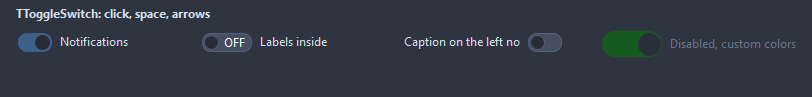
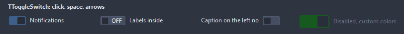
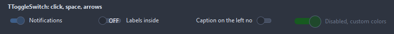

# TToggleSwitch

An on/off switch: a pill with a thumb sliding between the two ends, the caption beside it. A click, the space bar and the keyboard arrows flip it; the thumb animates across.

- Palette page: Unleashed: Input
- Unit: `toggleswitch.pas`
- Ancestor: `TCustomControl`



## Usage

```pascal
procedure TForm1.FormCreate(Sender: TObject);
begin
  var dark := TToggleSwitch.Create(Self);
  dark.Parent := Self;
  dark.Caption := 'Dark mode';
  dark.StateText := stInside;
  dark.TextOn := 'ON';
  dark.TextOff := 'OFF';
  dark.OnChange := @darkChange;
end;

procedure TForm1.darkChange(Sender: TObject);
begin
  Caption := if TToggleSwitch(Sender).Checked then 'dark' else 'light';
end;
```

## Properties

| Property | Type | Default | Notes |
|---|---|---|---|
| `Checked` | `boolean` | `false` | on or off |
| `CaptionPosition` | `TCaptionPosition` | `cpRight` | where the caption sits |
| `StateText` | `TSwitchTextMode` | `stNone` | where the state words go: in the pill, next to it, or nowhere |
| `TextOn` | `string` |  |  |
| `TextOff` | `string` |  |  |
| `Animated` | `boolean` | `true` | the thumb slides over; off, it jumps |
| `AnimationDuration` | `integer` | `150` | the slide, in milliseconds |
| `SwitchWidth` | `integer` | `0` | the pill; 0 takes its size from the font |
| `SwitchHeight` | `integer` | `0` |  |
| `Spacing` | `integer` | `8` | between the pill and the caption |
| `OffColor` | `TColor` | `clDefault` |  |
| `ThumbColor` | `TColor` | `clDefault` | clDefault takes the color of the theme |
| `BorderColor` | `TColor` | `clDefault` | clDefault takes the color of the theme |
| `ReadOnly` | `boolean` | `false` | the mouse and the keyboard change nothing |
| `Antialiasing` | `TAntialiasSetting` | `asTheme` | the smoothing of the shapes: after the theme, or its own choice |
| `Style` | `TSwitchStyle` | `swPill` | the look of the switch: a pill, a box, a thin track under a big thumb, a thumb with a check and a cross |

Also the standard properties of a control, re-published: `Caption`, `Align`, `Anchors`, `AutoSize`, `BorderSpacing`, `Color`, `Constraints`, `Cursor`, `Enabled`, `Font`, `Hint`, `ParentColor`, `ParentFont`, `ParentShowHint`, `PopupMenu`, `ShowHint`, `TabOrder`, `TabStop`, `Visible`, `OnClick`, `OnContextPopup`, `OnDblClick`, `OnEnter`, `OnExit`, `OnKeyDown`, `OnKeyPress`, `OnKeyUp`, `OnMouseDown`, `OnMouseEnter`, `OnMouseLeave`, `OnMouseMove`, `OnMouseUp`, `OnResize`.

## Events

| Event | Handler | Notes |
|---|---|---|
| `OnColor` | `TColor` | clDefault takes the colors of the theme |
| `OnChange` | `procedure(Sender: TObject)` | after the value changed |
| `OnDraw` | `TCustomDrawEvent` | paints the switch (not the caption) by itself: dsChecked when on, dsHover, dsPressed, dsFocused |

## Types

| Type | Values | Notes |
|---|---|---|
| `TCaptionPosition` | `cpRight`, `cpLeft` |  |
| `TSwitchTextMode` | `stNone`, `stInside`, `stBeside` |  |
| `TSwitchStyle` | `swPill`, `swSquare`, `swSlim`, `swIcons` | the look of the switch: a pill, a box, a thin track under a big thumb, a thumb with a check and a cross |

## Custom drawing

The component paints its parts by itself, through the shapes of `ControlPaint`. A handler on the event below takes over a part: it gets the canvas of the control, the rectangle of the part, which part it is and a `TDrawState` set telling what the part is in: `dsHover`, `dsActive`, `dsSelected`, `dsPressed`, `dsDisabled`, `dsFocused`, `dsChecked`.

- `OnDraw`: paints the switch (not the caption) by itself: dsChecked when on, dsHover, dsPressed, dsFocused. Handler: `TCustomDrawEvent`.

A handler may paint with the plain canvas, or through `beginShapes()` from `ControlPaint` for the same smoothed shapes the components use: `paintRoundRect()`, `paintCircle()`, `paintCheck()`, `FillPolygon()` and the rest, then `Flush` once. Colors of the theme come from `pick()`, `blend()` and `contrastText()`.

## In pictures

### Every Style

The demo group with each value of `Style` in turn.

`Style = swPill`


`Style = swSquare`



`Style = swSlim`



`Style = swIcons`


