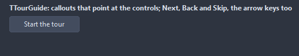
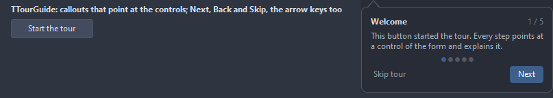

# TTourGuide

A guided tour of a form: one callout per step, each pointing at a control, with Next, Back and Skip. Start opens the first step, the callout follows the form around, the keyboard pages too.

- Palette page: Unleashed: Feedback
- Unit: `tourguide.pas`
- Ancestor: `TComponent`



## Usage

```pascal
procedure TForm1.FormCreate(Sender: TObject);
begin
  var save := TButton.Create(Self);
  save.Parent := Self;
  save.Caption := 'Save';
  var tour := TTourGuide.Create(Self);
  tour.AddStep(save, 'Saving', 'Writes the document to disk. Ctrl+S does the same.', tsBelow);
  tour.AddStep(nil, 'Done', 'That is all for now.');
  tour.OnFinish := @tourFinish;
  tour.Start;
end;

procedure TForm1.tourFinish(Sender: TObject);
begin
  Caption := 'tour finished';
end;
```

## Properties

| Property | Type | Default | Notes |
|---|---|---|---|
| `Steps` | `TTourSteps` |  |  |
| `Width` | `integer` | `280` | the callout |
| `CornerRadius` | `integer` | `8` | the rounding of the corners, in pixels |
| `ArrowSize` | `integer` | `10` | the size of the arrow, in pixels |
| `Padding` | `integer` | `14` | the space between the border and the content |
| `NextCaption` | `string` |  |  |
| `BackCaption` | `string` |  |  |
| `SkipCaption` | `string` |  |  |
| `FinishCaption` | `string` |  | the Next button on the last step |
| `ShowStepNumber` | `boolean` | `true` | "2 of 5" in the corner |
| `ShowSkip` | `boolean` | `true` |  |
| `ShowBack` | `boolean` | `true` |  |
| `Keyboard` | `boolean` | `true` | Right and Enter page forward, Left back, Escape skips |
| `SurfaceColor` | `TColor` | `clDefault` | clDefault takes the colors of the theme |
| `BorderColor` | `TColor` | `clDefault` | clDefault takes the color of the theme |
| `AccentColor` | `TColor` | `clDefault` | the Next button and the step dots |
| `TitleColor` | `TColor` | `clDefault` | clDefault takes the color of the theme |
| `TextColor` | `TColor` | `clDefault` | clDefault takes the color of the theme |
| `Antialiasing` | `TAntialiasSetting` | `asTheme` | asTheme follows the theme setting, asOn and asOff force it |

## Events

| Event | Handler | Notes |
|---|---|---|
| `OnStep` | `procedure(Sender: TObject; step: integer)` | every step |
| `OnBeforeStep` | `procedure(Sender: TObject; step: integer; var skip: boolean)` | a step is about to show; skip true leaves it out |
| `OnFinish` | `procedure(Sender: TObject)` | it finished |
| `OnSkip` | `procedure(Sender: TObject)` |  |

## Runtime

Available in code, not in the Object Inspector.

| Property | Type | Notes |
|---|---|---|
| `Current` | `integer` | the step shown, -1 while the tour is off |

| Method | Notes |
|---|---|
| `AddStep(target: TControl; const title, text: string; side: TTourSide = tsAuto): TTourStep` |  |
| `Start(fromStep: integer = 0)` | opens the first step; a step index starts there |
| `Next` | moves to the next one |
| `Back` |  |
| `Finish` | closes the tour as finished |
| `Skip` | closes the tour as skipped |
| `Active: boolean` |  |

## Companion classes

### `TTourStep`

| Property | Type | Default | Notes |
|---|---|---|---|
| `Target` | `TControl` |  | the control the callout points at; none centers it on the form |
| `Title` | `string` |  | the heading |
| `Text` | `string` |  | the text |
| `Side` | `TTourSide` | `tsAuto` | where the callout goes, relative to the target |
| `Tag` | `PtrInt` | `0` | free for the application |

### `TTourSteps`

| Method | Notes |
|---|---|
| `Add: TTourStep` | a new entry at the end |

## Types

| Type | Values | Notes |
|---|---|---|
| `TTourSide` | `tsAuto`, `tsBelow`, `tsAbove`, `tsRight`, `tsLeft` |  |

## In pictures

**The first step of the tour, pointing at the button that started it.**


