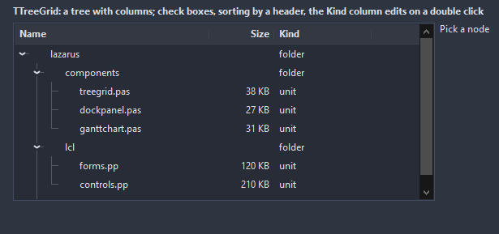

# TTreeGrid

A tree whose rows have columns: an outline on the left, cells to the right, a header that sorts and resizes, check boxes, in-place editing, children loaded when a node opens. The kind of view a tree view with columns would be, built once instead of faked with a list view.

- Palette page: Unleashed: Views
- Unit: `treegrid.pas`
- Ancestor: `TScrollingWinControl`



## Usage

```pascal
procedure TForm1.FormCreate(Sender: TObject);
begin
  var tree := TTreeGrid.Create(Self);
  tree.Parent := Self;
  tree.SetBounds(8, 8, 480, 240);
  tree.Columns.Add.Caption := 'Name';
  tree.Columns.Add.Caption := 'Size';
  tree.ShowCheckBoxes := true;
  var src := tree.Add(['src', '']);
  tree.AddChild(src, ['main.pas', '12 KB']);
  tree.AddChild(src, ['util.pas', '3 KB']);
  tree.ExpandAll;
  tree.OnChecked := @treeChecked;
end;

procedure TForm1.treeChecked(Sender: TObject; node: TTreeGridNode);
begin
  Caption := node.Cells[0];
end;
```

## Properties

| Property | Type | Default | Notes |
|---|---|---|---|
| `Columns` | `TTreeGridColumns` |  | the columns |
| `SortColumn` | `integer` | `-1` | the column the rows are sorted by, -1 for the stored order |
| `SortDescending` | `boolean` | `false` | the sort order of SortColumn |
| `RowHeight` | `integer` | `0` | 0 takes it from the font |
| `HeaderHeight` | `integer` | `0` | 0 takes it from the font |
| `Indent` | `integer` | `18` | the shift of each level, in pixels |
| `Padding` | `integer` | `6` | the space between the border and the content |
| `ShowHeader` | `boolean` | `true` | the header row is shown |
| `ShowLines` | `boolean` | `true` | the lines from a node to its children |
| `ShowGridLines` | `boolean` | `false` | lines between the cells |
| `ShowCheckBoxes` | `boolean` | `false` |  |
| `AlternateRows` | `boolean` | `false` | every other row in AlternateColor |
| `RowSelect` | `boolean` | `true` | the whole row takes the selection color, not the first cell alone |
| `ReadOnly` | `boolean` | `false` | the mouse and the keyboard change nothing |
| `AutoCheck` | `boolean` | `true` | a check on a node checks its children, the parent follows |
| `FullRowExpand` | `boolean` | `true` | a double click anywhere on the row opens it, not only the mark |
| `HeaderColor` | `TColor` | `clDefault` | clDefault takes the colors of the theme |
| `HeaderTextColor` | `TColor` | `clDefault` | clDefault takes the color of the theme |
| `TextColor` | `TColor` | `clDefault` | clDefault takes the color of the theme |
| `GridColor` | `TColor` | `clDefault` | clDefault takes the color of the theme |
| `SelectedColor` | `TColor` | `clDefault` | clDefault takes the color of the theme |
| `AlternateColor` | `TColor` | `clDefault` | clDefault takes the color of the theme |
| `LineColor` | `TColor` | `clDefault` | clDefault takes the color of the theme |
| `BackColor` | `TColor` | `clDefault` | clDefault takes the color of the theme |
| `Antialiasing` | `TAntialiasSetting` | `asTheme` | asTheme follows the theme setting, asOn and asOff force it |

Also the standard properties of a scrolling control, re-published: `Align`, `Anchors`, `BorderSpacing`, `BorderStyle`, `Color`, `Constraints`, `Enabled`, `Font`, `Hint`, `ParentFont`, `ParentShowHint`, `PopupMenu`, `ShowHint`, `TabOrder`, `TabStop`, `Visible`, `OnClick`, `OnContextPopup`, `OnDblClick`, `OnEnter`, `OnExit`, `OnKeyDown`, `OnKeyPress`, `OnKeyUp`, `OnMouseDown`, `OnMouseEnter`, `OnMouseLeave`, `OnMouseMove`, `OnMouseUp`, `OnMouseWheel`, `OnResize`.

## Events

| Event | Handler | Notes |
|---|---|---|
| `OnSelect` | `procedure(Sender: TObject; node: TTreeGridNode)` | the selection changed |
| `OnExpanded` | `procedure(Sender: TObject; node: TTreeGridNode)` | after it opened |
| `OnCollapsed` | `procedure(Sender: TObject; node: TTreeGridNode)` | after it folded |
| `OnChecked` | `procedure(Sender: TObject; node: TTreeGridNode)` |  |
| `OnCellClick` | `procedure(Sender: TObject; node: TTreeGridNode; column: integer)` | a click on a cell |
| `OnCellDblClick` | `procedure(Sender: TObject; node: TTreeGridNode; column: integer)` | a double click on a cell |
| `OnHeaderClick` | `procedure(Sender: TObject; node: TTreeGridNode; column: integer)` | a click on a column header |
| `OnGetText` | `procedure(Sender: TObject; node: TTreeGridNode; column: integer; var text: string)` | the text to show, before it is painted |
| `OnExpanding` | `procedure(Sender: TObject; node: TTreeGridNode; var allow: boolean)` | a node is about to open the first time: the handler adds its children |
| `OnEdit` | `procedure(Sender: TObject; node: TTreeGridNode; column: integer; var text: string; var accept: boolean)` |  |
| `OnCompare` | `procedure(Sender: TObject; a, b: TTreeGridNode; column: integer; var result: integer)` |  |
| `OnDrawCell` | `procedure(Sender: TObject; canvas: TCanvas; const r: TRect; node: TTreeGridNode; column: integer; state: TDrawState; var handled: boolean)` | paints over a cell; see TTreeGridDrawCellEvent |

## Runtime

Available in code, not in the Object Inspector.

| Property | Type | Notes |
|---|---|---|
| `Root` | `TTreeGridNode` |  |
| `FocusedNode` | `TTreeGridNode` |  |

| Method | Notes |
|---|---|
| `Add(const cells: array of string): TTreeGridNode` | a new entry at the end |
| `AddChild(parent: TTreeGridNode; const cells: array of string): TTreeGridNode` |  |
| `Clear` | removes everything |
| `ExpandAll` | opens every node |
| `CollapseAll` | folds every node |
| `ShownCount: integer` | the nodes shown, top to bottom |
| `ShownNode(index: integer): TTreeGridNode` |  |
| `CheckedNodes(list: TList)` | the checked nodes, the whole tree through |
| `Find(const text: string; column: integer = 0): TTreeGridNode` | the first node whose cell equals the text, or nil |
| `SaveToStrings(lines: TStrings)` | the tree as indented lines of cells joined by tabs |
| `BeginUpdate` |  |
| `EndUpdate` |  |

## Companion classes

### `TTreeGridColumn`

| Property | Type | Default | Notes |
|---|---|---|---|
| `Caption` | `string` |  | the text shown |
| `Width` | `integer` | `120` | the width in pixels |
| `MinWidth` | `integer` | `24` | the narrowest the user can drag it |
| `Alignment` | `TAlignment` | `taLeftJustify` | where the text sits |
| `Visible` | `boolean` | `true` | hidden items take no room |
| `Sortable` | `boolean` | `true` |  |
| `Editable` | `boolean` | `false` | a double click or F2 edits the cell in place |
| `AutoWidth` | `boolean` | `false` | the column takes the width that is left |
| `Tag` | `PtrInt` | `0` | free for the application |

### `TTreeGridColumns`

| Method | Notes |
|---|---|
| `Add: TTreeGridColumn` | a new entry at the end |

## Custom drawing

The component paints its parts by itself, through the shapes of `ControlPaint`. A handler on the event below takes over a part: it gets the canvas of the control, the rectangle of the part, which part it is and a `TDrawState` set telling what the part is in: `dsHover`, `dsActive`, `dsSelected`, `dsPressed`, `dsDisabled`, `dsFocused`, `dsChecked`.

- `OnDrawCell`: paints over a cell; see TTreeGridDrawCellEvent. Handler: `procedure(Sender: TObject; canvas: TCanvas; const r: TRect; node: TTreeGridNode; column: integer; state: TDrawState; var handled: boolean)`.

A handler may paint with the plain canvas, or through `beginShapes()` from `ControlPaint` for the same smoothed shapes the components use: `paintRoundRect()`, `paintCircle()`, `paintCheck()`, `FillPolygon()` and the rest, then `Flush` once. Colors of the theme come from `pick()`, `blend()` and `contrastText()`.
