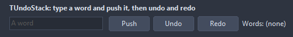

# TUndoStack

A stack of reversible actions. An entry carries either two methods, one to undo and one to redo, or a piece of data that OnApply knows how to turn both ways. A group folds several entries into one.

- Palette page: Unleashed: System
- Unit: `undostack.pas`
- Ancestor: `TComponent`



## Usage

```pascal
procedure TForm1.FormCreate(Sender: TObject);
begin
  var undo := TUndoStack.Create(Self);
  undo.Name := 'undo';
  undo.OnApply := @undoApply;
  undo.OnChange := @undoChange;
  undo.Push('Rename', 'old name'); // data the handler knows how to reverse
end;

procedure TForm1.undoApply(Sender: TObject; const caption, data: string; undo: boolean);
begin
  Self.Caption := (if undo then 'undo ' else 'redo ') + caption + ': ' + data;
end;

procedure TForm1.undoChange(Sender: TObject);
begin
  with TUndoStack(Sender) do Caption := Format('%d to undo, %d to redo', [UndoCount, RedoCount]);
end;
```

## Properties

| Property | Type | Default | Notes |
|---|---|---|---|
| `Limit` | `integer` | `100` | entries kept; the oldest ones fall off. 0 keeps all |

## Events

| Event | Handler | Notes |
|---|---|---|
| `OnChange` | `procedure(Sender: TObject)` | after the value changed |
| `OnApply` | `procedure(Sender: TObject; const caption, data: string; undo: boolean)` | applies an entry pushed with data: undo true takes it back |

## Runtime

Available in code, not in the Object Inspector.

| Property | Type | Notes |
|---|---|---|
| `Applying` | `boolean` | an undo or redo runs right now |
| `UndoCount` | `integer` |  |

| Method | Notes |
|---|---|
| `Push(const caption: string; undo, redo: TUndoProc)` | an entry with the methods that take it back and do it again |
| `Push(const caption, data: string)` | an entry with data for OnApply |
| `BeginGroup(const caption: string)` | the entries pushed until EndGroup undo and redo together |
| `EndGroup` |  |
| `Undo: boolean` | takes the last change back |
| `Redo: boolean` | does the change taken back again |
| `Clear` | removes everything |
| `MarkSaved` | the state now is the saved one |
| `CanUndo: boolean` | there is something to undo |
| `CanRedo: boolean` | there is something to redo |
| `UndoCaption: string` |  |
| `RedoCaption: string` |  |
| `Modified: boolean` | the state differs from the saved one |
| `RedoCount: integer` |  |
