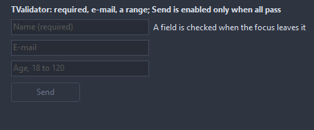

# TValidator

Checks the fields of a form against rules: required, a pattern, an e-mail address, a number, a range, a length, the same as another field or a check of your own. A field that fails gets a sign next to it with the message as hint; SubmitControl is enabled only while all pass.

- Palette page: Unleashed: System
- Unit: `validator.pas`
- Ancestor: `TComponent`



## Usage

```pascal
procedure TForm1.FormCreate(Sender: TObject);
begin
  var mail := TEdit.Create(Self);
  mail.Parent := Self;
  var age := TEdit.Create(Self);
  age.Parent := Self;
  age.Top := 40;
  var send := TButton.Create(Self);
  send.Parent := Self;
  send.Top := 80;
  send.Caption := 'Send';
  var check := TValidator.Create(Self);
  check.Rules.AddRule(mail, vkEmail, 'A valid e-mail address, please');
  var range := check.Rules.AddRule(age, vkRange, 'Between 18 and 120');
  range.MinValue := 18;
  range.MaxValue := 120;
  check.SubmitControl := send; // enabled only while every rule passes
  check.Mode := vmOnChange;
end;
```

## Properties

| Property | Type | Default | Notes |
|---|---|---|---|
| `Rules` | `TValidationRules` |  |  |
| `Mode` | `TValidationMode` | `vmOnExit` | when the rules run by themselves: on Validate only, when the focus leaves a field, or while the user types |
| `ShowMarkers` | `boolean` | `true` |  |
| `ErrorColor` | `TColor` | `clDefault` | clDefault takes a red that suits the background |
| `SubmitControl` | `TControl` |  | enabled only while every rule passes, as an OK button |

## Events

| Event | Handler | Notes |
|---|---|---|
| `OnValidated` | `procedure(Sender: TObject; valid: boolean)` | after each check, with the result of all rules |

## Runtime

Available in code, not in the Object Inspector.

| Property | Type | Notes |
|---|---|---|
| `Errors` | `TStringList` | the messages of the last Validate |

| Method | Notes |
|---|---|
| `ValueOf(control: TControl): string` | the text a rule checks: Checked as True or False, else Text or Caption |
| `Validate: boolean` | runs every rule and marks the fields; true when all pass |
| `ValidateControl(control: TControl): boolean` | runs the rules of one field |
| `IsValid: boolean` | all pass, without marking anything |
| `ErrorOf(control: TControl): string` | the message of the first rule a field fails, empty when it passes |
| `ClearMarkers` | takes the signs away |

## Companion classes

### `TValidationRule`

| Property | Type | Default | Notes |
|---|---|---|---|
| `Control` | `TControl` |  |  |
| `Kind` | `TValidationKind` | `vkRequired` | what a rule checks: a value present, a pattern, an e-mail address, a number, a whole number, a range, a length, the same text as another control, a handler of its own |
| `Pattern` | `string` |  | a regular expression the whole value must match |
| `MinValue` | `double` |  | the lower limit |
| `MaxValue` | `double` |  | the upper limit |
| `MinLength` | `integer` | `0` |  |
| `MaxLength` | `integer` | `0` | 0 sets no limit |
| `CompareTo` | `TControl` |  | the control whose value this one must repeat, as a password twice |
| `Message` | `string` |  | shown at the field; empty takes a message for the kind |
| `Enabled` | `boolean` | `true` | disabled items are drawn gray and ignore the mouse |

| Event | Handler | Notes |
|---|---|---|
| `OnValidate` | `procedure(Sender: TValidationRule; const value: string; var valid: boolean)` |  |

| Method | Notes |
|---|---|
| `Check(const value: string): boolean` | the value passes the rule |
| `ErrorText: string` | the message, or a default one for the kind |

### `TValidationRules`

| Method | Notes |
|---|---|
| `Add: TValidationRule` | a new entry at the end |
| `AddRule(control: TControl; kind: TValidationKind; const message: string = ''): TValidationRule` |  |

## Types

| Type | Values | Notes |
|---|---|---|
| `TValidationKind` | `vkRequired`, `vkPattern`, `vkEmail`, `vkNumber`, `vkInteger`, `vkRange`, `vkLength`, `vkSameAs`, `vkCustom` | what a rule checks: a value present, a pattern, an e-mail address, a number, a whole number, a range, a length, the same text as another control, a handler of its own |
| `TValidationMode` | `vmOnSubmit`, `vmOnExit`, `vmOnChange` | when the rules run by themselves: on Validate only, when the focus leaves a field, or while the user types |
