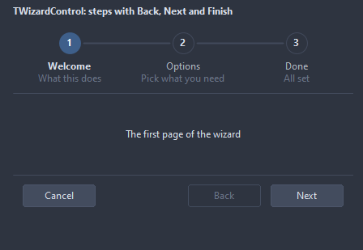
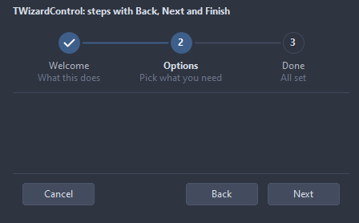
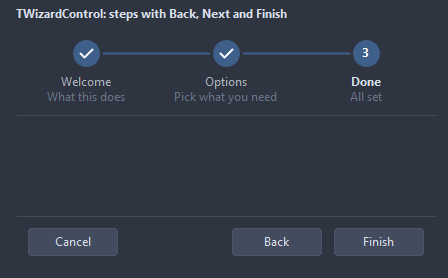
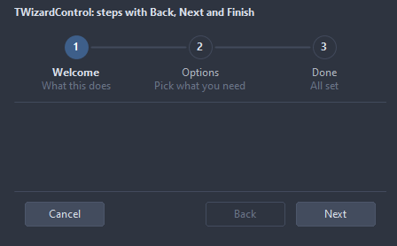
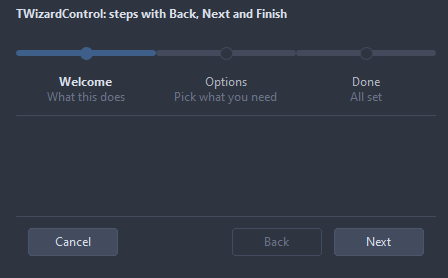
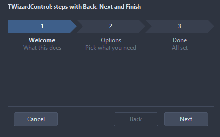
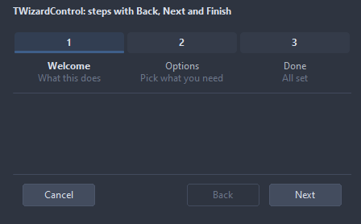

# TWizardControl

Steps along the top, the page of the step in the middle, Back, Next and Finish along the bottom. Each step names the child it shows; the other children stay hidden.

- Palette page: Unleashed: Navigation
- Unit: `wizardcontrol.pas`
- Ancestor: `TCustomControl`



## Usage

```pascal
procedure TForm1.FormCreate(Sender: TObject);
begin
  var wizard := TWizardControl.Create(Self);
  wizard.Parent := Self;
  wizard.Align := alClient;
  for var name in ['Welcome', 'Options', 'Finish'] do begin
    var page := TPanel.Create(Self);
    page.Caption := name;
    page.Parent := wizard;
    wizard.Steps.AddStep(name, page);
  end;
  wizard.OnStepChanging := @wizardChanging;
  wizard.OnFinish := @wizardFinish;
end;

procedure TForm1.wizardChanging(Sender: TObject; fromStep, toStep: integer; var allow: boolean);
begin
  allow := toStep <= fromStep + 1; // no skipping ahead
end;

procedure TForm1.wizardFinish(Sender: TObject);
begin
  Close;
end;
```

## Properties

| Property | Type | Default | Notes |
|---|---|---|---|
| `Steps` | `TWizardSteps` |  |  |
| `StepIndex` | `integer` | `0` |  |
| `ShowHeader` | `boolean` | `true` | the header row is shown |
| `ShowFooter` | `boolean` | `true` |  |
| `ShowCancel` | `boolean` | `true` | the Cancel button is shown |
| `ClickableSteps` | `boolean` | `true` | a click on a step in the header goes there, backwards only |
| `ShowDescriptions` | `boolean` | `true` |  |
| `HeaderHeight` | `integer` | `0` | 0 takes it from the font |
| `FooterHeight` | `integer` | `0` |  |
| `Padding` | `integer` | `12` | the space between the border and the content |
| `CircleSize` | `integer` | `26` |  |
| `BackCaption` | `string` |  |  |
| `NextCaption` | `string` |  |  |
| `FinishCaption` | `string` |  |  |
| `CancelCaption` | `string` |  | the caption of the Cancel button |
| `AccentColor` | `TColor` | `clDefault` | clDefault takes the colors of the theme |
| `DoneColor` | `TColor` | `clDefault` |  |
| `LineColor` | `TColor` | `clDefault` | clDefault takes the color of the theme |
| `Antialiasing` | `TAntialiasSetting` | `asTheme` | asTheme follows the theme setting, asOn and asOff force it |
| `HeaderStyle` | `TWizardHeaderStyle` | `whCircles` | the row of steps: numbered circles joined by lines, a bar filling up with small marks, chevron bands, or tabs with an underline for the current step |

Also the standard properties of a control, re-published: `Align`, `Anchors`, `BorderSpacing`, `ClientHeight`, `ClientWidth`, `Color`, `Constraints`, `Enabled`, `Font`, `Hint`, `ParentColor`, `ParentFont`, `ParentShowHint`, `PopupMenu`, `ShowHint`, `TabOrder`, `TabStop`, `Visible`, `OnClick`, `OnContextPopup`, `OnMouseDown`, `OnMouseEnter`, `OnMouseLeave`, `OnMouseMove`, `OnMouseUp`, `OnResize`.

## Events

| Event | Handler | Notes |
|---|---|---|
| `OnDrawStep` | `TCustomDrawEvent` | paints over the mark of a step, in the box of CircleSize: dsChecked for a step done, dsSelected for the current one; `handled` true leaves the number out |
| `OnStepChanging` | `procedure(Sender: TObject; fromStep, toStep: integer; var allow: boolean)` | before the move; allow false keeps the step |
| `OnStepChanged` | `procedure(Sender: TObject)` |  |
| `OnFinish` | `procedure(Sender: TObject)` | Next on the last step |
| `OnCancel` | `procedure(Sender: TObject)` | Cancel was pressed |

## Runtime

Available in code, not in the Object Inspector.

| Method | Notes |
|---|---|
| `Next: boolean` | false when the step refused, OnStepChanging said no, or there is no step |
| `Back: boolean` |  |
| `IsFirst: boolean` |  |
| `IsLast: boolean` |  |
| `CurrentStep: TWizardStep` |  |

## Companion classes

### `TWizardStep`

| Property | Type | Default | Notes |
|---|---|---|---|
| `Caption` | `string` |  | the text shown |
| `Description` | `string` |  | a line under the caption in the header |
| `Page` | `TControl` |  | the child of the wizard shown while this is the step |
| `Tag` | `PtrInt` | `0` | free for the application |
| `Enabled` | `boolean` | `true` | disabled items are drawn gray and ignore the mouse |

### `TWizardSteps`

| Method | Notes |
|---|---|
| `Add: TWizardStep` | a new entry at the end |
| `AddStep(const caption: string; page: TControl = nil): TWizardStep` |  |

## Types

| Type | Values | Notes |
|---|---|---|
| `TWizardHeaderStyle` | `whCircles`, `whBar`, `whChevrons`, `whTabs` | the row of steps: numbered circles joined by lines, a bar filling up with small marks, chevron bands, or tabs with an underline for the current step |

## Custom drawing

The component paints its parts by itself, through the shapes of `ControlPaint`. A handler on the event below takes over a part: it gets the canvas of the control, the rectangle of the part, which part it is and a `TDrawState` set telling what the part is in: `dsHover`, `dsActive`, `dsSelected`, `dsPressed`, `dsDisabled`, `dsFocused`, `dsChecked`.

- `OnDrawStep`: paints over the mark of a step, in the box of CircleSize: dsChecked for a step done, dsSelected for the current one; `handled` true leaves the number out. Handler: `TCustomDrawEvent`.

A handler may paint with the plain canvas, or through `beginShapes()` from `ControlPaint` for the same smoothed shapes the components use: `paintRoundRect()`, `paintCircle()`, `paintCheck()`, `FillPolygon()` and the rest, then `Flush` once. Colors of the theme come from `pick()`, `blend()` and `contrastText()`.

## In pictures

**The second step.**



**The last step: Finish instead of Next.**



### Every HeaderStyle

The demo group with each value of `HeaderStyle` in turn.

`HeaderStyle = whCircles`



`HeaderStyle = whBar`



`HeaderStyle = whChevrons`



`HeaderStyle = whTabs`


